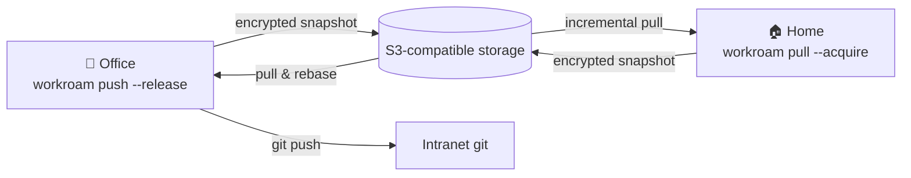

# Workroam

**Hand off your AI agent workspace between machines.**

One S3 bucket of your own. Tell any agent on any computer to "sync down", 
and your projects, code, rules, MCP / Skills and context pick up where you left off.

[简体中文](README.md) · **English**

> [!NOTE]
> Workroam is in the **design phase** and has no usable release yet. The design documents are currently written in Chinese.

---

## Why

If you use several coding agents (Claude Code, Codex, Antigravity, Grok Build, …) and switch between an office machine and a home machine:

- only the office machine can reach the intranet and internal git, so **remote development is not an option**;
- cloud drives, Syncthing and rclone **don't understand** agent rules, MCP, Skills, sessions or git, and syncing `.git` corrupts repositories;
- Windows, macOS and Linux disagree on paths, line endings, case sensitivity and symlinks;
- after switching machines, your agent **forgets** where it was.

## Features

- 🔐 **End-to-end encryption**: the server only stores ciphertext; credentials never sync.
- 🪶 **Minimal server**: any S3-compatible storage (RustFS, Garage, SeaweedFS, AWS S3, R2, OSS), deployed with one command.
- 🏃 **Handoff, not real-time sync**: a lease ensures only one machine writes at a time; nothing is ever silently overwritten.
- 🌿 **Git-aware**: every machine keeps its own `.git`. In bundle mode, intranet repos can carry only the last N commits and are rebased back onto real history at the office.
- 🤖 **Agent-aware**: one `AGENTS.md`, one MCP definition and one Skills folder, rendered into each agent's native config. `HANDOFF.md` lets the next agent continue.
- 🖥️ **Cross-platform checks** before you leave, not after you arrive.
- 🙋 **You stay in the loop**: approve every sync (including agent-initiated ones), watch progress, and get notified on success or failure.
- ⏪ **Rollback** to any previous sync.

## How it works

## Roadmap

| Version | Theme | Gate |
| --- | --- | --- |
| **v0.1** | Dogfooding: CLI, snapshots, lease, encryption, bundle mode, Claude Code & Codex adapters, tray cards | Two weeks of daily Windows ↔ Mac handoffs without data loss |
| v0.2 | More agents; session migration; remote & files modes | Six agents work right after switching machines |
| v0.3 | Hands-free: automatic triggers, arrival notices, mobile push, optional web UI | Almost no manual commands |
| v1.0 | Stable formats and adapter spec, full OS × agent CI matrix | Safe to recommend to others |

## Documentation

- [Product requirements (PRD)](docs/prd.md)
- [Technical architecture](docs/architecture.md)
- [Architecture decision records](docs/adr/README.md)

## Contributing

Contributions are welcome, especially **agent adapters**, which are plain data files. Please read [CONTRIBUTING.md](CONTRIBUTING.md); all commits require a DCO `Signed-off-by`. Report security issues privately as described in [SECURITY.md](SECURITY.md).

## License

[Apache License 2.0](LICENSE). Standalone Rust libraries will be dual-licensed under `MIT OR Apache-2.0`.
