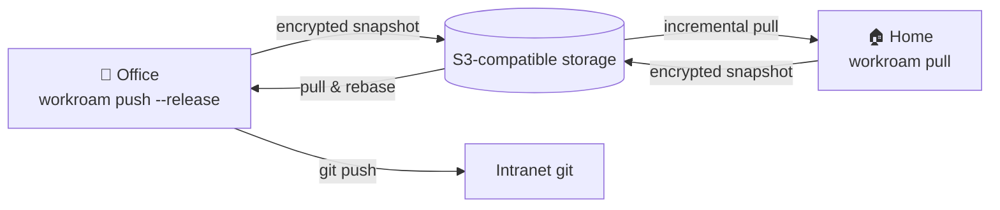

<div align="center">


# Workroam

**Hand off your AI agent workspace between machines.**

One S3 bucket of your own. Tell any agent on any computer to "sync down",<br>
and your projects, code, rules, MCP / Skills and context pick up where you left off.

[](LICENSE)
[](https://github.com/kverona-ai/workroam/actions/workflows/ci.yml)
[](https://github.com/kverona-ai/workroam/releases)
[](https://www.rust-lang.org)
[](#)
[](docs/architecture.md)
[](CONTRIBUTING.md)

**English** · [简体中文](README.zh-CN.md)

[Install](docs/install.md) · [Requirements](docs/prd.md) · [Architecture](docs/architecture.md) · [Decisions](docs/adr/README.md) · [Contributing](CONTRIBUTING.md)

<br>


</div>

> [!NOTE]
> Workroam **v0.1.0 is in development** and has not been released yet; see [Install](#install). Feedback is welcome via issues. The design documents are currently written in Chinese.

---

## Why Workroam

You probably use several coding agents (Claude Code, Codex, Antigravity, Grok Build, …) and switch between an office machine and a home machine:

- only the office machine can reach the intranet and internal git, so **remote development is not an option**: work has to stay local;
- cloud drives, Syncthing and rclone **don't understand** agent rules, MCP, Skills, sessions or git, and syncing `.git` directly corrupts repositories;
- Windows, macOS and Linux disagree on paths, line endings, case sensitivity and symlinks;
- after switching machines, your agent **forgets** where it left off.

Workroam turns "leave the office → get home → keep going → push at the office" into two sentences.

## Features

|  |  |
| --- | --- |
| 🔐 **End-to-end encryption** | Data is encrypted on the client and the server only stores ciphertext. Credentials never sync. |
| 🪶 **Minimal server** | Any S3-compatible storage (RustFS, Garage, SeaweedFS, AWS S3, R2, OSS), deployed with one command. |
| 🏃 **Handoff, not real-time sync** | A lease ensures only one machine writes at a time. Nothing is ever silently overwritten. |
| 🌿 **Git-aware** | Every machine keeps its own `.git`, with bundle, remote and files modes. Intranet repos can carry only the last N commits and are rebased back onto real history at the office. |
| 🤖 **Agent-aware** | One `AGENTS.md`, one MCP definition and one Skills folder, rendered into each agent's native config. `HANDOFF.md` lets the next agent continue. |
| 🖥️ **Cross-platform** | Case conflicts, invalid Windows file names and long paths are caught before you push. Links and executable bits are handled per OS on pull. |
| 🙋 **You stay in the loop** | Approve every sync, including agent-initiated ones, watch progress, and get notified on success or failure. |
| 🪟 **A calm desktop app** | Lives in the tray, shows which machine holds your workspace, and asks only when it needs you. Every desktop action has an equivalent command. |
| ⏪ **Rollback & archive** | Every sync is an immutable snapshot you can return to. When you decide a project is done, archive it: syncing stops, a self-contained copy is kept forever, and you can resume it any time. Local files are never touched. |

## The desktop app

Workroam lives in your tray and pops up only when something needs you. Everything below comes from the [clickable prototype](docs/prototype/README.md) (open `docs/prototype/index.html` in a browser); the prototype UI is currently in Chinese.

- **See where your work is.** Each project opens with a relay strip, office → your storage → home. The amber orb, your workspace, sits on whichever machine holds the lease. Pending pushes and pulls flow along the line, and the key numbers sit underneath.
- **Approve before anything moves.** Agent-initiated syncs raise a card in the screen corner that never steals keyboard focus. "Details" lists every changed file and commit.
- **Set up once.** A guided wizard connects your storage, scopes the access key, runs 16 capability checks and sets up encryption. Joining a second machine takes a pairing code.
- **Everything the CLI can do.** Settings, checks, data verification, archive packs, key and password changes and off-site backup all have a desktop entry point, and the reverse holds too.
- **Liquid Glass, light and dark.** Translucent glass with depth, concentric corners, and motion that never gets in your way. The rules are in [DESIGN.md](docs/prototype/DESIGN.md).

<table>
<tr>
<td width="50%"><br><sub>The relay strip: which machine holds the workspace, and what is waiting to move (dark)</sub></td>
<td width="50%"><br><sub>Approval details: every file and commit before you agree</sub></td>
</tr>
<tr>
<td width="50%"><br><sub>First run: create, join, or restore a workspace</sub></td>
<td width="50%"><br><sub>Setup checks: 16 storage capability tests</sub></td>
</tr>
<tr>
<td width="50%"><br><sub>Corner cards: approve, progress, done, failed, arrival, lease conflict</sub></td>
<td width="50%"><br><sub>Tray menu: pending approvals, push, pull, pause (dark)</sub></td>
</tr>
<tr>
<td width="50%"><br><sub>Restoring an archive: what happens to your local folder (dark)</sub></td>
<td width="50%"><br><sub>Settings: this device, auto-sync, storage, encryption, off-site backup (dark)</sub></td>
</tr>
</table>

## How it works



1. **Leaving the office**: tell any agent "I'm heading home". It updates `.handoff/HANDOFF.md` and runs `workroam push --release`, and you click "Approve" on the card that pops up.
2. **Arriving home**: the tray tells you there is new progress on the server. Say "sync down" and Workroam pulls files, imports commits, and generates MCP configs, Skills links and an environment note for this machine.
3. **Keep going**: open any agent. It reads `AGENTS.md` and `HANDOFF.md`, reports where things stand, and continues.
4. **Back at the office**: pull the home progress. Home commits are rebased back onto real history, then you `git push` to the intranet.

## Install

> [!IMPORTANT]
> **v0.1.0 is coming soon.** The download links below start working with the first release. Until then you can [build from source](docs/install.md#从源码构建).

Every release goes to [GitHub Releases](https://github.com/kverona-ai/workroam/releases) with builds for Windows, macOS and Linux, each on x64 and arm64. All files are listed in `SHA256SUMS` and carry build provenance.

| You want to | Install |
| --- | --- |
| Use Workroam on your computer (recommended) | **Desktop app** from [Releases](https://github.com/kverona-ai/workroam/releases): `.dmg` on macOS, `-setup.exe` or `.msi` on Windows, `.deb`, `.rpm` or `.AppImage` on Linux. It includes the `workroam` CLI and opens the setup wizard on first launch. |
| Use only the command line, on a server or headless machine | **CLI**: `workroam` and the `workroamd` background service |
| Let a cloud personal agent connect (optional) | **`workroam-server`** relay, a single static binary that can run on a bot's cloud computer |

```sh
# CLI on macOS / Linux, installed to ~/.local/bin with checksum verification
curl -fsSL https://github.com/kverona-ai/workroam/releases/latest/download/install-cli.sh | sh
```

```powershell
# CLI on Windows (PowerShell)
irm https://github.com/kverona-ai/workroam/releases/latest/download/install-cli.ps1 | iex
```

```sh
# Optional relay for cloud agents
curl -fsSL https://github.com/kverona-ai/workroam/releases/latest/download/install-server.sh | sh
```

The full guide covers package managers (Homebrew, Scoop, winget), verifying downloads, mirrors for intranets, self-hosting storage and building from source. It is in [docs/install.md](docs/install.md). For maintainers, the release process is in [docs/release.md](docs/release.md).

## Quick start

```bash
# First run: the desktop app opens a setup wizard; on a headless machine
# run the same steps in the terminal (every desktop action has a command)
workroam setup
cd ~/projects/proj-a && workroam init

# Hand off
workroam push --release     # when leaving
workroam pull               # when arriving (takes the lease)
```

## Release scope

Workroam ships everything in the PRD as a single **v0.1** release. It goes out only when every gate below is met.

| Area | Scope | Gate |
| --- | --- | --- |
| Handoff & data safety | Setup wizard & checks, pairing codes, read-only devices, key rotation, snapshots, lease, encryption, restore & sync history, bundle / remote / files modes | Two weeks of daily Windows ↔ Mac handoffs without data loss |
| Agents | Six local agents (Claude Code, Codex, Grok Build, Antigravity, ZCode, Pi), session migration, CLI `--json` + Workroam Skill, local MCP server | Six agents work right after switching machines |
| Hands-free | Automatic sync, approval / progress / done / arrival cards, desktop ↔ CLI parity | Almost no manual commands |
| Archive & backup | Project archive & restore, archive packs, pruning, optional off-site mirror | Archived projects restore and just work |
| Cloud agents & optional server | `workroam-server` relay (can run on a bot's cloud computer) with a remote connector for Grok Bot and Muse; full mode adds short pairing codes, mobile push and a web UI | A cloud personal agent connects in under 2 minutes |

See [PRD · Release scope](docs/prd.md#10-发布范围与验收门槛) for details.

## Repository layout

```text
.
├── docs/            # Docs: install, release, PRD, architecture, ADRs, prototype
├── crates/          # Rust code (see crates/README.md)
├── deploy/          # Deployment files for workroam-server
├── scripts/         # Install scripts and release tooling
├── .github/         # CI and release workflows, issue / PR templates
├── CHANGELOG.md     # Changes per release
├── CONTRIBUTING.md  # Contribution guide
└── LICENSE          # Apache-2.0
```

## Contributing

Contributions of every kind are welcome, especially **agent adapters**: they are plain data files, the easiest place to start and the most valuable. Please read [CONTRIBUTING.md](CONTRIBUTING.md) first. All commits require a DCO `Signed-off-by`.

Report security issues privately as described in [SECURITY.md](SECURITY.md), not in public issues.

## License

[Apache License 2.0](LICENSE). Standalone Rust libraries will be dual-licensed under `MIT OR Apache-2.0`.

> Before taking intranet code off your company network, check your company's policies.
