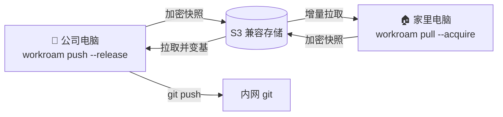

<div align="center">


# Workroam

**在多台电脑之间接力 AI Agent 的工作区。**

一台自己的 S3 存储，在任何电脑上对任何 Agent 说一句“同步下来”，<br>
项目、代码、规则、MCP / Skills 和上下文就都能接上。

[](LICENSE)
[](docs/prd.md#10-版本规划与验收门槛)
[](https://www.rust-lang.org)
[](#)
[](docs/architecture.md#5-存储布局)
[](CONTRIBUTING.md)

[English](README.md) · **简体中文**

[产品需求](docs/prd.md) · [技术架构](docs/architecture.md) · [架构决策](docs/adr/README.md) · [参与贡献](CONTRIBUTING.md)

</div>

> [!NOTE]
> 项目处于**设计阶段**，还没有可用的版本。欢迎阅读文档、提 Issue 讨论设计。

---

## 为什么需要 Workroam

你可能同时在用 Claude Code、Codex、Antigravity、Grok Build 等多个 Agent，并且在公司电脑和家里电脑之间来回切换：

- 只有公司电脑能连内网和内网 git，**远程开发行不通**，必须本地优先；
- 网盘、Syncthing、rclone **不理解** Agent 的规则、MCP、Skills 和会话，也不理解 git，直接同步 `.git` 还会损坏仓库；
- Windows、macOS、Linux 之间的路径、换行符、大小写、符号链接**处处是坑**；
- 换了机器，Agent 就**忘了**上次做到哪里。

Workroam 把“下班 → 回家 → 接着干 → 回公司推送”变成两句话的事。

## 特性

|  |  |
| --- | --- |
| 🔐 **端到端加密** | 数据在客户端加密，服务器只存密文；凭证永远不同步 |
| 🪶 **服务端极简** | 任意 S3 兼容存储（RustFS、Garage、SeaweedFS、AWS S3、R2、OSS），一条命令部署 |
| 🏃 **接力而非实时** | 租约保证同一时间只有一台机器在写，从不静默覆盖 |
| 🌿 **懂 git** | 每台机器自有 `.git`；bundle / remote / files 三种模式；内网仓库可只带最近 N 次提交，回公司自动变基回真实历史 |
| 🤖 **懂 Agent** | 一份 `AGENTS.md`、一份 MCP 定义、一份 Skills，为每个 Agent 生成原生配置；`HANDOFF.md` 让下一个 Agent 接着干 |
| 🖥️ **跨平台** | 推送前就检查大小写冲突、Windows 非法文件名、长路径；拉取时按本机系统处理链接与可执行位 |
| 🙋 **人始终知情** | 同步前授权、同步中可见进度、完成或失败有提醒；Agent 发起的同步也要你确认 |
| ⏪ **可回滚** | 每次同步都是一个不可变快照，随时回到任意一次 |

## 工作方式



1. **下班**：对任一 Agent 说“我要下班了”。Agent 写好 `.handoff/HANDOFF.md`，执行 `workroam push --release`；你在弹出的卡片上点“同意”。
2. **到家**：托盘提示“服务器上有新进度”。说一句“同步下来”，Workroam 拉取文件、导入提交，并为本机生成 MCP 配置、Skills 链接和环境说明。
3. **继续**：打开任一 Agent，它读 `AGENTS.md` 和 `HANDOFF.md`，汇报进度后接着干。
4. **回公司**：拉取家里的进度，家里的提交自动变基回真实历史，然后 `git push` 到内网。

## 快速开始（规划中）

```bash
# 服务端：一条命令部署存储与 HTTPS
curl -fsSL https://<项目域名>/install.sh | sh -s -- --domain sync.example.com --storage rustfs

# 客户端：首次启动桌面应用会自动打开初始化向导
# （没有图形界面的机器在终端里走同样的步骤）
workroam setup
cd ~/projects/proj-a && workroam init

# 接力
workroam push --release     # 离开时
workroam pull --acquire     # 到达时
```

## 路线图

| 版本 | 主题 | 门槛 |
| --- | --- | --- |
| **v0.1** | 我自己每天在用：初始化向导与检查、配对码、CLI、快照、租约、加密、bundle 模式、Claude Code 与 Codex 适配器、授权卡片 | 公司 Windows ↔ 家里 Mac 连续使用两周不丢数据 |
| v0.2 | 多 Agent：Grok Build、Antigravity、ZCode、Pi；会话迁移；remote 与 files 模式；专用密钥、只读设备、密钥轮换 | 六个 Agent 换机器后都能直接开工 |
| **v0.3** | 无感同步（最终形态）：自动同步、到达卡片、同步历史、Agent 用 MCP server、手机推送、可选服务端（配对码与 Web 界面） | 日常基本不用手动敲命令 |

详见 [PRD · 版本规划](docs/prd.md#10-版本规划与验收门槛)。

## 仓库结构

```text
.
├── docs/            # 文档：PRD、技术架构、ADR、图片资源
├── crates/          # Rust 代码（规划中，见 crates/README.md）
├── .github/         # Issue / PR 模板
├── CONTRIBUTING.md  # 贡献指南
└── LICENSE          # Apache-2.0
```

## 参与贡献

欢迎任何形式的贡献，尤其是 **Agent 适配器**：它们是纯数据文件，门槛最低、价值最高。提交前请阅读 [CONTRIBUTING.md](CONTRIBUTING.md)，所有提交需要 `Signed-off-by`（DCO）。

发现安全问题请按 [SECURITY.md](SECURITY.md) 私下报告，不要公开提 Issue。

## 许可证

[Apache License 2.0](LICENSE)。将来单独发布的 Rust 库采用 `MIT OR Apache-2.0` 双许可。

> 内网代码离开公司网络前，请先确认公司的相关规定。
