<div align="center">

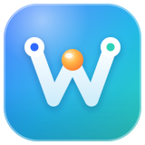

# Workroam

**在多台电脑之间接力 AI Agent 的工作区。**

一台自己的 S3 存储，在任何电脑上对任何 Agent 说一句“同步下来”，<br>
项目、代码、规则、MCP / Skills 和上下文就都能接上。

[](LICENSE)
[](docs/prd.md#10-发布范围与验收门槛)
[](https://www.rust-lang.org)
[](#)
[](docs/architecture.md#5-存储布局)
[](CONTRIBUTING.md)

[English](README.md) · **简体中文**

[产品需求](docs/prd.md) · [技术架构](docs/architecture.md) · [架构决策](docs/adr/README.md) · [参与贡献](CONTRIBUTING.md)

<br>

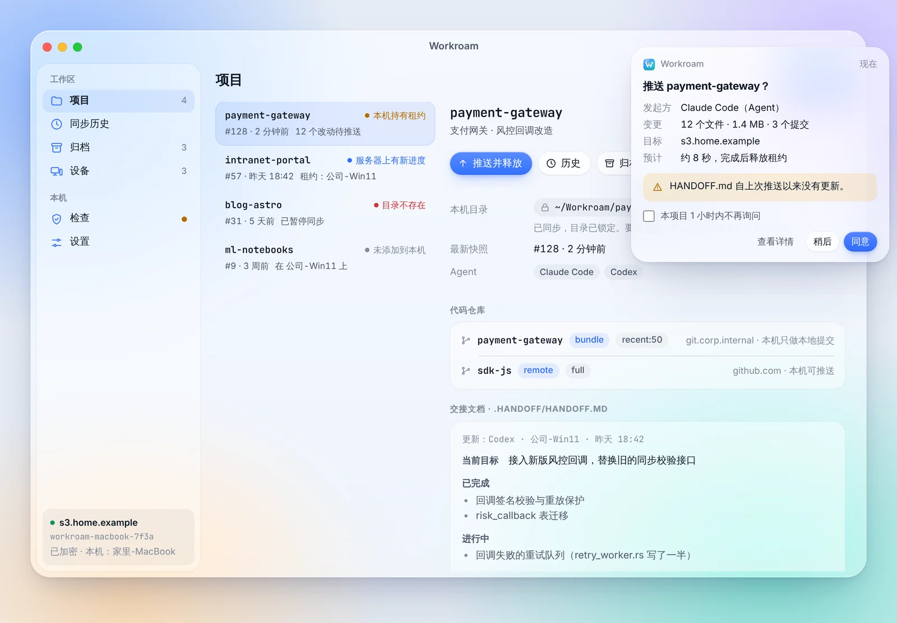

</div>

> [!NOTE]
> 项目处于**设计阶段**，还没有可用的版本。欢迎阅读文档、提 Issue 讨论设计。

---

## 为什么需要 Workroam

你可能同时在用 Claude Code、Codex、Antigravity、Grok Build 等多个 Agent，并且在公司电脑和家里电脑之间来回切换：

- 只有公司电脑能连内网和内网 git，**远程开发行不通**，必须本地优先；
- 网盘、Syncthing、rclone **不理解** Agent 的规则、MCP、Skills 和会话，也不理解 git，直接同步 `.git` 还会损坏仓库；
- Windows、macOS、Linux 之间的路径、换行符、大小写、符号链接**处处是坑**；
- 换了机器，Agent 就**忘了**上次做到哪里。

Workroam 把“下班 → 回家 → 接着干 → 回公司推送”变成两句话的事。

## 特性

|  |  |
| --- | --- |
| 🔐 **端到端加密** | 数据在客户端加密，服务器只存密文；凭证永远不同步 |
| 🪶 **服务端极简** | 任意 S3 兼容存储（RustFS、Garage、SeaweedFS、AWS S3、R2、OSS），一条命令部署 |
| 🏃 **接力而非实时** | 租约保证同一时间只有一台机器在写，从不静默覆盖 |
| 🌿 **懂 git** | 每台机器自有 `.git`；bundle / remote / files 三种模式；内网仓库可只带最近 N 次提交，回公司自动变基回真实历史 |
| 🤖 **懂 Agent** | 一份 `AGENTS.md`、一份 MCP 定义、一份 Skills，为每个 Agent 生成原生配置；`HANDOFF.md` 让下一个 Agent 接着干 |
| 🖥️ **跨平台** | 推送前就检查大小写冲突、Windows 非法文件名、长路径；拉取时按本机系统处理链接与可执行位 |
| 🙋 **人始终知情** | 同步前授权、同步中可见进度、完成或失败有提醒；Agent 发起的同步也要你确认 |
| 🪟 **安静的桌面应用** | 平时待在托盘，随时看到工作区在哪台机器上，只在需要你时才打扰；每个桌面操作都有对应的命令 |
| ⏪ **回滚与归档** | 每次同步都是一个不可变快照，随时回到任意一次；项目做完后由你决定是否归档：停止同步、永久留存，随时恢复继续开发，本地文件一律不动 |

## 桌面应用

Workroam 平时待在托盘里，只在需要你的时候弹出来。以下截图来自[可点击的高保真原型](docs/prototype/README.md)，用浏览器打开 `docs/prototype/index.html` 即可操作。

- **一眼看到工作区在哪**：每个项目顶部是一条“公司电脑 → 你的存储 → 家里电脑”的接力路线。琥珀色光点就是你的工作区，停在持有租约的那台机器上。等待推送或拉取的数据沿路线流动，下方是关键数字。
- **先确认，再同步**：Agent 发起的同步会在屏幕角落弹出卡片，不抢键盘焦点。点“查看详情”可以看到每个改动的文件和提交。
- **一次设置**：向导会连接存储、收窄访问密钥权限、跑 16 项能力检查并设置加密。第二台电脑用配对码就能加入。
- **命令行能做的，桌面都能做**：设置、检查、数据完整性校验、归档包、密钥与密码更换、异地备份都有桌面入口，反过来也一样。
- **Liquid Glass 风格，浅色与深色**：有厚度的半透明玻璃、同心圆角、不打扰的动效，设计规范见 [DESIGN.md](docs/prototype/DESIGN.md)。

<table>
<tr>
<td width="50%">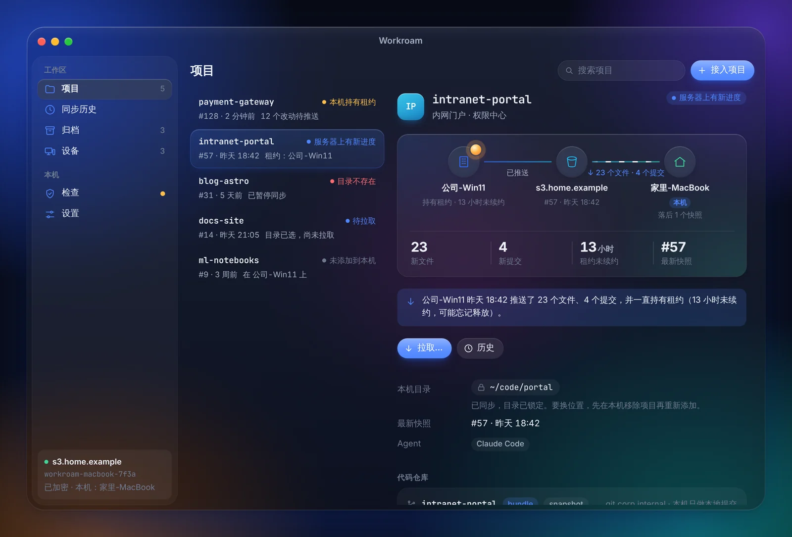<br><sub>接力路线：工作区在哪台机器、有什么在等着传（深色）</sub></td>
<td width="50%">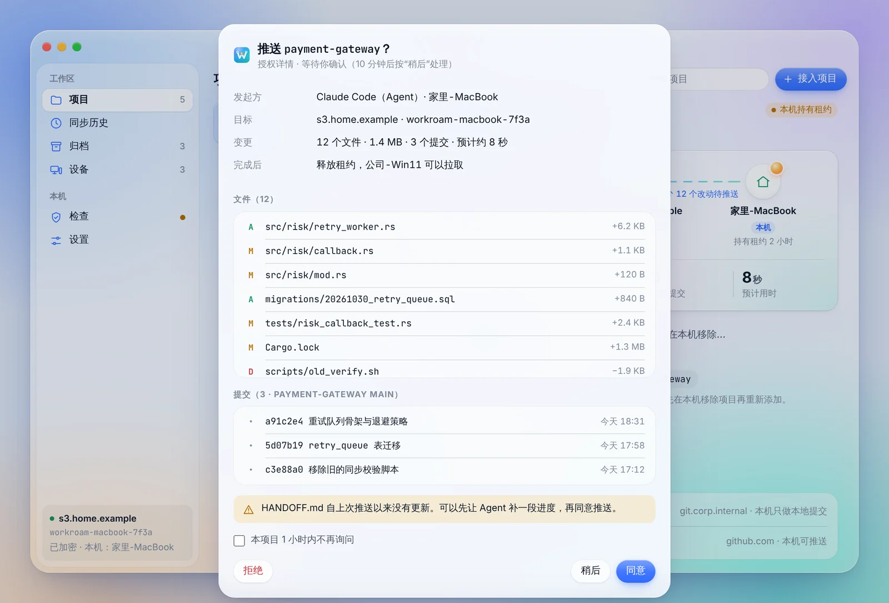<br><sub>授权详情：同意前看清每个文件和提交</sub></td>
</tr>
<tr>
<td width="50%">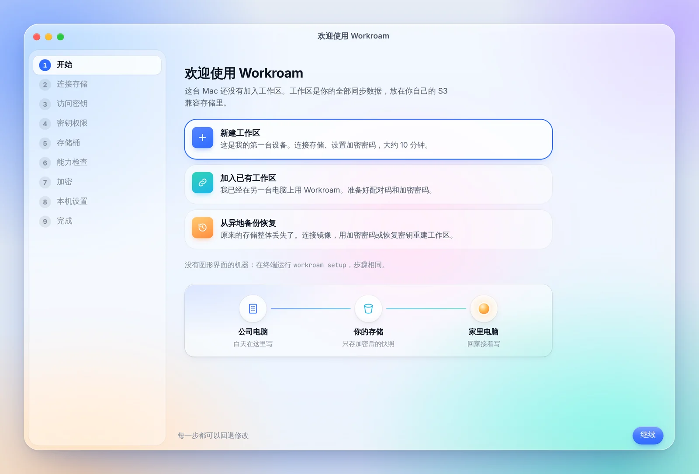<br><sub>首次启动：新建、加入或从异地备份恢复工作区</sub></td>
<td width="50%">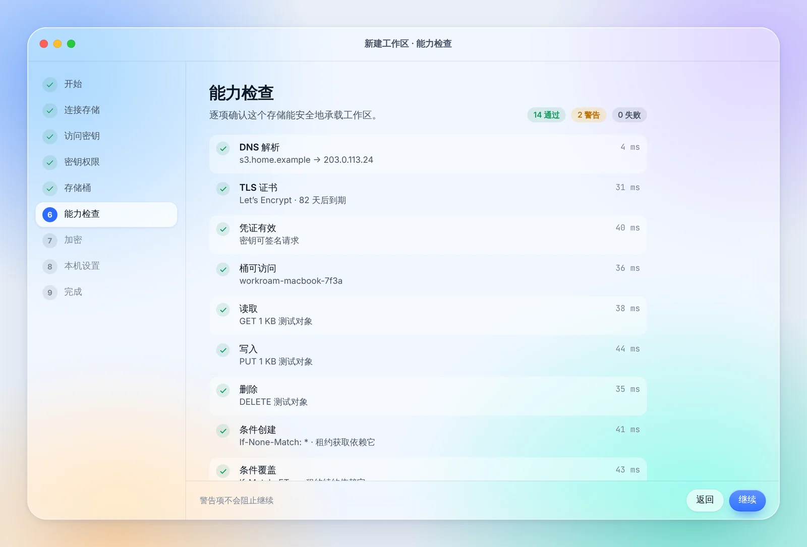<br><sub>初始化检查：16 项存储能力测试</sub></td>
</tr>
<tr>
<td width="50%">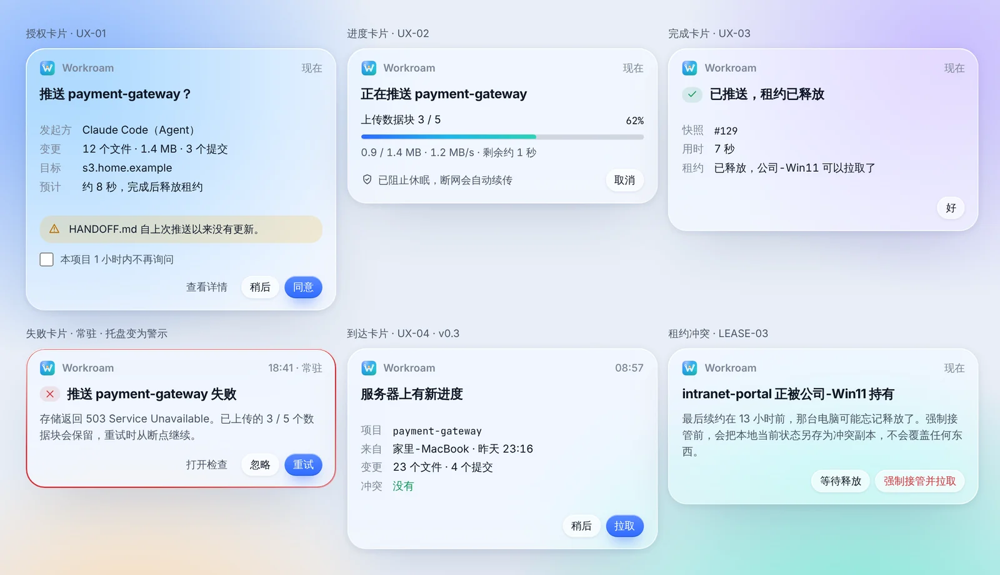<br><sub>角落卡片：授权、进度、完成、失败、到达、租约冲突</sub></td>
<td width="50%">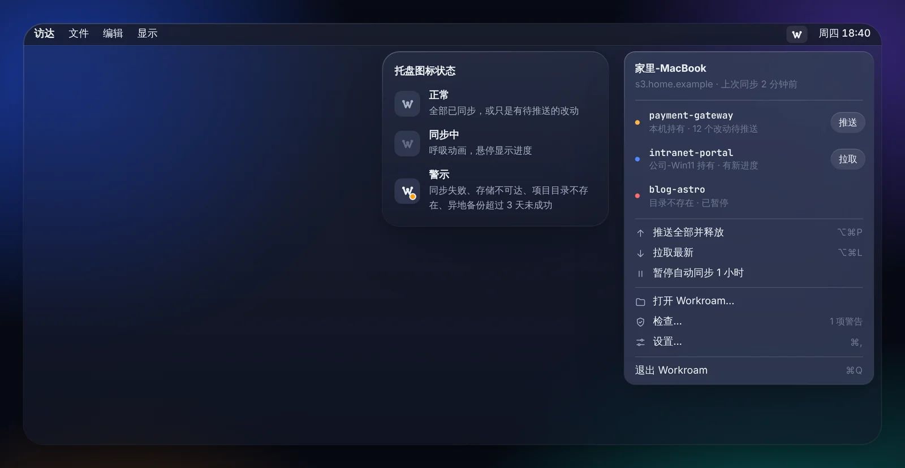<br><sub>托盘菜单：待确认授权、推送、拉取、暂停（深色）</sub></td>
</tr>
<tr>
<td width="50%">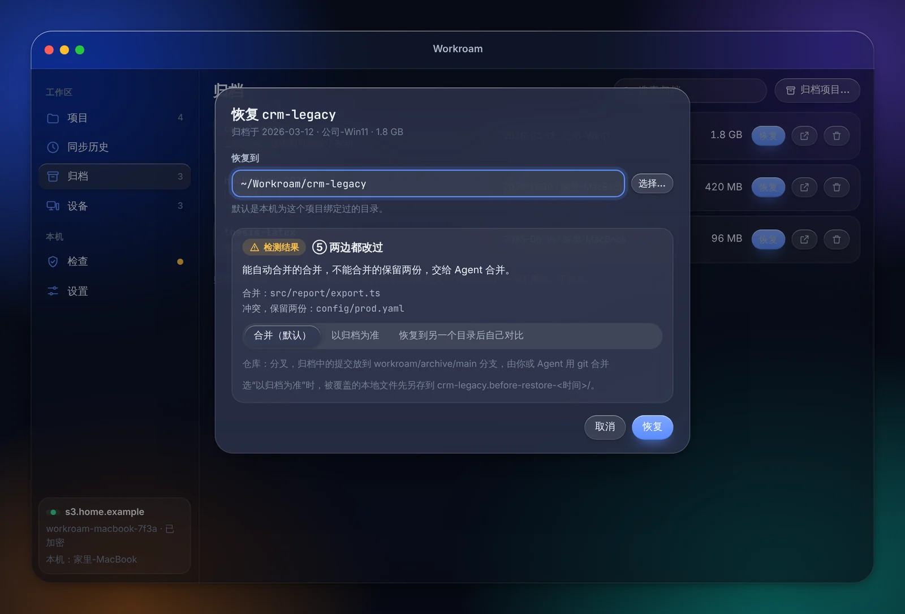<br><sub>恢复归档：按本地目录情况说明会做什么（深色）</sub></td>
<td width="50%">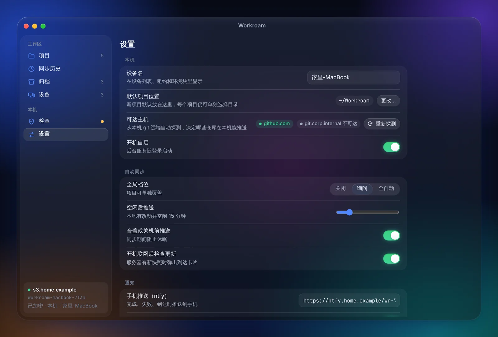<br><sub>设置：本机、自动同步、存储、加密、异地备份（深色）</sub></td>
</tr>
</table>

## 工作方式

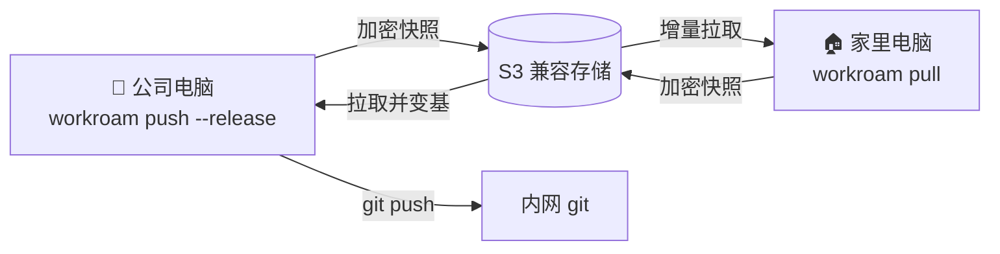

1. **下班**：对任一 Agent 说“我要下班了”。Agent 写好 `.handoff/HANDOFF.md`，执行 `workroam push --release`；你在弹出的卡片上点“同意”。
2. **到家**：托盘提示“服务器上有新进度”。说一句“同步下来”，Workroam 拉取文件、导入提交，并为本机生成 MCP 配置、Skills 链接和环境说明。
3. **继续**：打开任一 Agent，它读 `AGENTS.md` 和 `HANDOFF.md`，汇报进度后接着干。
4. **回公司**：拉取家里的进度，家里的提交自动变基回真实历史，然后 `git push` 到内网。

## 快速开始（规划中）

```bash
# 服务端：一条命令部署存储与 HTTPS
curl -fsSL https://<项目域名>/install.sh | sh -s -- --domain sync.example.com --storage rustfs

# 客户端：首次启动桌面应用会自动打开初始化向导
# （没有图形界面的机器在终端里走同样的步骤；
#   桌面应用里的每项操作都有等价的 workroam 命令）
workroam setup
cd ~/projects/proj-a && workroam init

# 接力
workroam push --release     # 离开时
workroam pull               # 到达时（同时获取租约）
```

## 发布范围

PRD 中的全部功能作为 **v0.1** 一次发布，下表门槛全部达到才发布。

| 范围 | 内容 | 门槛 |
| --- | --- | --- |
| 接力与数据安全 | 初始化向导与检查、配对码、只读设备、密钥轮换、快照、租约、加密、恢复与同步历史、bundle / remote / files 模式 | 公司 Windows ↔ 家里 Mac 连续使用两周不丢数据 |
| 多 Agent | 六个本机 Agent（Claude Code、Codex、Grok Build、Antigravity、ZCode、Pi）、会话迁移、命令行 `--json` 与 Workroam Skill、本机 MCP server | 六个 Agent 换机器后都能直接开工 |
| 无感同步 | 自动同步、授权 / 进度 / 完成 / 到达卡片、桌面应用与命令行功能对等 | 日常基本不用手动敲命令 |
| 归档与备份 | 项目归档与恢复、归档包、快照清理、可选异地备份 | 归档项目恢复后直接可用 |
| 云端个人 Agent 与可选服务端 | `workroam-server` 中继模式（可部署在 bot 的云端电脑上）与远程连接器（Grok Bot、Muse）；完整模式另有 6 位配对码、手机推送与 Web 界面 | 云端个人 Agent 2 分钟内连上 |

详见 [PRD · 发布范围](docs/prd.md#10-发布范围与验收门槛)。

## 仓库结构

```text
.
├── docs/            # 文档：PRD、技术架构、ADR、原型、图片资源
├── crates/          # Rust 代码（规划中，见 crates/README.md）
├── .github/         # Issue / PR 模板
├── CONTRIBUTING.md  # 贡献指南
└── LICENSE          # Apache-2.0
```

## 参与贡献

欢迎任何形式的贡献，尤其是 **Agent 适配器**：它们是纯数据文件，门槛最低、价值最高。提交前请阅读 [CONTRIBUTING.md](CONTRIBUTING.md)，所有提交需要 `Signed-off-by`（DCO）。

发现安全问题请按 [SECURITY.md](SECURITY.md) 私下报告，不要公开提 Issue。

## 许可证

[Apache License 2.0](LICENSE)。将来单独发布的 Rust 库采用 `MIT OR Apache-2.0` 双许可。

> 内网代码离开公司网络前，请先确认公司的相关规定。
