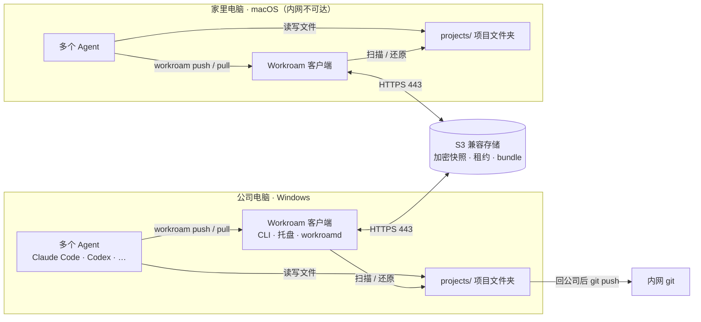
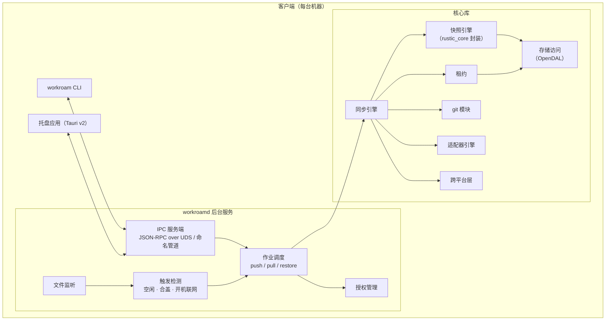
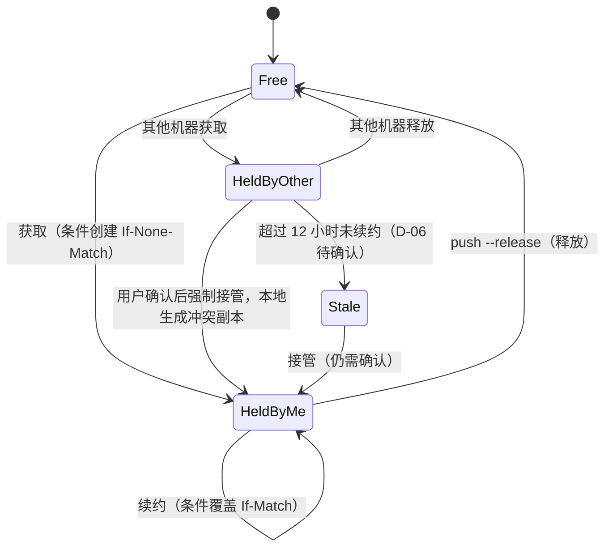
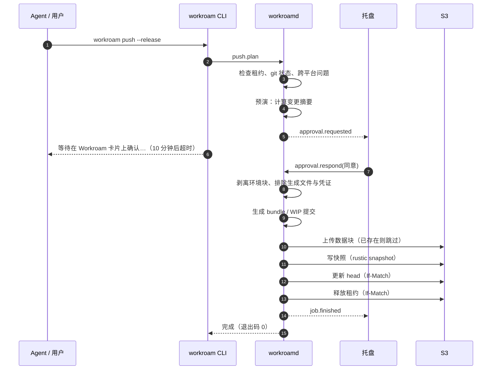
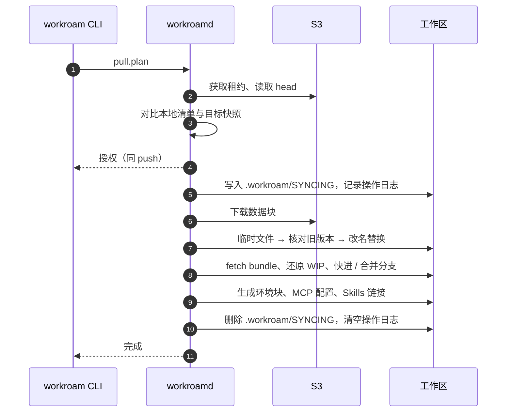
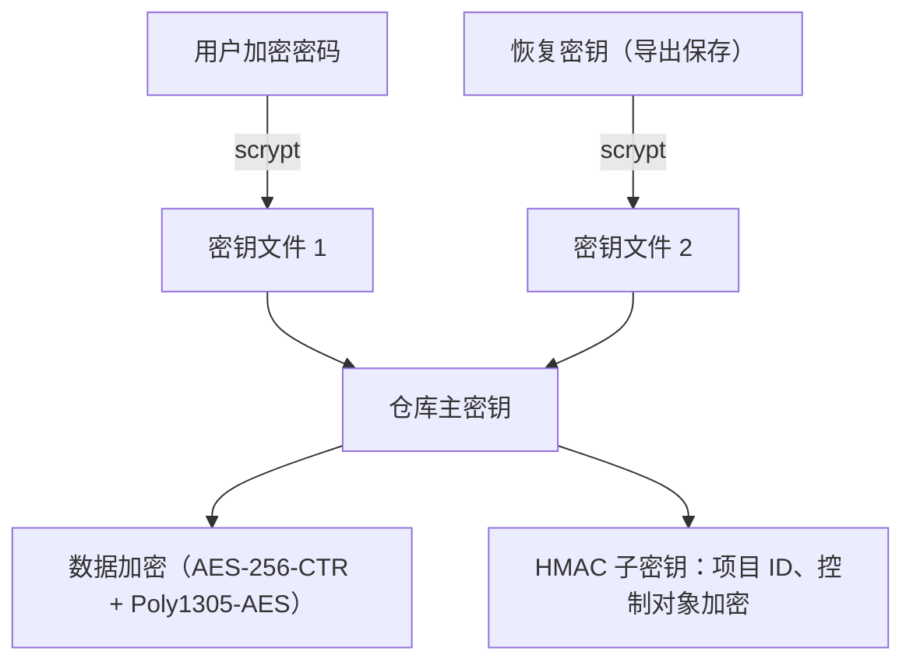
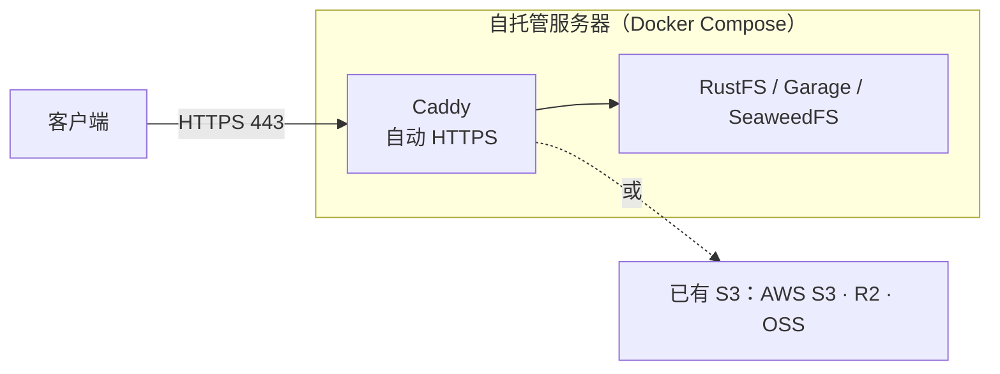

# Workroam 技术架构

| 项目 | 内容 |
| --- | --- |
| 文档状态 | 草案，对应 v0.1 设计；标注“待确认”的部分见 [PRD §12](prd.md#12-待决事项) |
| 最后更新 | 2026-10-29 |
| 关联文档 | [产品需求](prd.md) · [架构决策记录](adr/README.md) |

---

## 目录

1. [架构原则](#1-架构原则)
2. [系统上下文](#2-系统上下文)
3. [组件](#3-组件)
4. [代码组织](#4-代码组织)
5. [存储布局](#5-存储布局)
6. [配置与数据模型](#6-配置与数据模型)
7. [同步协议](#7-同步协议)
8. [代码仓库同步](#8-代码仓库同步)
9. [Agent 适配层](#9-agent-适配层)
10. [跨平台层](#10-跨平台层)
11. [进程间通信协议](#11-进程间通信协议)
12. [安全架构](#12-安全架构)
13. [部署架构](#13-部署架构)
14. [可观测性](#14-可观测性)
15. [测试策略](#15-测试策略)
16. [技术选型](#16-技术选型)
17. [架构决策记录](#17-架构决策记录)

---

## 1. 架构原则

1. **客户端重、服务端薄。** 所有逻辑在客户端；服务端只是一个 S3 兼容存储，用户不需要运维任何自研后端。
2. **源文件同步，生成文件不同步。** MCP 配置、Skills 链接、环境块等在每台机器拉取后重新生成。
3. **共享内容同步，机器差异本地化。** 系统、Shell、路径、网络可达性只写入本机文件或环境块。
4. **从不静默覆盖。** 任何可能丢数据的操作要么可回滚，要么先询问。
5. **先写数据、后写指针。** 所有对外可见的状态切换都是一次原子写，中断不会留下半成品。
6. **人始终在环中。** 每次同步默认需要授权，Agent 发起的也一样。
7. **差异用数据描述。** Agent 的差异写在适配器数据文件里，而不是写死在代码里。

## 2. 系统上下文



两台机器之间没有直连，只通过存储交换加密快照；内网 git 只在公司电脑上推送。

## 3. 组件

### 3.1 客户端



| 组件 | 职责 |
| --- | --- |
| `workroamd` 后台服务 | 同步引擎宿主、触发检测、租约、文件监听、授权管理；以用户级服务开机自启（macOS launchd、Windows 登录任务、Linux systemd 用户服务）；通过 IPC 提供请求接口与事件流 |
| `workroam` CLI | 给用户和 Agent 使用；把请求交给后台服务执行，在终端显示进度；后台服务未运行时可以前台临时启动一个实例 |
| 托盘应用 | 托盘图标、授权 / 进度 / 完成 / 到达四种卡片、设置面板；只负责展示和转达用户选择，不含同步逻辑 |

### 3.2 服务端

- 任意 S3 兼容存储：RustFS、Garage、SeaweedFS，或已有的 AWS S3、Cloudflare R2、阿里云 OSS 等。RustFS 是默认选项之一，不是依赖。
- Caddy：TLS 终结与自动证书，把单一域名的 443 端口反向代理到存储。
- 后续可选一个轻量服务端组件（v0.3）：Web 界面、推送通知、配对码与多设备管理。

### 3.3 四层数据

| 层 | 内容 | 同步策略 |
| --- | --- | --- |
| 项目层 | 代码仓库、文档、交付物 | 文件按内容哈希增量同步；仓库按代码同步模式处理（§8） |
| 规则层 | `AGENTS.md` | 正文同步；末尾环境块在本机生成 |
| Agent 状态层 | 各 Agent 的会话、记忆 md | 按适配器白名单同步本项目相关部分；排除凭证；改写路径（v0.2） |
| 交接层 | `.handoff/HANDOFF.md` | 推送前由当前 Agent 写，随项目同步 |

## 4. 代码组织

单仓库、Cargo workspace。文档与代码分开：`docs/` 只放文档，代码在 `crates/` 与 `apps/`。

```text
.
├── docs/                    # 产品与架构文档、ADR
├── crates/
│   ├── workroam-core/          # 公共类型：项目、清单、配置模型、错误
│   ├── workroam-store/         # 存储访问（OpenDAL）、能力探测、条件写
│   ├── workroam-lease/         # 租约与最新快照指针
│   ├── workroam-snapshot/      # 快照引擎接口与 rustic_core 实现
│   ├── workroam-git/           # bundle / WIP / 历史重建 / 三方合并（调用本机 git）
│   ├── workroam-adapters/      # 适配器加载、校验与本机文件生成
│   ├── workroam-platform/      # 跨平台检查、原子落盘、链接、阻止休眠、服务安装
│   ├── workroam-ipc/           # IPC 协议定义（消息类型、版本协商）与传输
│   ├── workroam-engine/        # 推送 / 拉取流程编排
│   ├── workroamd/              # 后台服务（二进制）
│   └── workroam-cli/           # 命令行（二进制，名为 workroam）
├── apps/
│   └── tray/                # Tauri v2 托盘应用
├── adapters/                # 适配器数据文件（claude-code.toml、codex.toml…）
└── deploy/                  # install.sh、Compose、Caddyfile、Helm Chart
```

依赖方向：`workroam-cli`、`workroamd`、`apps/tray` → `workroam-ipc`；`workroamd` → `workroam-engine` → 各功能 crate → `workroam-core`。托盘只依赖 IPC 协议，不依赖任何同步逻辑（ADR-0002）。

## 5. 存储布局

一个 bucket 内分两部分：**加密仓库**（rustic / restic 格式，保存所有文件内容、git bundle、清单）与 **控制对象**（租约、最新快照指针，需要条件写）。

```text
<bucket>/
├── repo/                         # rustic 仓库（全部内容加密）
│   ├── config
│   ├── keys/                     # 每个密钥文件包装同一个主密钥：用户密码、恢复密钥
│   ├── data/  index/  snapshots/
│   └── locks/
└── control/
    ├── format.json               # 布局版本、创建时间（明文，不含敏感信息）
    ├── devices/<device-id>       # 设备登记（加密）
    └── projects/<pid>/
        ├── lease                 # 租约（加密内容，条件写）
        └── head                  # 最新快照指针（加密内容，条件写）
```

- `<pid>` = `HMAC-SHA256(仓库密钥, 项目名)` 的前 16 字节十六进制，避免在服务器上暴露项目名（D-08，待确认）。
- 所有项目共用一个加密仓库，跨项目去重；每个项目一条独立的快照序列（rustic 快照标签 `workroam:project=<pid>`）与一把租约（D-05，待确认）。
- git bundle、WIP 提交、Workroam 清单都作为快照中的虚拟文件存放在 `.workroam-snapshot/` 下，随快照一起加密、去重、续传，不另开明文对象。

## 6. 配置与数据模型

### 6.1 项目目录

```text
projects/
└── proj-a/
    ├── AGENTS.md            # 共享规则 + 本机环境块（自动生成）
    ├── CLAUDE.md            # 仅一行 @AGENTS.md（需要时生成）
    ├── .workroam/
    │   ├── workroam.toml       # 本项目同步策略
    │   ├── mcp.toml         # MCP 唯一定义，含各系统覆盖项
    │   ├── env/             # windows.md / macos.md / linux.md
    │   └── local/           # 本机状态：哈希缓存、操作日志、映射表（不同步）
    ├── .agents/skills/      # Skills 唯一来源
    ├── .handoff/HANDOFF.md  # 跨 Agent 交接
    ├── repo-a/              # 代码仓库（每台机器自有 .git）
    └── docs/ deliverables/
```

Agent 在项目根目录启动，不在 `repo-a/` 里启动：部分 Agent 只从 git 仓库根往下找规则文件，在仓库里启动会看不到项目根的 `AGENTS.md`。

### 6.2 machine.toml（每台机器一份）

```toml
# ~/.workroam/machine.toml
name = "office-win"
os = "windows"
root = 'D:\projects'
reachable = ["git.corp.internal", "github.com"]

[server]
endpoint = "https://sync.example.com"
bucket = "workroam"

[sync]
auto = "ask"                    # off | ask | auto
idle_minutes = 15
on_sleep = "ask"
agent_requires_approval = true
approval_timeout = "10m"

[projects]
pull = ["proj-a", "proj-b"]     # 本机需要的项目
```

访问密钥与加密密码不写入此文件，保存在系统密钥库（macOS Keychain、Windows Credential Manager、Linux Secret Service），通过 `keyring` 访问。

### 6.3 workroam.toml（每个项目一份）

```toml
# projects/proj-a/.workroam/workroam.toml
[sync]
exclude = ["node_modules/", "target/", ".venv/", "dist/"]
auto = "ask"                    # 可覆盖机器默认值

[agents]
claude = { state = true }
codex  = { state = true }

[repos.order-service]           # 内网仓库
path = "repo-a"
mode = "bundle"
history = "recent:50"           # full | recent:N | snapshot
branches = ["main", "feature/*"]
extras = ["docs/generated/"]    # 被 .gitignore 忽略但需要带走

[repos.oss-tool]                # 两地都能连 origin
path = "repo-b"
mode = "remote"
via = "origin"

[repos.scripts]
path = "repo-c"
mode = "files"
```

### 6.4 mcp.toml（MCP 唯一定义）

```toml
[servers.filesystem]
command = "npx"
args = ["-y", "@modelcontextprotocol/server-filesystem", "{project}/docs"]
targets = ["claude", "codex"]

[servers.filesystem.windows]
command = "cmd"
args = ["/c", "npx", "-y", "@modelcontextprotocol/server-filesystem", "{project}/docs"]

[servers.jira]
url = "https://jira.example.com/mcp"
headers = { Authorization = "Bearer ${secret:jira_token}" }
```

### 6.5 Workroam 快照清单

每个快照内附带 `.workroam-snapshot/manifest.json`：

```json
{
  "format": 1,
  "project": "<pid>",
  "parent": "<上一个快照 ID 或 null>",
  "machine": { "id": "<device-id>", "name": "office-win", "os": "windows" },
  "created_at": "2026-10-29T18:02:11Z",
  "handoff_updated": true,
  "repos": {
    "order-service": {
      "mode": "bundle",
      "history": "recent:50",
      "exchanged": { "main": "<上次交换到的提交>" },
      "bundle": ".workroam-snapshot/git/order-service.bundle",
      "wip": { "branch": "main", "commit": "<WIP 提交>" }
    }
  },
  "entries_meta": { "scripts/run.sh": { "mode": "0755" }, "link": { "symlink": "target" } }
}
```

文件内容、大小、修改时间由 rustic 快照树记录；清单只补充 Workroam 需要的元数据（父快照、仓库交换点、可执行位、符号链接）。

### 6.6 租约对象

```json
{
  "project": "<pid>",
  "holder": { "device_id": "…", "name": "home-mac" },
  "acquired_at": "2026-10-29T19:30:00Z",
  "renewed_at": "2026-10-29T21:10:00Z",
  "expires_at": "2026-10-30T09:10:00Z",
  "state": "held"
}
```

## 7. 同步协议

### 7.1 存储能力探测

`workroam login` 时探测并记录到本机：

| 能力 | 探测方法 | 不支持时 |
| --- | --- | --- |
| 条件创建 `If-None-Match: *` | 对探测键连续两次创建，第二次应返回 412 | 租约降级为乐观并发 |
| 条件覆盖 `If-Match: <ETag>` | 用过期 ETag 覆盖，应返回 412 | 同上 |
| 分片上传 | 上传一个超过分片阈值的探测对象 | 只用单次上传，降低块大小上限 |
| 访问风格 | 先试虚拟主机风格，失败后用路径风格 | — |

### 7.2 租约



- 获取：`PUT control/projects/<pid>/lease` 带 `If-None-Match: *`；对象已存在时读取，若是本机持有则续约，否则进入“他人持有”流程。
- 续约 / 接管：带 `If-Match: <ETag>` 覆盖，保证并发下只有一方成功。
- 释放：以 `If-Match` 写入 `state = "released"`（不依赖条件删除，兼容性更好）；获取时把 `released` 视为空闲。
- 降级（无条件写）：不使用租约；`head` 写入前读取并比对父快照，若服务器上的 `head` 已不是本机快照的父快照，即视为分叉，交给用户处理。

### 7.3 推送



步骤 1–3 任一失败都不会写入任何远端对象；步骤“写快照”之前中断，只会留下未被引用的数据块，下次推送复用、`prune` 时清理。

### 7.4 拉取



操作日志（`.workroam/local/oplog`）逐条记录“已完成的替换”，进程中断后重启时先重放日志、完成剩余步骤，再接受新作业。

### 7.5 冲突处理

| 对象 | 判定 | 处理 |
| --- | --- | --- |
| 普通文件 | 本地相对上次快照有修改，且目标快照也有修改 | 以上次快照为共同祖先三方合并（文本）；无法自动合并时保留两份（如 `xxx.conflict-home.md`），交给 Agent 合并 |
| 二进制文件 | 同上 | 直接保留两份 |
| 代码 | git 分支分叉 | 交给 git 的 merge / rebase，Agent 可直接处理 |
| 快照分叉 | 无条件写时同一父快照被推送两次 | 下次拉取时提示用户选择保留哪条线；另一条仍可从快照历史找回 |

### 7.6 防中断

- 同步期间调用系统接口阻止休眠（macOS `IOPMAssertion`、Windows `SetThreadExecutionState`、Linux `systemd-inhibit`）。
- 推送先传数据块、最后写清单与指针；拉取使用临时文件 + 改名替换 + 操作日志。
- git 仓库正处于 rebase 或 merge 中途时拒绝同步。
- 拉取期间的 `.workroam/SYNCING` 标记让 Agent 暂停写入（约定写在 `AGENTS.md` 共享正文中）。

## 8. 代码仓库同步

每台机器各自维护 `.git`，不对 `.git` 目录做文件级同步。git 操作一律调用本机 git 命令行，保证行为与用户本地 git 完全一致。

### 8.1 bundle 模式（v0.1）

- 首次：生成完整 bundle（按历史档位裁剪后）放入快照；另一端从该文件 `git clone`。
- 之后：只打包“上次交换点”之后的新提交与 WIP 提交（`git bundle create <file> <交换点>..<分支>`）；另一端 `git fetch` 后快进本地分支。
- 交换点记录在快照清单 `repos.<name>.exchanged` 中。
- 仓库目录不走文件同步，只有 `extras` 中列出的被忽略文件走文件同步。

### 8.2 历史档位

| 档位 | 家里能看到什么 | 首次传输量 | 回公司时 |
| --- | --- | --- | --- |
| `full` | 全部分支和提交 | 约等于 `.git` 大小 | 直接快进，两边提交号一致 |
| `recent:N` | 选定分支最近 N 次提交，说明和作者保留 | 当前代码 + N 次改动 | 自动变基回真实历史 |
| `snapshot` | 只有当前代码，没有历史 | 当前代码的压缩体积 | 自动变基回真实历史 |

`recent` 与 `snapshot` 的实现：

1. 取真实分支最近 N 个提交，用完全相同的树、说明和作者逐个 `git commit-tree` 重建，最底下一个作为新根；`snapshot` 即 N = 0。
2. 映射表“重建提交 ↔ 真实提交”保存在公司机器的 `.workroam/local/map/<repo>`，并加密附在快照中，供任意机器回到内网环境时使用。
3. 家里得到普通仓库，可正常 log、diff、多次提交。
4. 回公司时执行 `git rebase --onto <真实提交> <重建提交> <分支>`；树相同，不产生冲突，只是提交号变化（这些提交从未推送到别处）。
5. 下次离开时，若内网有新提交，生成新的重建提交挂在家里上次的最新提交之后，保持增量传输。

### 8.3 未提交改动：WIP 提交

```bash
GIT_INDEX_FILE=.git/workroam-index git add -A
tree=$(GIT_INDEX_FILE=.git/workroam-index git write-tree)
wip=$(git commit-tree "$tree" -p HEAD -m "workroam wip")
```

- 用临时索引生成，不碰用户暂存区和业务分支；未跟踪但未被忽略的新文件也包含在内。
- bundle 模式一并打包；remote 模式推到 `workroam/wip/<分支名>`。到达后还原为未提交改动，再删除 WIP。

### 8.4 remote 与 files 模式（v0.2）

- **remote**：origin 两地都能连时直接用 origin；origin 是内网仓库时增加中转远端（Gitea 或 GitHub 私有库），回公司后先从中转库拉取再推送内网。
- **files**：`git ls-files -co --exclude-standard` 列文件；离开时记录分支与 HEAD 作为基线，回来时 HEAD 与工作区都没动则直接覆盖，否则以基线为共同祖先 `git merge-file` 逐文件合并；可生成只含基线的影子仓库供 Agent 看 diff。

### 8.5 模式推荐

`workroam init` 根据 origin 主机名与各机器 `reachable` 推荐：两地都能连 origin → `remote`；内网仓库 → `bundle` + `recent:50`；高度敏感 → `bundle` + `snapshot`；轻量 → `files`。v0.1 只实现 `bundle`，推荐 `remote` / `files` 时提示“v0.2 支持，暂用 bundle”。

## 9. Agent 适配层

### 9.1 适配器数据文件

每个 Agent 一个 TOML 文件，放在 `adapters/` 并编译进二进制，用户也可在 `~/.workroam/adapters/` 覆盖。示例（字段为草案）：

```toml
# adapters/claude-code.toml
id = "claude"
name = "Claude Code"
adapter_version = 1
agent_versions = ">=2.1.0"
detect = { command = "claude --version" }

[rules]
read = ["AGENTS.md"]
generate = [{ path = "CLAUDE.md", template = "@AGENTS.md\n", when = "missing" }]

[skills]
source = ".agents/skills"
link = ".claude/skills"

[mcp]
path = ".mcp.json"
format = "claude-mcp-json"

[sessions]                      # v0.2
dir = "~/.claude/projects/{path_key}/"
path_key = "claude-path-key"

[exclude]
paths = ["~/.claude/.credentials.json"]
```

### 9.2 本机文件生成

拉取完成后按顺序执行，全部写入本机排除列表：

1. **环境块**：用 `.workroam/env/<os>.md` 与 `machine.toml` 渲染，替换 `AGENTS.md` 中 `<!-- workroam:env:begin -->` 与 `<!-- workroam:env:end -->` 之间的内容。
2. **MCP**：读取 `.workroam/mcp.toml`，合并当前系统的覆盖项，解析 `${secret:xxx}`，为每个 `targets` 中的 Agent 按其格式生成原生配置。
3. **Skills**：为需要的 Agent 创建指向 `.agents/skills/` 的链接（Windows 目录用 junction，文件用复制）。
4. **规则引用**：按需生成 `CLAUDE.md` 等引用文件。

推送时反向处理：剥离环境块，忽略所有生成文件。

### 9.3 适配矩阵（实现前需实测确认）

| Agent | 规则 | 项目级 Skills | 项目级 MCP | 会话位置 | 版本 |
| --- | --- | --- | --- | --- | --- |
| Claude Code | `CLAUDE.md` 一行 `@AGENTS.md` | `.claude/skills`（链接） | `.mcp.json` | `~/.claude/projects/<路径键>/` | v0.1 |
| Codex | `AGENTS.md` 原生 | `.agents/skills` 原生 | `.codex/config.toml`（项目受信任后加载） | `~/.codex/sessions/` | v0.1 |
| Grok Build | `AGENTS.md`，也读 `CLAUDE.md` | `.grok/skills`，兼容 Claude Code | `.grok/config.toml`，也读 `.mcp.json` | `~/.grok/sessions/<路径键>/` | v0.2 |
| Antigravity | CLI 读 `AGENTS.md`；2.0 用 `.agents/rules` 引用 | `.agents/skills` 原生 | `.agents/mcp_config.json` | 待确认 | v0.2 |
| ZCode | 项目根 `AGENTS.md` 与 `~/.zcode/AGENTS.md` | 待确认 | 全局 `~/.zcode/cli/config.json`，项目级待确认 | 待确认 | v0.2 |
| Pi | `AGENTS.md` | 待确认 | 待确认 | 待确认 | v0.2 |

## 10. 跨平台层

| 问题 | 处理 | 时机 |
| --- | --- | --- |
| 大小写冲突 | 检测并拒绝 | 推送前 |
| Windows 非法文件名 | 检测并拒绝（保留名、`<>:"\|?*`、结尾点或空格） | 推送前 |
| 路径长度（> 260） | 提示开启 LongPathsEnabled，设置 `core.longpaths=true` | 推送前 / 拉取时 |
| 符号链接 | 记入清单；Windows 上目录用 junction，文件改为复制 | 拉取时 |
| 可执行位 | 记入清单；Windows 上保持原值不动，回到 macOS / Linux 时恢复 | 推送 / 拉取 |
| 换行符 | 仓库统一 `.gitattributes`，各机器 `core.autocrlf=false` | init 时建议 |
| Unicode 规范化 | 清单内路径统一为 NFC | 推送前 |
| 文件被占用（Windows） | 重试，并用临时文件 + 改名替换落盘 | 拉取时 |
| 路径分隔符与根路径 | 清单统一用相对路径和 `/`；本机根路径由 `machine.toml` 提供 | 全程 |

平台相关的 git 配置（`core.filemode`、`core.ignorecase`、worktree 绝对路径等）留在每台机器自己的 `.git` 中，不参与同步。

## 11. 进程间通信协议

托盘、CLI 与 `workroamd` 之间使用**语言无关**的协议，使托盘实现可以替换（ADR-0002）。

- **传输**：macOS / Linux 使用 Unix domain socket（`$XDG_RUNTIME_DIR/workroam/workroamd.sock`，macOS 为 `~/Library/Application Support/Workroam/workroamd.sock`，权限 0600）；Windows 使用命名管道 `\\.\pipe\workroam-<用户 SID>`，ACL 仅当前用户。
- **编码**：每行一个 UTF-8 JSON 对象，消息格式遵循 JSON-RPC 2.0；服务端主动推送的事件使用无 `id` 的通知。
- **握手**：连接后客户端先发 `hello { protocol: 1, client: "tray" | "cli", version }`，服务端返回支持的协议版本与能力；主版本不同则拒绝。
- **协议定义**：`workroam-ipc` crate 中的类型同时导出 JSON Schema，作为其他语言客户端的唯一依据。

| 方法 / 事件 | 方向 | 说明 |
| --- | --- | --- |
| `status` | 客户端 → 服务端 | 后台服务、租约、最新快照、本地改动 |
| `push.plan` / `pull.plan` | 客户端 → 服务端 | 预演，返回作业 ID 与变更摘要 |
| `job.start` / `job.cancel` | 客户端 → 服务端 | 启动或取消作业 |
| `approval.respond` | 客户端 → 服务端 | 同意 / 稍后 / 拒绝，可带“1 小时内不再询问” |
| `subscribe` | 客户端 → 服务端 | 订阅事件流 |
| `approval.requested` | 服务端 → 客户端 | 需要授权（卡片内容） |
| `job.progress` | 服务端 → 客户端 | 阶段、已传 / 总量、速度、剩余时间 |
| `job.finished` / `job.failed` | 服务端 → 客户端 | 结果、快照 ID、错误与建议 |
| `arrival` | 服务端 → 客户端 | 服务器上有更新的快照（v0.3） |

### CLI 退出码（草案）

| 码 | 含义 |
| --- | --- |
| 0 | 成功 |
| 2 | 参数错误 |
| 10 | 用户拒绝 |
| 11 | 授权超时（按“稍后”处理） |
| 12 | 租约被其他机器持有 |
| 13 | 跨平台检查未通过 |
| 14 | 存在需要处理的冲突 |
| 15 | git 仓库处于 rebase / merge 中途 |
| 20 | 网络或存储错误（可重试） |
| 30 | 后台服务不可用 |

## 12. 安全架构

### 12.1 密钥层次



- 仓库格式由 rustic_core 提供：多个密钥文件包装同一个主密钥，因此“恢复密钥”就是额外添加的一个密钥文件；修改密码不需要重新加密数据。
- S3 访问密钥与加密密码保存在系统密钥库，不落盘明文。

### 12.2 威胁与对策

| 威胁 | 对策 |
| --- | --- |
| 存储服务器被入侵 / 存储服务商可见数据 | 端到端加密；对象键不含项目名（D-08） |
| 访问密钥泄露 | 只授权单个 bucket；可在服务端轮换；v0.3 起每设备独立凭证 |
| Agent 误操作或被项目文件诱导执行同步 | 默认人工确认；卡片显示发起方；超时按“稍后” |
| 凭证被同步到其他机器 | 适配器强制排除；MCP 密钥 `${secret:xxx}` 本机解析，生成文件不同步 |
| 本机其他用户调用 `workroamd` | UDS 权限 0600 / 命名管道 ACL 仅当前用户 |
| 传输被窃听 | 全部 HTTPS 443 |
| 内网代码外流的合规风险 | 按项目开启；`snapshot` 历史档位；文档明确提示 |

## 13. 部署架构



- `install.sh --domain sync.example.com --storage rustfs|garage|seaweedfs|external`：生成 Compose 与 Caddyfile、启动服务、创建 bucket 与只授权该 bucket 的访问密钥，打印配对串（D-02）。
- 没有公网 IP：用 Cloudflare Tunnel 暴露 443。
- Kubernetes：Helm Chart（v0.2+）。
- 需要 Web 界面看代码历史：附带 Gitea 的 Compose，作为 remote 模式中转库（v0.2）。
- Garage 等 AGPL 存储只作为独立容器启动，属于并列分发，不影响 Workroam 代码的许可证。

## 14. 可观测性

- 本地结构化日志（`tracing`），按天滚动，默认保留 14 天；日志中不记录文件内容与密钥。
- `workroam status`：后台服务、租约持有者、最新快照、本地未同步改动、最近一次作业结果。
- `workroam doctor`（v0.2）：存储能力、git 版本、适配器检测结果、系统设置（长路径、`core.autocrlf`）。
- 托盘图标三态：正常 / 同步中 / 警示（最近一次失败未处理）。

## 15. 测试策略

| 层次 | 内容 | 环境 |
| --- | --- | --- |
| 单元测试 | 清单、跨平台检查、环境块渲染、适配器生成、退出码 | 三系统 CI |
| 集成测试 | 推送 / 拉取 / 租约 / 降级路径，对接真实 S3 实现 | Linux CI 中用 Docker 启动 RustFS；可选 Garage、SeaweedFS |
| git 场景测试 | bundle 增量、`recent:N` 重建与回变基、WIP 还原 | 三系统 CI，脚本化构造仓库 |
| 故障注入 | 推送 / 拉取过程中随机终止进程、断网，验证可恢复且无数据丢失 | Linux CI |
| 跨平台端到端 | Windows 推送 → macOS 拉取 → 改动 → Windows 拉取 | GitHub Actions 三系统矩阵，经同一 RustFS |
| 适配器一致性 | 每个适配器的生成结果与快照文件比对；Agent 版本识别 | 三系统 CI |
| 许可证 | `cargo-deny` | CI |

## 16. 技术选型

| 领域 | 选型 | 理由 |
| --- | --- | --- |
| 语言 | Rust | 单文件跨平台二进制；对文件系统细节的掌控力强 |
| 存储访问 | Apache OpenDAL | 多后端；写入接口支持 `If-Match` / `If-None-Match` 条件写；rustic_backend 也基于 OpenDAL |
| 快照引擎 | rustic_core | 内容寻址分块、去重、加密、快照历史均已成熟；restic 兼容格式可用官方工具应急恢复（ADR-0003） |
| git 操作 | 调用本机 git 命令行 | 行为与用户本地 git 完全一致 |
| 托盘与卡片 | Tauri v2 + tray、notification、autostart、positioner 插件 | 体积小、三系统、与 Rust 同栈（ADR-0002） |
| IPC | JSON-RPC 2.0（换行分隔）over UDS / 命名管道 | 语言无关，托盘可替换 |
| 密钥存储 | `keyring` | 统一访问三系统密钥库 |
| 异步运行时 | Tokio | 生态成熟，OpenDAL、rustic 均兼容 |
| CLI | clap + indicatif | 终端进度条；非终端时每约 10% 输出一行 |
| 日志 | tracing | 结构化日志 |
| 依赖许可证检查 | cargo-deny | CI 自动检查 |

## 17. 架构决策记录

见 [adr/README.md](adr/README.md)。
