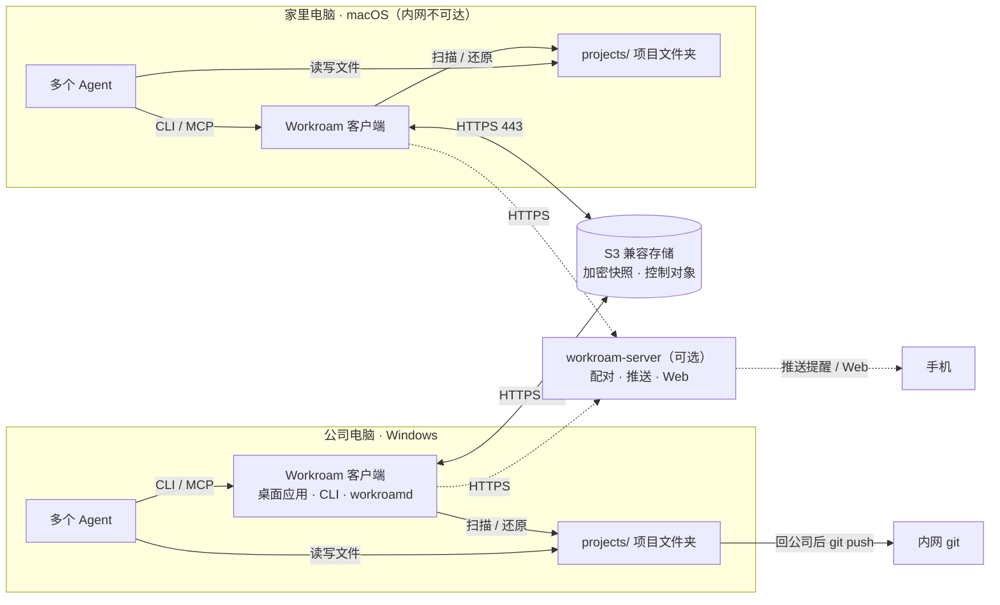
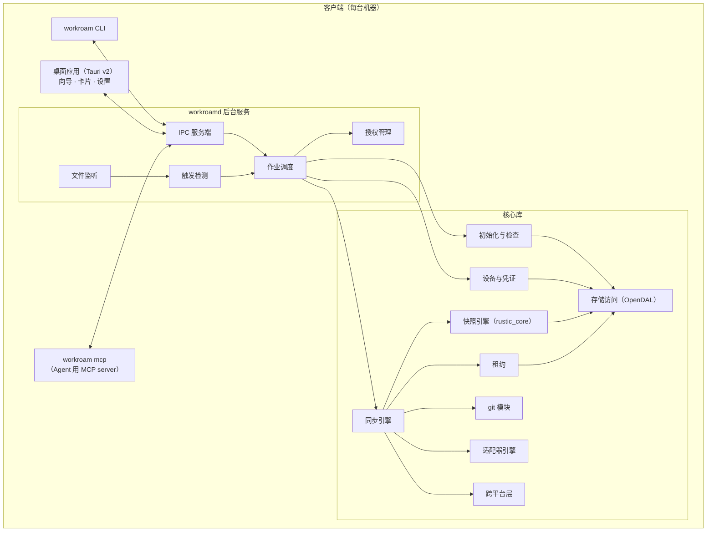
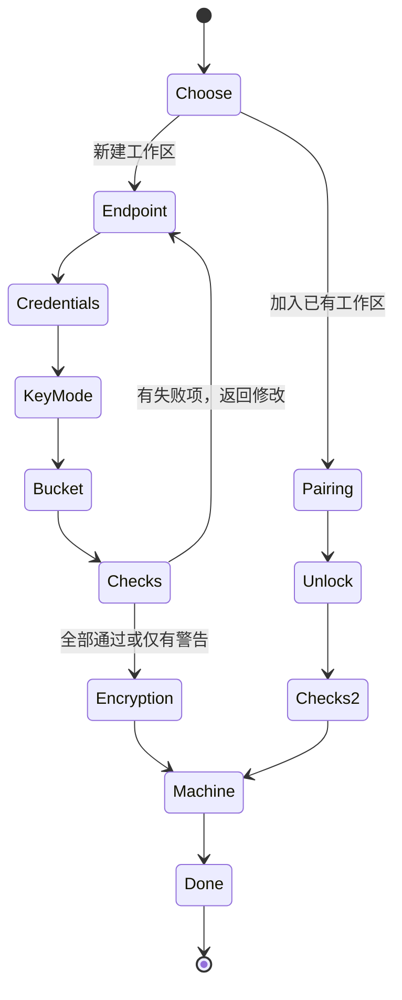
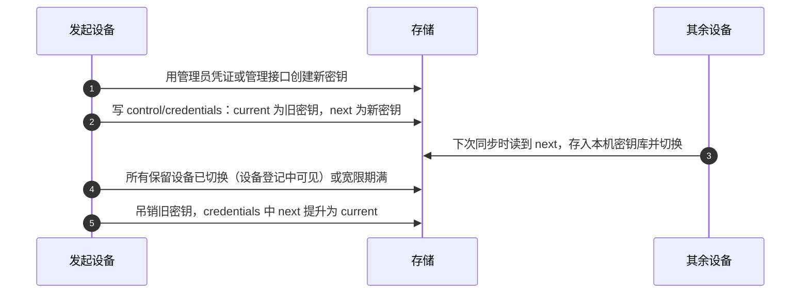
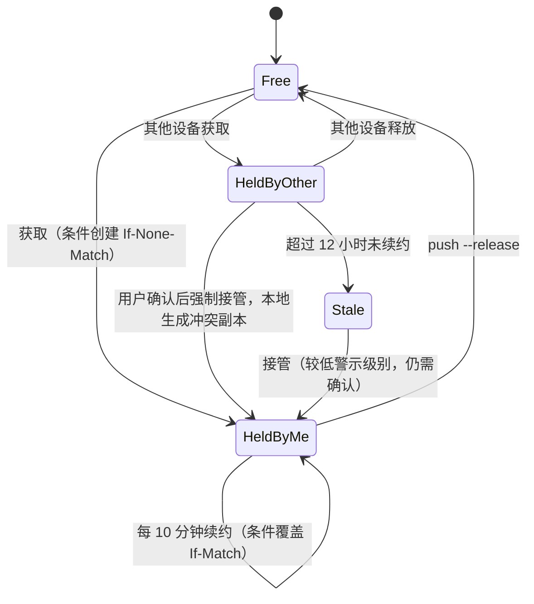
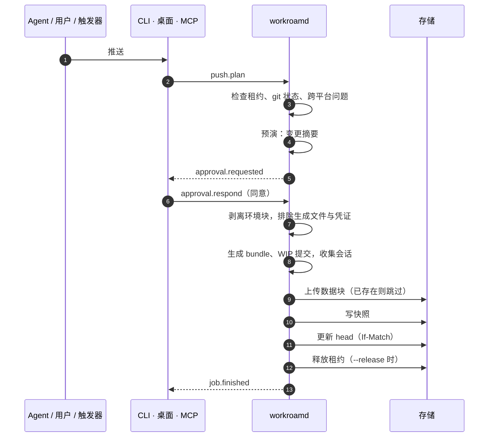
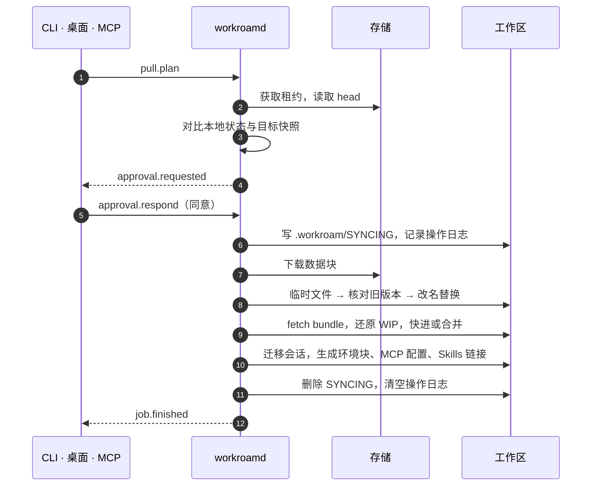
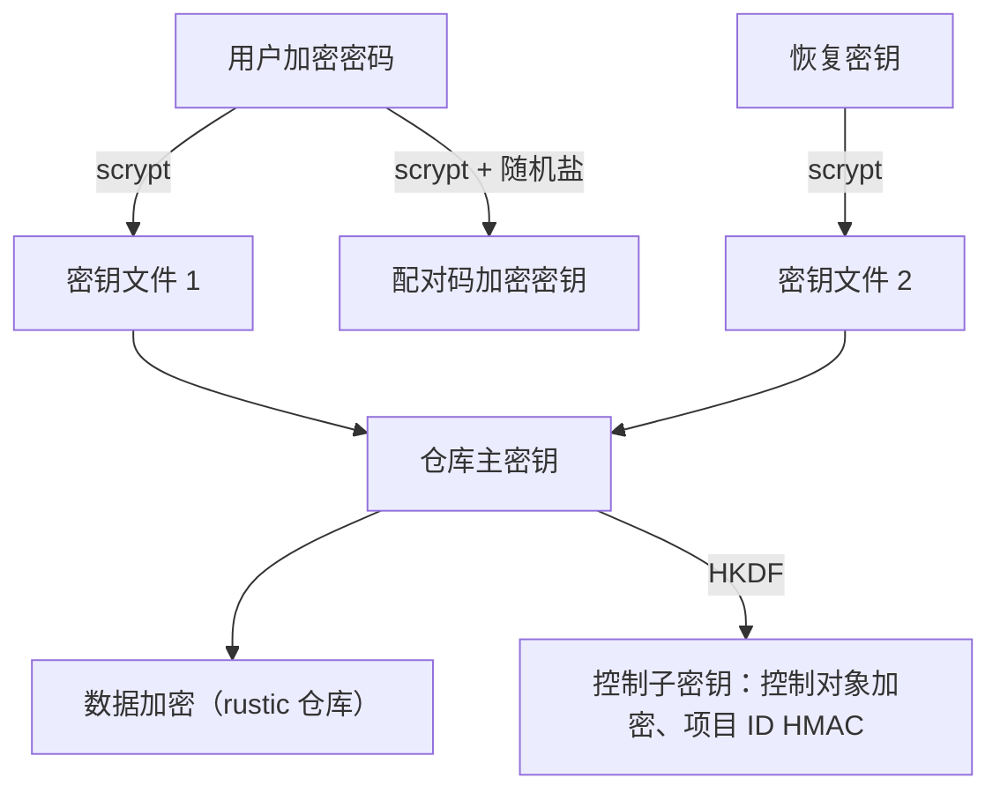
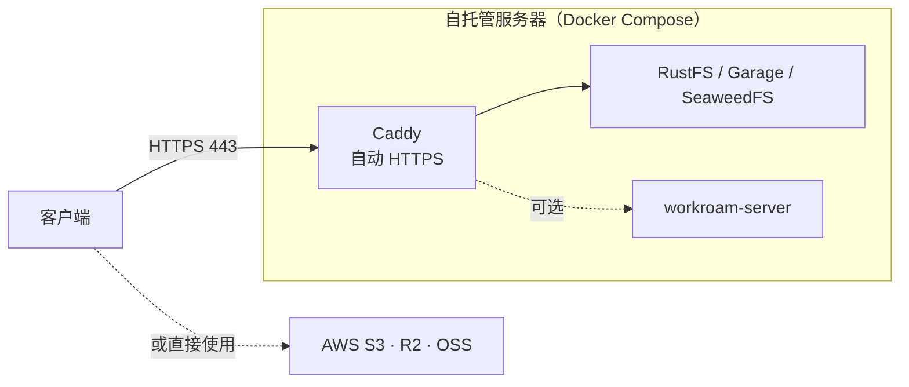

# Workroam 技术架构

| 项目 | 内容 |
| --- | --- |
| 版本 | 1.0（第一版完整技术方案） |
| 覆盖范围 | 产品最终形态 v0.3，各模块标注首次交付版本 |
| 最后更新 | 2026-10-29 |
| 关联文档 | [产品需求](prd.md) · [架构决策记录](adr/README.md) |

---

## 目录

1. [架构原则](#1-架构原则)
2. [系统上下文](#2-系统上下文)
3. [组件](#3-组件)
4. [代码组织](#4-代码组织)
5. [存储布局](#5-存储布局)
6. [配置与数据模型](#6-配置与数据模型)
7. [初始化引导与检查](#7-初始化引导与检查)
8. [设备与凭证](#8-设备与凭证)
9. [同步协议](#9-同步协议)
10. [代码仓库同步](#10-代码仓库同步)
11. [Agent 适配层](#11-agent-适配层)
12. [自动同步与触发](#12-自动同步与触发)
13. [跨平台层](#13-跨平台层)
14. [进程间通信协议](#14-进程间通信协议)
15. [Agent 用 MCP server](#15-agent-用-mcp-server)
16. [轻量服务端（可选）](#16-轻量服务端可选)
17. [安全架构](#17-安全架构)
18. [部署架构](#18-部署架构)
19. [可观测性](#19-可观测性)
20. [测试策略](#20-测试策略)
21. [技术选型](#21-技术选型)
22. [架构决策记录](#22-架构决策记录)

---

## 1. 架构原则

1. **客户端重、服务端薄。** 同步逻辑全部在客户端；必需的服务端只有 S3 兼容存储。可选的 `workroam-server` 只提供配对、推送和 Web 界面，不参与同步，也看不到明文。
2. **源文件同步，生成文件不同步。** MCP 配置、Skills 链接、环境块等在每台机器拉取后重新生成。
3. **共享内容同步，机器差异本地化。** 系统、Shell、路径、网络可达性只写入本机文件或环境块。
4. **从不静默覆盖。** 可能丢数据的操作要么可回滚，要么先询问。
5. **先写数据、后写指针。** 对外可见的状态切换都是一次原子写，中断不会留下半成品。
6. **人始终在环中。** 同步默认需要授权，Agent 发起的也一样。
7. **差异用数据描述。** Agent 差异写在适配器数据文件里。
8. **一套逻辑，多个入口。** 桌面应用、命令行和 MCP server 都通过同一个后台服务调用同一套核心逻辑。

## 2. 系统上下文



两台机器之间没有直连，只通过存储交换加密快照；内网 git 只在能访问内网的设备上推送。

## 3. 组件

### 3.1 客户端



| 组件 | 职责 |
| --- | --- |
| `workroamd` | 后台服务：作业调度、触发检测、文件监听、授权管理、事件推送；以用户级服务开机自启（macOS launchd、Windows 登录任务、Linux systemd 用户服务） |
| `workroam` CLI | 用户与 Agent 的命令行入口；后台服务未运行时临时在前台启动一个实例 |
| 桌面应用 | 托盘图标、初始化与项目接入向导、四种卡片、设置界面；只负责展示和转达用户选择 |
| `workroam mcp` | stdio MCP server，把 MCP 工具调用转成 IPC 请求（v0.3） |

### 3.2 服务端

| 组件 | 必需 | 职责 |
| --- | --- | --- |
| S3 兼容存储 | 是 | RustFS（默认）、Garage、SeaweedFS，或 AWS S3、Cloudflare R2、阿里云 OSS 等 |
| Caddy | 自建时 | TLS 终结与自动证书，单一域名 443 |
| `workroam-server` | 否 | 配对码与每设备凭证、推送转发、Web 界面静态资源（v0.3） |

### 3.3 四层数据

| 层 | 内容 | 同步策略 |
| --- | --- | --- |
| 项目层 | 代码仓库、文档、交付物 | 文件按内容哈希增量同步；仓库按代码同步模式处理（§10） |
| 规则层 | `AGENTS.md`、`.workroam/mcp.toml`、`.agents/skills/` | 正文与定义源同步；环境块与各 Agent 原生配置在本机生成 |
| Agent 状态层 | 各 Agent 的会话、记忆 | 按适配器白名单同步本项目相关部分；排除凭证；改写路径（v0.2） |
| 交接层 | `.handoff/HANDOFF.md` | 推送前由当前 Agent 写，随项目同步 |

## 4. 代码组织

单仓库、Cargo workspace；文档在 `docs/`，代码在 `crates/` 与 `apps/`。

```text
.
├── docs/                      # 产品与架构文档、ADR
├── crates/
│   ├── workroam-core/         # 公共类型：工作区、项目、设备、清单、配置模型、错误
│   ├── workroam-store/        # 存储访问（OpenDAL）、能力探测、条件写
│   ├── workroam-setup/        # 初始化步骤与全部检查项
│   ├── workroam-device/       # 配对码、设备登记、凭证创建与轮换
│   ├── workroam-lease/        # 租约与最新快照指针
│   ├── workroam-snapshot/     # 快照引擎接口与 rustic_core 实现
│   ├── workroam-git/          # bundle / WIP / 历史重建 / 三方合并（调用本机 git）
│   ├── workroam-adapters/     # 适配器加载、校验、导入与本机文件生成、会话迁移
│   ├── workroam-platform/     # 跨平台检查、原子落盘、链接、阻止休眠、服务安装、密钥库
│   ├── workroam-ipc/          # IPC 协议定义与传输，导出 JSON Schema
│   ├── workroam-engine/       # 推送 / 拉取 / 恢复流程编排、触发策略
│   ├── workroamd/             # 后台服务（二进制）
│   ├── workroam-cli/          # 命令行与 MCP server（二进制，名为 workroam）
│   └── workroam-server/       # 可选服务端（二进制，v0.3）
├── apps/
│   ├── desktop/               # Tauri v2 桌面应用
│   └── web/                   # Web 界面（浏览器内解密，WASM，v0.3）
├── adapters/                  # 适配器数据文件
└── deploy/                    # install.sh、Compose、Caddyfile、Helm Chart
```

依赖方向：`workroam-cli`、`workroamd`、`apps/desktop` 只通过 `workroam-ipc` 交互；`workroamd` → `workroam-engine` / `workroam-setup` / `workroam-device` → 各功能 crate → `workroam-core`。

## 5. 存储布局

工作区位于一个桶内的前缀下（默认为空，即整个桶）。分两部分：**加密仓库**（rustic 格式，保存所有文件内容、git bundle 与 Workroam 清单）与 **控制对象**（需要条件写或在仓库之外被读取的小对象）。

```text
<bucket>/<prefix>/
├── repo/                          # rustic 仓库（全部内容加密）
│   ├── config
│   ├── keys/                      # 多个密钥文件包装同一个主密钥：加密密码、恢复密钥
│   ├── data/  index/  snapshots/
│   └── locks/
└── control/
    ├── workspace.json             # 布局版本、创建时间、仓库 ID（明文，不含敏感信息）
    ├── credentials                # 当前与待轮换的访问密钥（加密）
    ├── devices/<device-id>        # 设备登记：名称、系统、权限、最后活动（加密）
    └── projects/<pid>/
        ├── lease                  # 租约（加密，条件写）
        └── head                   # 最新快照指针（加密，条件写）
```

- `<pid>` = `HMAC-SHA256(控制子密钥, 项目名)` 的前 16 字节十六进制，服务器上看不到项目名。
- 控制对象用主密钥派生的控制子密钥以 AEAD 加密；对象键只含随机 ID 或 HMAC。
- 所有项目共用一个加密仓库，跨项目去重；每个项目一条独立快照序列（rustic 快照标签 `workroam:project=<pid>`）。
- git bundle、WIP 提交与 Workroam 清单都作为快照中的虚拟文件放在 `.workroam-snapshot/` 下，随快照加密、去重、续传。

## 6. 配置与数据模型

### 6.1 项目目录

```text
projects/
└── proj-a/
    ├── AGENTS.md              # 共享规则 + 本机环境块（自动生成）
    ├── CLAUDE.md              # 仅一行 @AGENTS.md（需要时生成）
    ├── .workroam/
    │   ├── workroam.toml      # 本项目同步策略
    │   ├── mcp.toml           # MCP 唯一定义，含各系统覆盖项
    │   ├── env/               # windows.md / macos.md / linux.md
    │   └── local/             # 本机状态：哈希缓存、操作日志、映射表（不同步）
    ├── .agents/skills/        # Skills 唯一来源
    ├── .handoff/HANDOFF.md    # 跨 Agent 交接
    ├── repo-a/                # 代码仓库（每台机器自有 .git）
    └── docs/ deliverables/
```

Agent 在项目根目录启动，不在 `repo-a/` 里启动：部分 Agent 只从 git 仓库根往下找规则文件，在仓库里启动会看不到项目根的 `AGENTS.md`。

### 6.2 machine.toml（每台机器一份）

```toml
# ~/.workroam/machine.toml
name = "office-win"
os = "windows"
device_id = "d_7f3a…"
access = "read-write"            # read-write | read-only
root = 'D:\projects'
reachable = ["git.corp.internal", "github.com"]

[workspace]
endpoint = "https://sync.example.com"
bucket = "workroam-office-win-8k2d"
prefix = ""
addressing = "path"              # path | virtual-host（初始化时探测）
capabilities = { conditional_create = true, conditional_overwrite = true, multipart = true }

[sync]
auto = "ask"                     # off | ask | auto
idle_minutes = 15
on_sleep = "ask"
agent_requires_approval = true
approval_timeout = "10m"

[notify]
ntfy = ""                        # 可选：ntfy 主题地址

[projects]
pull = ["proj-a", "proj-b"]
```

访问密钥与加密密码不写入此文件，只存在系统密钥库（macOS Keychain、Windows Credential Manager、Linux Secret Service）。

### 6.3 workroam.toml（每个项目一份）

```toml
# projects/proj-a/.workroam/workroam.toml
[sync]
exclude = ["node_modules/", "target/", ".venv/", "dist/"]
auto = "ask"                     # 可覆盖机器默认值

[agents]
claude = { state = true }
codex  = { state = true }
grok   = { state = false }

[repos.order-service]            # 内网仓库
path = "repo-a"
mode = "bundle"
history = "recent:50"            # full | recent:N | snapshot
branches = ["main", "feature/*"]
extras = ["docs/generated/"]

[repos.oss-tool]                 # 两地都能连 origin
path = "repo-b"
mode = "remote"
via = "origin"

[repos.scripts]
path = "repo-c"
mode = "files"
```

### 6.4 mcp.toml（MCP 唯一定义）

```toml
[servers.filesystem]
command = "npx"
args = ["-y", "@modelcontextprotocol/server-filesystem", "{project}/docs"]
targets = ["claude", "codex", "grok", "antigravity"]

[servers.filesystem.windows]
command = "cmd"
args = ["/c", "npx", "-y", "@modelcontextprotocol/server-filesystem", "{project}/docs"]

[servers.jira]
url = "https://jira.example.com/mcp"
headers = { Authorization = "Bearer ${secret:jira_token}" }
```

### 6.5 快照清单

每个快照内附带 `.workroam-snapshot/manifest.json`：

```jsonc
{
  "format": 1,
  "project": "<pid>",
  "parent": "<上一个快照 ID 或 null>",
  "device": { "id": "d_7f3a…", "name": "office-win", "os": "windows" },
  "created_at": "2026-10-29T18:02:11Z",
  "handoff_updated": true,
  "repos": {
    "order-service": {
      "mode": "bundle",
      "history": "recent:50",
      "exchanged": { "main": "<上次交换到的提交>" },
      "bundle": ".workroam-snapshot/git/order-service.bundle",
      "rebuild_map": ".workroam-snapshot/git/order-service.map",
      "wip": { "branch": "main", "commit": "<WIP 提交>" }
    }
  },
  "sessions": { "claude": ".workroam-snapshot/sessions/claude/" },
  "entries_meta": { "scripts/run.sh": { "mode": "0755" }, "link": { "symlink": "target" } }
}
```

文件内容、大小、修改时间由 rustic 快照树记录；清单补充父快照、仓库交换点、会话、可执行位与符号链接。

### 6.6 控制对象

```jsonc
// control/projects/<pid>/lease（解密后）
{ "holder": { "device_id": "d_7f3a…", "name": "home-mac" },
  "acquired_at": "2026-10-29T19:30:00Z", "renewed_at": "2026-10-29T21:10:00Z",
  "state": "held" }

// control/projects/<pid>/head（解密后）
{ "snapshot": "<快照 ID>", "parent": "<父快照 ID>", "device_id": "d_7f3a…",
  "created_at": "2026-10-29T18:02:11Z" }

// control/credentials（解密后）
{ "current": { "access_key": "…", "secret_key": "…", "scope": "read-write" },
  "next": null, "rotated_at": null }
```

## 7. 初始化引导与检查

### 7.1 入口与共用逻辑

桌面向导与 `workroam setup` 都调用 `workroamd` 的 `setup.*` 方法，步骤、检查项和结果完全一致。`workroam setup` 有交互式问答与非交互两种模式：

```bash
workroam setup --new \
  --endpoint https://sync.example.com --access-key … --secret-key-stdin \
  --key-mode create --key-access read-write \
  --bucket auto --prefix "" \
  --device-name office-win --root 'D:\projects' --yes
```

非交互模式下加密密码从标准输入或环境变量读取，恢复密钥写入 `--recovery-key-out` 指定的文件。

### 7.2 状态机



每一步的结果暂存在 `workroamd` 的初始化会话中，用户可回退；只有到达“完成”才会写入存储与本机配置，中途退出不留下任何远端对象（检查用的探测对象除外，检查结束即删除）。

### 7.3 密钥权限方式

| 方式 | 流程 | 适用 |
| --- | --- | --- |
| 创建专用密钥（v0.2） | 用户提供一次管理员凭证；Workroam 调用存储的管理接口创建只授权 `<bucket>/<prefix>` 的访问密钥（读写或只读）；验证新密钥可用后丢弃管理员凭证 | RustFS、Garage、SeaweedFS、AWS（IAM）等提供管理接口的存储；不支持时向导隐藏此项 |
| 使用当前密钥 | 探测该密钥能否列举所有桶、能否访问工作区之外的桶；权限过宽时警告并给出收窄步骤，用户确认后继续 | 所有存储 |

各存储管理接口的差异封装在 `workroam-device` 的 `KeyProvisioner` 接口后面，每种存储一个实现。

### 7.4 存储桶选择

| 选项 | 行为 |
| --- | --- |
| 选择已有桶 | 有列举权限时列出所有可见桶，否则手动输入；读取 `control/workspace.json` 判断是否已是工作区 |
| 默认新建 | 桶名 `workroam-<设备名小写化>-<4 位随机>`；创建失败（重名、无权限）时给出原因并允许改名 |
| 自定义桶名 | 实时校验：3–63 位，小写字母、数字、连字符，不以连字符开头或结尾，不是 IP 格式；再检查是否可创建 |
| 桶内前缀 | 可选；非空且非工作区的桶必须设置前缀 |

### 7.5 检查项

检查由 `workroam-setup` 中的检查注册表提供，初始化、`workroam doctor` 与桌面“检查”页共用。

| 检查 | 方法 | 失败级别 | 修复建议示例 |
| --- | --- | --- | --- |
| DNS 解析 | 解析端点主机名 | 失败 | 检查域名与 DNS 记录 |
| TLS 证书 | 建立 HTTPS 连接并校验证书链 | 失败 | 自建时检查 Caddy 是否已签发证书 |
| 凭证有效 | 签名请求返回非 403 | 失败 | 核对 Access Key 与 Secret |
| 时钟偏差 | 比较服务器 `Date` 与本机时间 | 超过 5 分钟为失败 | 开启系统时间同步 |
| 桶可访问 | `HeadBucket` | 失败 | 检查桶名与区域 |
| 读 / 写 / 删除 | 写入、读回、删除探测对象 | 失败 | 检查密钥权限范围 |
| 条件创建 | 对同一键两次 `If-None-Match: *` 写入，第二次应得 412 | 警告 | 将以乐观并发方式运行，说明影响 |
| 条件覆盖 | 用过期 ETag 执行 `If-Match` 写入，应得 412 | 警告 | 同上 |
| 分片上传 | 上传超过分片阈值的探测对象 | 警告 | 将限制单块大小 |
| 地址风格 | 先试虚拟主机风格，失败再试路径风格 | 失败（两者都不可用） | 检查反向代理配置 |
| 密钥权限范围 | 尝试列举所有桶、访问工作区之外的桶 | 警告 | 收窄权限或改用专用密钥 |
| 版本控制与生命周期 | 读取桶的版本控制与生命周期规则 | 警告 | 生命周期规则可能删除快照数据，建议关闭或排除工作区前缀 |
| 延迟与带宽 | 小对象往返与 8 MB 上传 / 下载测速 | 提示 | 显示预计同步耗时 |
| 本机 git | `git --version` 不低于 2.30 | 失败 | 升级 git |
| 长路径（Windows） | 读取 LongPathsEnabled | 警告 | 一键打开设置说明 |
| Agent 检测 | 按适配器的检测命令识别已安装 Agent 与版本 | 提示 | 版本不在支持范围时提示 |

## 8. 设备与凭证

### 8.1 配对码

配对码格式为 `wr1:` 加 Base32 编码的二进制串，同时渲染为二维码：

```text
wr1:<salt 16B><nonce 24B><AEAD 密文>
密文 = XChaCha20-Poly1305(key = scrypt(加密密码, salt), 明文)
明文 = { endpoint, bucket, prefix, addressing, access_key, secret_key, scope, workspace_id }
```

- 新设备只需要配对码和加密密码（用户本来就要输入），不需要第三个秘密；
- 配对码本身被加密，即使截图泄露，没有加密密码也无法使用；
- 生成只读设备的配对码时，内含只读密钥（需工作区使用专用密钥方式，v0.2）。

### 8.2 设备登记

加入时写入 `control/devices/<device-id>`（加密），记录名称、系统、权限、加入时间；每次同步更新最后活动时间。设备列表由所有设备读取同一前缀得到。

### 8.3 密钥轮换与移除设备（v0.2）



被移除设备的登记被删除，它不会再收到新密钥；旧密钥吊销后立即失去访问权限。存储不提供管理接口时，向导指导用户在存储控制台手动创建新密钥并粘贴，后续流程相同。

### 8.4 配合 workroam-server（v0.3）

服务端保存一个管理员凭证（只在服务端，不进入客户端），提供：

- `POST /pair`：已登录设备申请 6 位一次性配对码（10 分钟有效）；
- `POST /pair/redeem`：新设备用配对码换取为它单独创建的访问密钥与加密的工作区信息；
- `DELETE /devices/<id>`：吊销该设备的密钥。

工作区加密密码从不经过服务端；配对兑换得到的工作区信息仍需加密密码才能解锁仓库。

## 9. 同步协议

### 9.1 租约



- 获取：`PUT control/projects/<pid>/lease` 带 `If-None-Match: *`；已存在则读取：本机持有则续约，`state = released` 视为空闲并以 `If-Match` 覆盖，否则进入“他人持有”流程。
- 续约、接管、释放都以 `If-Match: <ETag>` 覆盖写入，保证并发下只有一方成功；释放写入 `state = released`，不依赖条件删除。
- 只读设备不获取租约，拉取时只读取 `head`。
- 降级（不支持条件写）：不使用租约；写 `head` 前读取并比对父快照，服务器上的 `head` 不是本机快照的父快照即视为分叉。

### 9.2 推送



“写快照”之前任何一步中断，都只会留下未被引用的数据块，下次推送复用，清理时删除。

### 9.3 拉取



操作日志（`.workroam/local/oplog`）逐条记录已完成的替换；进程中断后重启时先重放日志、完成剩余步骤，再接受新作业。

### 9.4 冲突处理

| 对象 | 判定 | 处理 |
| --- | --- | --- |
| 文本文件 | 本地相对上次快照有修改，且目标快照也有修改 | 以上次快照为共同祖先三方合并；无法自动合并时保留两份（如 `xxx.conflict-home-mac.md`），交给 Agent 合并 |
| 二进制文件 | 同上 | 保留两份 |
| 代码 | git 分支分叉 | 交给 git 的 merge / rebase |
| 快照分叉 | 降级模式下同一父快照被推送两次 | 拉取时提示选择保留哪条线；另一条仍在历史中 |

### 9.5 防中断

- 同步期间阻止休眠（macOS `IOPMAssertion`、Windows `SetThreadExecutionState`、Linux `systemd-inhibit`）；
- Windows 关机时通过 `ShutdownBlockReasonCreate` 显示“Workroam 正在同步”（v0.3）；
- git 仓库处于 rebase 或 merge 中途时拒绝同步；
- 拉取期间的 `.workroam/SYNCING` 让 Agent 暂停写入（约定写在 `AGENTS.md` 共享正文中）。

## 10. 代码仓库同步

每台机器各自维护 `.git`；git 操作一律调用本机 git 命令行。

### 10.1 bundle 模式（v0.1）

- 首次：生成完整 bundle（按历史档位裁剪后）放入快照；另一端从该文件 `git clone`；
- 之后：只打包“上次交换点”之后的新提交与 WIP 提交，另一端 `git fetch` 后快进；
- 交换点记录在清单 `repos.<name>.exchanged`；
- 仓库目录不走文件同步，只有 `extras` 中的被忽略文件走文件同步。

### 10.2 历史档位

| 档位 | 家里能看到什么 | 首次传输量 | 回到内网设备时 |
| --- | --- | --- | --- |
| `full` | 全部分支和提交 | 约等于 `.git` 大小 | 直接快进，两边提交号一致 |
| `recent:N` | 选定分支最近 N 次提交，说明和作者保留 | 当前代码 + N 次改动 | 自动变基回真实历史 |
| `snapshot` | 只有当前代码 | 当前代码的压缩体积 | 自动变基回真实历史 |

`recent` 与 `snapshot` 的实现：

1. 取真实分支最近 N 个提交，用完全相同的树、说明和作者逐个 `git commit-tree` 重建，最底下一个作为新根；`snapshot` 即 N = 0；
2. 映射表“重建提交 ↔ 真实提交”随快照加密保存（清单 `rebuild_map`），任何能访问内网的设备都能使用；
3. 家里得到普通仓库，可正常 log、diff、多次提交；
4. 回到内网设备时执行 `git rebase --onto <真实提交> <重建提交> <分支>`，树相同不产生冲突；
5. 内网有新提交时，生成新的重建提交挂在家里上次的最新提交之后，保持增量。

默认值：内网仓库 `recent:50`；高度敏感仓库 `snapshot`；自己的项目与公开仓库 `full`。

### 10.3 WIP 提交

```bash
GIT_INDEX_FILE=.git/workroam-index git add -A
tree=$(GIT_INDEX_FILE=.git/workroam-index git write-tree)
wip=$(git commit-tree "$tree" -p HEAD -m "workroam wip")
```

用临时索引生成，不碰用户暂存区和业务分支；未跟踪但未被忽略的新文件也包含在内。bundle 模式一并打包；remote 模式推到 `workroam/wip/<分支名>`。到达后还原为未提交改动，再删除 WIP。

### 10.4 remote 模式（v0.2）

- origin 两地都能连：直接用 origin 中转；
- origin 是内网仓库：增加中转远端（Gitea 或私有托管仓库）；家里只与中转库交互，回到内网设备后先从中转库拉取，再推送 origin；
- Gitea 的 LFS 与附件存储可配置为 S3，指向同一个存储。

### 10.5 files 模式（v0.2）

- `git ls-files -co --exclude-standard` 列文件，自动遵守 `.gitignore`；
- 离开时记录分支与 HEAD 作为基线；回来时若 HEAD 与工作区都没动则直接覆盖，否则以基线为共同祖先用 `git merge-file` 逐文件合并；
- 可生成只含基线的影子仓库供 Agent 查看 diff，环境块注明“不要提交”。

### 10.6 模式推荐

`workroam init` 根据 origin 主机名和各设备 `reachable`：两地都能连 origin → `remote`；内网仓库 → `bundle` + `recent:50`；标记为敏感 → `bundle` + `snapshot`；无远端或轻量 → `files`。推荐结果写入环境块，告诉 Agent 每个仓库在本机能否推送。

### 10.7 注意事项

- 统一仓库级 `user.email`：内网 git 服务器常校验提交邮箱域名；
- 各仓库统一 `.gitattributes`（`* text=auto eol=lf`），各机器 `core.autocrlf=false`；
- 不会被带走：stash、未选中的分支、hooks、`.git/config`。

## 11. Agent 适配层

### 11.1 适配器数据文件

每个 Agent 一个 TOML 文件，放在 `adapters/` 并编译进二进制；用户可在 `~/.workroam/adapters/` 覆盖。

```toml
# adapters/claude-code.toml
id = "claude"
name = "Claude Code"
adapter_version = 1
agent_versions = ">=2.1.0"
detect = { command = "claude --version" }

[rules]
read = ["AGENTS.md"]
generate = [{ path = "CLAUDE.md", template = "@AGENTS.md\n", when = "missing" }]
import = ["CLAUDE.md"]

[skills]
source = ".agents/skills"
link = ".claude/skills"

[mcp]
path = ".mcp.json"
format = "claude-mcp-json"
import = true

[sessions]
dir = "~/.claude/projects/{path_key}/"
path_key = "claude-path-key"
rewrite_fields = ["cwd"]

[exclude]
paths = ["~/.claude/.credentials.json"]
```

### 11.2 适配矩阵（实现时逐项实测确认）

| Agent | 规则 | 项目级 Skills | 项目级 MCP | 会话位置 | 版本 |
| --- | --- | --- | --- | --- | --- |
| Claude Code | `CLAUDE.md` 一行 `@AGENTS.md` | `.claude/skills`（链接） | `.mcp.json` | `~/.claude/projects/<路径键>/` | v0.1 |
| Codex | `AGENTS.md` 原生 | `.agents/skills` 原生 | `.codex/config.toml`（项目受信任后加载） | `~/.codex/sessions/` | v0.1 |
| Grok Build | `AGENTS.md`，也读 `CLAUDE.md` | `.grok/skills`，兼容 Claude Code | `.grok/config.toml`，也读 `.mcp.json` | `~/.grok/sessions/<路径键>/` | v0.2 |
| Antigravity | `AGENTS.md`；`.agents/rules` 引用 | `.agents/skills` 原生 | `.agents/mcp_config.json` | 实现时实测 | v0.2 |
| ZCode | 项目根 `AGENTS.md` | 实现时实测 | 实现时实测 | 实现时实测 | v0.2 |
| Pi | `AGENTS.md` | 实现时实测 | 实现时实测 | 实现时实测 | v0.2 |

### 11.3 导入、生成与剥离

- **导入**（`workroam init`）：读取适配器 `import` 声明的已有文件，合并进 `AGENTS.md`、`.workroam/mcp.toml`、`.agents/skills/`，冲突时列出差异让用户选择；
- **生成**（每次拉取后）：渲染环境块；按当前系统合并 MCP 覆盖项、解析 `${secret:xxx}`，为每个目标 Agent 写原生配置；创建 Skills 链接；生成规则引用文件；全部记入本机排除列表；
- **剥离**（每次推送前）：去掉环境块，忽略全部生成文件。

### 11.4 会话迁移（v0.2）

- 机器的 `root` 定义逻辑根路径映射，例如 `D:\projects` ↔ `/Users/me/projects`；
- 推送时按适配器白名单收集本项目相关会话，放入快照的 `.workroam-snapshot/sessions/`；
- 拉取时按适配器的路径键规则换成本机路径对应的目录，并改写 `rewrite_fields` 中的工作目录字段；
- 迁移失败只记录警告，不影响同步。

## 12. 自动同步与触发（v0.3）

| 触发 | 检测方式 | 动作 |
| --- | --- | --- |
| 空闲 | 文件监听发现改动，且 N 分钟内无新的写入，且无 Agent 进程在写 | 推送（不释放租约） |
| 合盖 / 睡眠 / 关机前 | macOS `NSWorkspaceWillSleepNotification`、Windows `WM_POWERBROADCAST` / `WM_QUERYENDSESSION`、Linux logind `PrepareForSleep` / `PrepareForShutdown` | 推送并释放租约 |
| 开机联网 | 网络可达变化后轮询各项目 `head`（之后每 5 分钟） | 有更新的快照时弹出到达卡片；全自动档直接拉取 |

档位决定是否弹出授权卡片：关闭（不触发）、询问（弹卡片）、全自动（直接执行，完成后提醒）。拉取会覆盖本地未同步改动时一律先询问。

## 13. 跨平台层

| 问题 | 处理 | 时机 |
| --- | --- | --- |
| 大小写冲突 | 检测并拒绝 | 推送前 |
| Windows 非法文件名 | 检测并拒绝 | 推送前 |
| 路径长度超过 260 | 提示开启 LongPathsEnabled，设置 `core.longpaths=true` | 推送前、拉取时 |
| 符号链接 | 记入快照；Windows 上目录用 junction，文件改为复制 | 拉取时 |
| 可执行位 | 记入快照；Windows 上保持原值，回到 macOS / Linux 时恢复 | 推送、拉取 |
| 换行符 | 仓库统一 `.gitattributes`，各机器 `core.autocrlf=false` | 接入项目时 |
| Unicode 规范化 | 快照内路径统一为 NFC | 推送前 |
| 文件被占用（Windows） | 重试，临时文件 + 改名替换落盘 | 拉取时 |
| 路径分隔符与根路径 | 快照统一用相对路径和 `/`；本机根路径由 machine.toml 提供 | 全程 |

平台相关的 git 配置（`core.filemode`、`core.ignorecase`、worktree 绝对路径等）留在每台机器自己的 `.git` 中。

## 14. 进程间通信协议

桌面应用、CLI、MCP server 与 `workroamd` 之间使用语言无关的协议，桌面应用的实现可以独立替换（ADR-0002）。

- **传输**：macOS / Linux 使用 Unix domain socket（`$XDG_RUNTIME_DIR/workroam/workroamd.sock`；macOS 为 `~/Library/Application Support/Workroam/workroamd.sock`，权限 0600）；Windows 使用命名管道 `\\.\pipe\workroam-<用户 SID>`，ACL 仅当前用户；
- **编码**：每行一个 UTF-8 JSON 对象，遵循 JSON-RPC 2.0；服务端事件为无 `id` 的通知；
- **握手**：客户端先发 `hello { protocol: 1, client: "desktop" | "cli" | "mcp", version }`，主版本不同则拒绝；
- **定义**：`workroam-ipc` 中的类型同时导出 JSON Schema。

| 方法 / 事件 | 方向 | 说明 |
| --- | --- | --- |
| `setup.begin` / `setup.step` / `setup.check` / `setup.commit` / `setup.cancel` | 客户端 → 服务端 | 初始化会话：提交每一步输入、运行检查、最终写入 |
| `doctor.run` | 客户端 → 服务端 | 运行全部检查 |
| `device.pairing_code` / `device.list` / `device.remove` | 客户端 → 服务端 | 设备管理 |
| `project.scan` / `project.init` | 客户端 → 服务端 | 接入项目 |
| `status` | 客户端 → 服务端 | 后台服务、租约、最新快照、本地改动 |
| `push.plan` / `pull.plan` / `restore.plan` | 客户端 → 服务端 | 预演，返回作业 ID 与变更摘要 |
| `job.start` / `job.cancel` | 客户端 → 服务端 | 启动或取消作业 |
| `approval.respond` | 客户端 → 服务端 | 同意 / 稍后 / 拒绝，可带“1 小时内不再询问” |
| `history.list` | 客户端 → 服务端 | 同步历史 |
| `subscribe` | 客户端 → 服务端 | 订阅事件流 |
| `setup.check_result` | 服务端 → 客户端 | 单项检查结果（逐项推送，界面实时刷新） |
| `approval.requested` | 服务端 → 客户端 | 需要授权（卡片内容） |
| `job.progress` / `job.finished` / `job.failed` | 服务端 → 客户端 | 进度与结果 |
| `arrival` | 服务端 → 客户端 | 服务器上有更新的快照 |

### CLI 退出码

| 码 | 含义 |
| --- | --- |
| 0 | 成功 |
| 2 | 参数错误 |
| 10 | 用户拒绝 |
| 11 | 授权超时（按“稍后”处理） |
| 12 | 租约被其他设备持有 |
| 13 | 跨平台检查未通过 |
| 14 | 存在需要处理的冲突 |
| 15 | git 仓库处于 rebase / merge 中途 |
| 16 | 只读设备不能执行此操作 |
| 20 | 网络或存储错误（可重试） |
| 21 | 检查未通过（初始化或 doctor） |
| 30 | 后台服务不可用 |

## 15. Agent 用 MCP server（v0.3）

`workroam mcp` 以 stdio 运行，接入项目时自动加入各 Agent 的项目级 MCP 配置。

| 工具 | 参数 | 行为 |
| --- | --- | --- |
| `status` | — | 返回租约、最新快照、本地未同步改动、本机能推送的仓库 |
| `push` | `release: bool` | 发起推送；等待用户在卡片上确认，返回结果或“被拒绝 / 超时” |
| `pull` | — | 发起拉取；同样需要确认 |
| `history` | `limit` | 返回最近的快照列表 |
| `handoff_template` | — | 返回 HANDOFF.md 模板与本次需要填写的提示 |

MCP 调用只是另一个 IPC 客户端，授权规则与 CLI 完全相同。

## 16. 轻量服务端（可选，v0.3）

```mermaid
flowchart LR
    D["客户端"] -- 配对 / 推送转发 --> SV["workroam-server"]
    B["浏览器 / 手机"] -- 静态页面 --> SV
    B -- 直接读取密文 --> S[("S3 存储")]
    SV -- 管理接口：签发 / 吊销设备密钥 --> S
    SV -- 推送 --> N["ntfy"]
```



- **配对与设备凭证**：见 §8.4；
- **推送转发**：客户端把完成、失败、到达事件发给服务端，服务端转发到配置的 ntfy 主题；未部署服务端时客户端直接调用 ntfy；
- **Web 界面**：`apps/web` 是静态页面，快照读取与解密逻辑编译为 WASM，在浏览器中用加密密码解锁仓库并直接从 S3 读取密文（浏览器使用只读密钥，存储需配置 CORS）；服务端只提供页面与配对，永远看不到明文；
- 服务端是单个容器，`install.sh --with-server` 时与存储、Caddy 一起部署。

## 17. 安全架构

### 17.1 密钥层次



- rustic 仓库支持多个密钥文件包装同一主密钥：恢复密钥即额外的一个密钥文件，修改密码无需重新加密数据；
- 访问密钥与加密密码只保存在系统密钥库；可选“每次同步都询问加密密码”。

### 17.2 威胁与对策

| 威胁 | 对策 |
| --- | --- |
| 存储被入侵或存储服务商可见数据 | 端到端加密；控制对象加密；对象键不含项目名与设备名 |
| 访问密钥泄露 | 只授权单个桶或前缀；移除设备即轮换；配合服务端时每设备独立凭证 |
| 管理员凭证泄露 | 客户端只在初始化或轮换时短暂使用，不落盘；服务端部署时仅存在于服务端容器 |
| 配对码泄露 | 配对码以加密密码加密；服务端配对码一次性且 10 分钟过期 |
| Agent 误操作或被项目文件诱导执行同步 | 默认人工确认；卡片显示发起方；超时按“稍后” |
| 凭证被同步到其他机器 | 适配器强制排除；MCP 密钥 `${secret:xxx}` 本机解析，生成文件不同步 |
| 本机其他用户调用后台服务 | socket 权限 0600 / 命名管道 ACL 仅当前用户 |
| 传输被窃听 | 全部 HTTPS |
| 内网代码外流的合规风险 | 按项目开启；`snapshot` 历史档位；文档明确提示 |

## 18. 部署架构



- `install.sh --domain sync.example.com --storage rustfs|garage|seaweedfs [--with-server]`：生成 Compose 与 Caddyfile，启动服务，输出端点与管理员凭证，提示在客户端向导中选择“由 Workroam 创建专用密钥”；
- 已有云存储时不需要部署任何东西，直接在向导中选择对应预设；
- 没有公网 IP：Cloudflare Tunnel 暴露 443（v0.2）；Kubernetes：Helm Chart（v0.2）；remote 模式中转库：附带 Gitea 的 Compose（v0.2）；
- Garage 等 AGPL 存储只作为独立容器启动，属于并列分发，不影响 Workroam 代码的许可证。

## 19. 可观测性

- 本地结构化日志（`tracing`），按天滚动，默认保留 14 天，不记录文件内容与密钥；
- `workroam status`：后台服务、租约持有者、最新快照、本地未同步改动、最近一次作业结果；
- `workroam doctor` 与桌面“检查”页：§7.5 全部检查项；
- 托盘图标三态：正常 / 同步中 / 警示。

## 20. 测试策略

| 层次 | 内容 | 环境 |
| --- | --- | --- |
| 单元测试 | 清单、跨平台检查、环境块、适配器生成与导入、配对码编解码、桶名校验、退出码 | 三系统 CI |
| 初始化检查 | 每个检查项在“通过 / 警告 / 失败”下的结果与修复建议；不支持条件写的模拟存储 | Linux CI，Docker 启动 RustFS，另用代理注入故障 |
| 集成测试 | 推送 / 拉取 / 租约 / 降级路径 / 密钥轮换 | Linux CI，RustFS；定期跑 Garage、SeaweedFS |
| git 场景 | bundle 增量、`recent:N` 重建与回变基、WIP 还原、remote 与 files 模式 | 三系统 CI |
| 故障注入 | 推送 / 拉取中随机终止进程、断网，验证可恢复且无数据丢失 | Linux CI |
| 跨平台端到端 | Windows 推送 → macOS 拉取 → 修改 → Windows 拉取 | GitHub Actions 三系统矩阵，共用一个 RustFS |
| 适配器一致性 | 生成结果与快照文件比对；Agent 版本识别 | 三系统 CI |
| 桌面应用 | 向导与卡片的端到端测试 | 三系统 CI |
| 许可证 | `cargo-deny` | CI |

## 21. 技术选型

| 领域 | 选型 | 理由 |
| --- | --- | --- |
| 语言 | Rust | 单文件跨平台二进制；对文件系统细节的掌控力强 |
| 存储访问 | Apache OpenDAL | 多后端；支持 `If-Match` / `If-None-Match` 条件写；rustic 后端同样基于它 |
| 快照引擎 | rustic_core | 内容寻址分块、去重、加密、快照历史成熟；restic 兼容格式可用官方工具应急恢复（ADR-0003） |
| git 操作 | 本机 git 命令行 | 行为与用户本地 git 完全一致 |
| 桌面应用 | Tauri v2 + tray、notification、autostart、positioner 插件 | 体积小、三系统、与 Rust 同栈（ADR-0002） |
| IPC | JSON-RPC 2.0（换行分隔）over UDS / 命名管道 | 语言无关 |
| 命令行交互 | clap + dialoguer + indicatif | 参数解析、交互式向导、进度条 |
| MCP server | rmcp | Rust 官方 MCP SDK |
| 密钥库 | keyring | 统一访问三系统密钥库 |
| 配对码加密 | scrypt + XChaCha20-Poly1305 | 与仓库密钥派生方式一致，抗暴力破解 |
| 异步运行时 | Tokio | 生态成熟 |
| 日志 | tracing | 结构化日志 |
| Web 界面 | WASM（复用快照读取代码） | 浏览器内解密 |
| 依赖许可证检查 | cargo-deny | CI 自动检查 |

## 22. 架构决策记录

见 [adr/README.md](adr/README.md)。
