# Workroam 技术架构

| 项目 | 内容 |
| --- | --- |
| 版本 | 1.3（新增 Agent 接入；命令行与界面一致性、命令行启动横幅） |
| 覆盖范围 | 产品最终形态 v0.3，各模块标注首次交付版本 |
| 最后更新 | 2026-10-30 |
| 关联文档 | [产品需求](prd.md) · [架构决策记录](adr/README.md) · [桌面应用与命令行功能对照](cli-ui-parity.md) |

---

## 目录

1. [架构原则](#1-架构原则)
2. [系统上下文](#2-系统上下文)
3. [组件](#3-组件)
4. [代码组织](#4-代码组织)
5. [存储布局](#5-存储布局)
6. [配置与数据模型](#6-配置与数据模型)
7. [初始化引导与检查](#7-初始化引导与检查)
8. [设备与凭证](#8-设备与凭证)
9. [同步协议](#9-同步协议)
10. [归档与恢复](#10-归档与恢复)
11. [代码仓库同步](#11-代码仓库同步)
12. [Agent 适配层](#12-agent-适配层)
13. [自动同步与触发](#13-自动同步与触发v03)
14. [跨平台层](#14-跨平台层)
15. [进程间通信协议](#15-进程间通信协议)
16. [Agent 接入](#16-agent-接入)
17. [命令行与界面一致性](#17-命令行与界面一致性)
18. [轻量服务端（可选）](#18-轻量服务端可选)
19. [安全架构](#19-安全架构)
20. [部署架构](#20-部署架构)
21. [可观测性](#21-可观测性)
22. [测试策略](#22-测试策略)
23. [技术选型](#23-技术选型)
24. [架构决策记录](#24-架构决策记录)

---

## 1. 架构原则

1. **客户端重、服务端薄。** 同步逻辑全部在客户端；必需的服务端只有 S3 兼容存储。可选的 `workroam-server` 只提供远程连接器与设备中继（中继模式），以及配对、推送和 Web 界面（完整模式），不参与同步，也看不到存储中的明文。
2. **源文件同步，生成文件不同步。** MCP 配置、Skills 链接、环境块等在每台机器拉取后重新生成。
3. **共享内容同步，机器差异本地化。** 系统、Shell、路径、网络可达性只写入本机文件或环境块。
4. **从不静默覆盖。** 可能丢数据的操作要么可回滚，要么先询问。
5. **先写数据、后写指针。** 对外可见的状态切换都是一次原子写，中断不会留下半成品。
6. **人始终在环中。** 同步默认需要授权，Agent 发起的也一样。
7. **差异用数据描述。** Agent 差异写在适配器数据文件里。
8. **一套逻辑，多个入口。** 桌面应用、命令行、本机 MCP server 和远程连接器都通过同一个后台服务调用同一套核心逻辑，授权规则相同；桌面应用与命令行功能对等，每项功能在两端都有入口（§17）。

## 2. 系统上下文

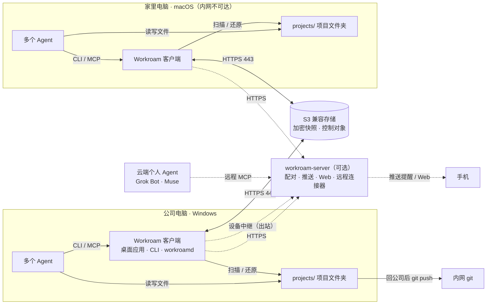

两台机器之间没有直连，只通过存储交换加密快照；内网 git 只在能访问内网的设备上推送。本机 Agent 通过 CLI 或本机 MCP 调用客户端；云端个人 Agent 只能经 `workroam-server` 的远程连接器，由在线设备代为执行（§16）。

## 3. 组件

### 3.1 客户端

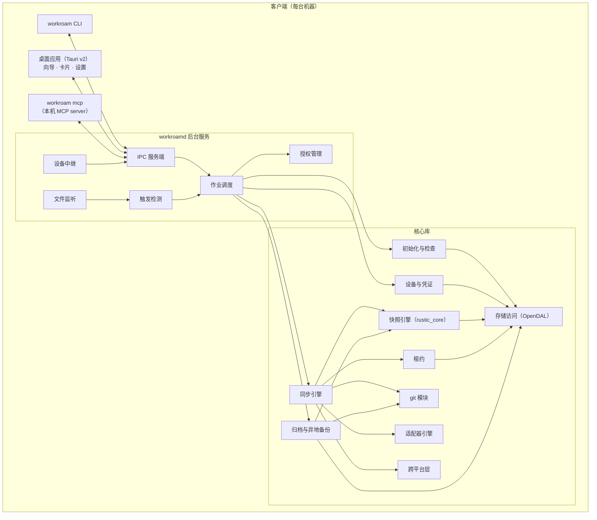

| 组件 | 职责 |
| --- | --- |
| `workroamd` | 后台服务：作业调度、触发检测、文件监听、授权管理、事件推送；开启异地备份的设备上还负责定期镜像；以用户级服务开机自启（macOS launchd、Windows 登录任务、Linux systemd 用户服务） |
| `workroam` CLI | 用户与本机 Agent 的命令行入口，所有命令支持 `--json`，与桌面应用功能对等（§17）；后台服务未运行时临时在前台启动一个实例；交互式启动时显示启动横幅（§17.3） |
| 桌面应用 | 托盘图标、初始化与项目接入向导、四种卡片、主窗口与设置界面；只负责展示和转达用户选择 |
| `workroam mcp` | stdio MCP server，把 MCP 工具调用转成 IPC 请求（v0.3） |
| 设备中继 | `workroamd` 内的模块：开启远程连接时与 `workroam-server` 保持出站连接，把云端 Agent 的工具调用作为 IPC 请求执行（v0.3） |

### 3.2 服务端

| 组件 | 必需 | 职责 |
| --- | --- | --- |
| S3 兼容存储 | 是 | RustFS（默认）、Garage、SeaweedFS，或 AWS S3、Cloudflare R2、阿里云 OSS 等 |
| Caddy | 自建时 | TLS 终结与自动证书，单一域名 443 |
| `workroam-server` | 否 | 中继模式：远程连接器与设备中继，可部署在 bot 的云端电脑上；完整模式：另加配对码与每设备凭证、推送转发、Web 界面静态资源（§18） |

### 3.3 四层数据

| 层 | 内容 | 同步策略 |
| --- | --- | --- |
| 项目层 | 代码仓库、文档、交付物 | 文件按内容哈希增量同步；仓库按代码同步模式处理（§11） |
| 规则层 | `AGENTS.md`、`.workroam/mcp.toml`、`.agents/skills/` | 正文与定义源同步；环境块与各 Agent 原生配置在本机生成 |
| Agent 状态层 | 各 Agent 的会话、记忆 | 按适配器白名单同步本项目相关部分；排除凭证；改写路径（v0.2） |
| 交接层 | `.handoff/HANDOFF.md` | 推送前由当前 Agent 写，随项目同步 |

## 4. 代码组织

单仓库、Cargo workspace；文档在 `docs/`，代码在 `crates/` 与 `apps/`。

```text
.
├── docs/                      # 产品与架构文档、ADR
├── crates/
│   ├── workroam-core/         # 公共类型：工作区、项目、设备、清单、配置模型、错误
│   ├── workroam-store/        # 存储访问（OpenDAL）、能力探测、条件写
│   ├── workroam-setup/        # 初始化步骤与全部检查项
│   ├── workroam-device/       # 配对码、设备登记、凭证创建与轮换
│   ├── workroam-lease/        # 租约与最新快照指针
│   ├── workroam-snapshot/     # 快照引擎接口与 rustic_core 实现
│   ├── workroam-archive/      # 项目归档与恢复、归档包、异地备份镜像、完整性校验
│   ├── workroam-git/          # bundle / WIP / 历史重建 / 三方合并（调用本机 git）
│   ├── workroam-adapters/     # 适配器加载、校验、导入与本机文件生成、会话迁移
│   ├── workroam-platform/     # 跨平台检查、原子落盘、链接、阻止休眠、服务安装、密钥库
│   ├── workroam-ipc/          # IPC 协议定义与传输，导出 JSON Schema
│   ├── workroam-engine/       # 推送 / 拉取 / 恢复流程编排、触发策略
│   ├── workroamd/             # 后台服务（二进制）
│   ├── workroam-cli/          # 命令行与本机 MCP server（二进制，名为 workroam）
│   └── workroam-server/       # 可选服务端（二进制；中继模式默认，完整模式为 cargo feature）
├── apps/
│   ├── desktop/               # Tauri v2 桌面应用
│   └── web/                   # Web 界面（浏览器内解密，WASM，v0.3）
├── adapters/                  # 适配器数据文件；skills/workroam/ 为 Workroam Skill 模板
└── deploy/                    # install.sh、Compose、Caddyfile、Helm Chart
```

依赖方向：`workroam-cli`、`workroamd`、`apps/desktop` 只通过 `workroam-ipc` 交互；`workroamd` → `workroam-engine` / `workroam-setup` / `workroam-device` / `workroam-archive` → 各功能 crate → `workroam-core`。

## 5. 存储布局

工作区位于一个桶内的前缀下（默认为空，即整个桶）。分两部分：**加密仓库**（rustic 格式，保存所有文件内容、git bundle 与 Workroam 清单）与 **控制对象**（需要条件写或在仓库之外被读取的小对象）。

```text
<bucket>/<prefix>/
├── repo/                          # rustic 仓库（全部内容加密）
│   ├── config
│   ├── keys/                      # 多个密钥文件包装同一个主密钥：加密密码、恢复密钥
│   ├── data/  index/  snapshots/
│   └── locks/
└── control/
    ├── workspace.json             # 布局版本、创建时间、仓库 ID（明文，不含敏感信息）
    ├── settings                   # 工作区级设置：快照保留策略（加密）
    ├── credentials                # 当前与待轮换的访问密钥（加密）
    ├── devices/<device-id>        # 设备登记：名称、系统、权限、最后活动（加密）
    └── projects/<pid>/
        ├── lease                  # 租约（加密，条件写）
        ├── head                   # 最新快照指针（加密，条件写）
        └── archive                # 归档记录（加密，仅已归档项目，v0.2）
```

- `<pid>` = `HMAC-SHA256(控制子密钥, 项目名)` 的前 16 字节十六进制，服务器上看不到项目名。
- 控制对象用主密钥派生的控制子密钥以 AEAD 加密；对象键只含随机 ID 或 HMAC。
- 所有项目共用一个加密仓库，跨项目去重；每个项目一条独立快照序列（rustic 快照标签 `workroam:project=<pid>`）。
- git bundle、WIP 提交与 Workroam 清单都作为快照中的虚拟文件放在 `.workroam-snapshot/` 下，随快照加密、去重、续传。
- 归档快照带 `workroam:archived` 标签，清理时跳过（§10.2）；异地备份是整个前缀的对象级镜像（§10.5）。

## 6. 配置与数据模型

### 6.1 项目目录

```text
projects/
└── proj-a/
    ├── AGENTS.md              # 共享规则 + 本机环境块（自动生成）
    ├── CLAUDE.md              # 仅一行 @AGENTS.md（需要时生成）
    ├── .workroam/
    │   ├── workroam.toml      # 本项目同步策略
    │   ├── mcp.toml           # MCP 唯一定义，含各系统覆盖项
    │   ├── env/               # windows.md / macos.md / linux.md
    │   └── local/             # 本机状态：哈希缓存、操作日志、映射表（不同步）
    ├── .agents/skills/        # Skills 唯一来源
    ├── .handoff/HANDOFF.md    # 跨 Agent 交接
    ├── repo-a/                # 代码仓库（每台机器自有 .git）
    └── docs/ deliverables/
```

Agent 在项目根目录启动，不在 `repo-a/` 里启动：部分 Agent 只从 git 仓库根往下找规则文件，在仓库里启动会看不到项目根的 `AGENTS.md`。

### 6.2 machine.toml（每台机器一份）

```toml
# ~/.workroam/machine.toml
name = "office-win"
os = "windows"
device_id = "d_7f3a…"
access = "read-write"            # read-write | read-only
root = 'D:\projects'              # 默认项目位置；每个项目可单独指定目录（§6.7）
reachable = ["git.corp.internal", "github.com"]
autostart = true                 # 开机自启

[workspace]
endpoint = "https://sync.example.com"
bucket = "workroam-office-win-8k2d"
prefix = ""
addressing = "path"              # path | virtual-host（初始化时探测）
capabilities = { conditional_create = true, conditional_overwrite = true, multipart = true }

[sync]
auto = "ask"                     # off | ask | auto
idle_minutes = 15
on_sleep = "ask"
on_wake = true                   # 开机联网后检查更新（v0.3）
agent_requires_approval = true
approval_timeout = "10m"
paused_until = ""                # workroam pause / 托盘“暂停自动同步”写入

[notify]
ntfy = ""                        # 可选：ntfy 主题地址
on_success = true                # 同步完成时提醒

[ui]
banner = true                    # 命令行启动横幅（§17.3）
lang = ""                        # 空为跟随系统

[projects.proj-a]
path = 'D:\projects\proj-a'
state = "bound"                  # pending | bound | missing

[projects.proj-b]
path = 'E:\work\customer-b'      # 自定义目录
state = "pending"
```

访问密钥与加密密码不写入此文件，只存在系统密钥库（macOS Keychain、Windows Credential Manager、Linux Secret Service）。

### 6.3 workroam.toml（每个项目一份）

```toml
# projects/proj-a/.workroam/workroam.toml
[sync]
exclude = ["node_modules/", "target/", ".venv/", "dist/"]
auto = "ask"                     # 可覆盖机器默认值

[agents]
claude = { state = true }
codex  = { state = true }
grok   = { state = false }

[repos.order-service]            # 内网仓库
path = "repo-a"
mode = "bundle"
history = "recent:50"            # full | recent:N | snapshot
branches = ["main", "feature/*"]
extras = ["docs/generated/"]

[repos.oss-tool]                 # 两地都能连 origin
path = "repo-b"
mode = "remote"
via = "origin"

[repos.scripts]
path = "repo-c"
mode = "files"
```

### 6.4 mcp.toml（MCP 唯一定义）

```toml
[servers.filesystem]
command = "npx"
args = ["-y", "@modelcontextprotocol/server-filesystem", "{project}/docs"]
targets = ["claude", "codex", "grok", "antigravity"]

[servers.filesystem.windows]
command = "cmd"
args = ["/c", "npx", "-y", "@modelcontextprotocol/server-filesystem", "{project}/docs"]

[servers.jira]
url = "https://jira.example.com/mcp"
headers = { Authorization = "Bearer ${secret:jira_token}" }
```

### 6.5 快照清单

每个快照内附带 `.workroam-snapshot/manifest.json`：

```jsonc
{
  "format": 1,
  "project": "<pid>",
  "parent": "<上一个快照 ID 或 null>",
  "restored_from": null,
  "device": { "id": "d_7f3a…", "name": "office-win", "os": "windows" },
  "created_at": "2026-10-29T18:02:11Z",
  "handoff_updated": true,
  "repos": {
    "order-service": {
      "mode": "bundle",
      "history": "recent:50",
      "exchanged": { "main": "<上次交换到的提交>" },
      "bundle": ".workroam-snapshot/git/order-service.bundle",
      "rebuild_map": ".workroam-snapshot/git/order-service.map",
      "wip": { "branch": "main", "commit": "<WIP 提交>" }
    }
  },
  "sessions": { "claude": ".workroam-snapshot/sessions/claude/" },
  "entries_meta": { "scripts/run.sh": { "mode": "0755" }, "link": { "symlink": "target" } }
}
```

文件内容、大小、修改时间由 rustic 快照树记录；清单补充父快照、恢复来源（由恢复生成的快照记录来源快照 ID）、仓库交换点、会话、可执行位与符号链接。

### 6.6 控制对象

```jsonc
// control/projects/<pid>/lease（解密后）
{ "holder": { "device_id": "d_7f3a…", "name": "home-mac" },
  "acquired_at": "2026-10-29T19:30:00Z", "renewed_at": "2026-10-29T21:10:00Z",
  "state": "held" }

// control/projects/<pid>/head（解密后）
{ "snapshot": "<快照 ID>", "parent": "<父快照 ID>", "device_id": "d_7f3a…",
  "created_at": "2026-10-29T18:02:11Z" }

// control/credentials（解密后）
{ "current": { "access_key": "…", "secret_key": "…", "scope": "read-write" },
  "next": null, "rotated_at": null }

// control/projects/<pid>/archive（解密后）
{ "name": "proj-a", "snapshot": "<归档快照 ID>", "archived_at": "2026-10-29T18:30:00Z",
  "device": { "id": "d_7f3a…", "name": "office-win" },
  "note": "一期交付完成", "size": 1288490188, "keep_history": false }
```

### 6.7 项目目录绑定

每台设备为每个项目记录一条绑定（`machine.toml` 的 `[projects.<名称>]`），项目目录的位置只属于本机，不同步。

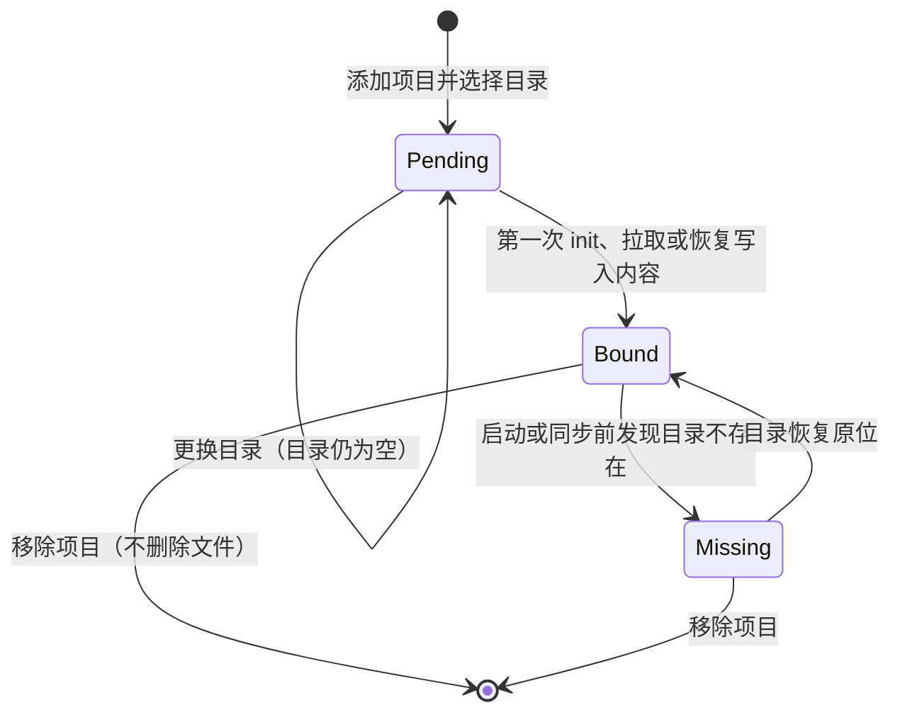

- **Pending**：已选目录但还没有写入任何内容；`project.move` 允许更换，前提是当前目录不存在或为空。
- **Bound**：目录已有内容并已同步。`.workroam/local/binding` 记录项目 ID、设备 ID 和绑定时的绝对路径，是本机比对改动的基准。此时 `project.move` 一律拒绝（退出码 18），提示先移除再重新添加。
- **Missing**：目录不存在，或其中 `binding` 的项目 ID 不符。暂停该项目的推送、拉取与自动触发，托盘警示；目录恢复原位后自动回到 Bound。
- **移除**（`project.remove`）：删除本机绑定、释放本机持有的租约（有未同步改动时先询问是否推送）；不删除、不修改目录中的任何文件，`.workroam/` 也原样保留。
- **重新添加**（`project.add`）：选择目录后按 §10.3 的场景判定：空目录直接拉取；目录中 `.workroam/` 的项目 ID 一致时只比对差异；其他内容拒绝。用户自己搬动过的文件夹因此可以原样接回。
- **选择目录时的检查**：可写；与本机其他项目目录互不嵌套；不是磁盘根目录、用户主目录或系统目录；位于 OneDrive、iCloud、Dropbox 等同步文件夹内时警告；Windows 路径过长时提示长路径设置。

## 7. 初始化引导与检查

### 7.1 入口与共用逻辑

桌面向导与 `workroam setup` 都调用 `workroamd` 的 `setup.*` 方法，步骤、检查项和结果完全一致。`workroam setup` 有交互式问答与非交互两种模式：标准输入是终端且没有给 `--yes` 时为交互模式，逐步提问，选项、默认值、校验规则和提示文本与向导相同（§17.1）；否则为非交互模式，缺少必要参数时以退出码 2 结束并列出缺少的参数。

```bash
# 新建工作区
workroam setup --new \
  --preset rustfs --endpoint https://sync.example.com \
  --access-key … --secret-key-stdin \
  --key-mode create --key-access read-write \
  --bucket auto --prefix "" \
  --password-stdin --recovery-key-out ./workroam-recovery.txt \
  --device-name office-win --root 'D:\projects' \
  --reachable git.corp.internal,github.com --auto ask --autostart --yes

# 加入已有工作区
workroam setup --join --pairing-code-stdin --password-stdin \
  --device-name home-mac --root ~/code \
  --project proj-a=~/code/proj-a --project proj-b --yes
```

| 向导步骤 | 非交互参数 |
| --- | --- |
| 选择路径 | `--new` / `--join` / `--from-backup`（v0.3） |
| 连接存储 | `--preset rustfs\|aws\|r2\|oss\|other`、`--endpoint`；自动识别可用 `--addressing path\|virtual-host`、`--region` 覆盖 |
| 访问密钥 | `--access-key`、`--secret-key-stdin`（或 `WORKROAM_SECRET_KEY`） |
| 密钥权限方式 | `--key-mode create\|current`、`--key-access read-write\|read-only`；当前密钥权限过宽时必须加 `--accept-broad-key`，否则检查失败（退出码 21） |
| 存储桶 | `--bucket auto\|<桶名>`、`--prefix` |
| 能力检查 | 无参数；任何失败项以退出码 21 结束 |
| 加密 | `--password-stdin`（或 `WORKROAM_PASSWORD`）、`--recovery-key-out <文件>`（必需） |
| 加入：配对码与解锁 | `--pairing-code-stdin`；忘记密码时 `--recovery-key-stdin` 代替 `--password-stdin` |
| 本机设置 | `--device-name`、`--root`、`--reachable <主机,…>`、`--auto off\|ask\|auto`、`--autostart` / `--no-autostart` |
| 加入：选择项目 | `--project <项目>[=<目录>]`（可重复）、`--all-projects` |
| 从异地备份恢复后重新加入 | `--as-device <设备名>`（v0.3） |
| 完成 | `--qr` 在终端显示配对二维码；配对码始终打印到标准输出 |

`--password-stdin`、`--secret-key-stdin` 与 `--pairing-code-stdin` 同时使用时，标准输入按参数出现的顺序逐行读取。从异地备份恢复使用 `workroam setup --from-backup`，参数为镜像的连接信息（v0.3）。

### 7.2 状态机

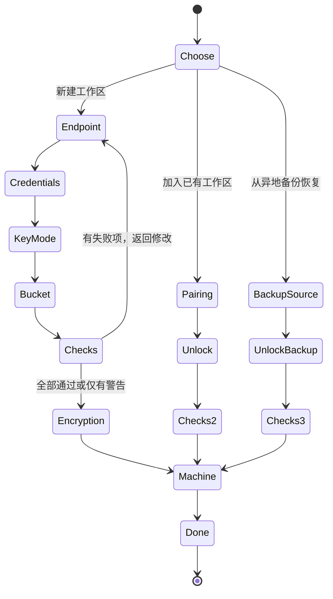

“从异地备份恢复”路径（v0.3）见 §10.5。

每一步的结果暂存在 `workroamd` 的初始化会话中，用户可回退；只有到达“完成”才会写入存储与本机配置，中途退出不留下任何远端对象（检查用的探测对象除外，检查结束即删除）。

### 7.3 密钥权限方式

| 方式 | 流程 | 适用 |
| --- | --- | --- |
| 创建专用密钥（v0.2） | 用户提供一次管理员凭证；Workroam 调用存储的管理接口创建只授权 `<bucket>/<prefix>` 的访问密钥（读写或只读）；验证新密钥可用后丢弃管理员凭证 | RustFS、Garage、SeaweedFS、AWS（IAM）等提供管理接口的存储；不支持时向导隐藏此项 |
| 使用当前密钥 | 探测该密钥能否列举所有桶、能否访问工作区之外的桶；权限过宽时警告并给出收窄步骤，用户确认后继续 | 所有存储 |

各存储管理接口的差异封装在 `workroam-device` 的 `KeyProvisioner` 接口后面，每种存储一个实现。

### 7.4 存储桶选择

| 选项 | 行为 |
| --- | --- |
| 选择已有桶 | 有列举权限时列出所有可见桶，否则手动输入；读取 `control/workspace.json` 判断是否已是工作区 |
| 默认新建 | 桶名 `workroam-<设备名小写化>-<4 位随机>`；创建失败（重名、无权限）时给出原因并允许改名 |
| 自定义桶名 | 实时校验：3–63 位，小写字母、数字、连字符，不以连字符开头或结尾，不是 IP 格式；再检查是否可创建 |
| 桶内前缀 | 可选；非空且非工作区的桶必须设置前缀 |

### 7.5 检查项

检查由 `workroam-setup` 中的检查注册表提供，初始化、`workroam doctor` 与桌面“检查”页共用。

| 检查 | 方法 | 失败级别 | 修复建议示例 |
| --- | --- | --- | --- |
| DNS 解析 | 解析端点主机名 | 失败 | 检查域名与 DNS 记录 |
| TLS 证书 | 建立 HTTPS 连接并校验证书链 | 失败 | 自建时检查 Caddy 是否已签发证书 |
| 凭证有效 | 签名请求返回非 403 | 失败 | 核对 Access Key 与 Secret |
| 时钟偏差 | 比较服务器 `Date` 与本机时间 | 超过 5 分钟为失败 | 开启系统时间同步 |
| 桶可访问 | `HeadBucket` | 失败 | 检查桶名与区域 |
| 读 / 写 / 删除 | 写入、读回、删除探测对象 | 失败 | 检查密钥权限范围 |
| 条件创建 | 对同一键两次 `If-None-Match: *` 写入，第二次应得 412 | 警告 | 将以乐观并发方式运行，说明影响 |
| 条件覆盖 | 用过期 ETag 执行 `If-Match` 写入，应得 412 | 警告 | 同上 |
| 分片上传 | 上传超过分片阈值的探测对象 | 警告 | 将限制单块大小 |
| 地址风格 | 先试虚拟主机风格，失败再试路径风格 | 失败（两者都不可用） | 检查反向代理配置 |
| 密钥权限范围 | 尝试列举所有桶、访问工作区之外的桶 | 警告 | 收窄权限或改用专用密钥 |
| 版本控制与生命周期 | 读取桶的版本控制与生命周期规则 | 警告 | 生命周期规则可能删除快照数据，建议关闭或排除工作区前缀 |
| 延迟与带宽 | 小对象往返与 8 MB 上传 / 下载测速 | 提示 | 显示预计同步耗时 |
| 本机 git | `git --version` 不低于 2.30 | 失败 | 升级 git |
| 长路径（Windows） | 读取 LongPathsEnabled | 警告 | 一键打开设置说明 |
| Agent 检测 | 按适配器的检测命令识别已安装 Agent 与版本 | 提示 | 版本不在支持范围时提示 |
| 异地备份（v0.3，开启时） | 镜像目标连通、可写（本地目录检查是否已挂载与剩余空间）；最近一次镜像是否成功、是否超过 3 天 | 警告 | 核对镜像凭证，或连接移动硬盘 / NAS 后立即备份 |

## 8. 设备与凭证

### 8.1 配对码

配对码格式为 `wr1:` 加 Base32 编码的二进制串，同时渲染为二维码：

```text
wr1:<salt 16B><nonce 24B><AEAD 密文>
密文 = XChaCha20-Poly1305(key = scrypt(加密密码, salt), 明文)
明文 = { endpoint, bucket, prefix, addressing, access_key, secret_key, scope, workspace_id }
```

- 新设备只需要配对码和加密密码（用户本来就要输入），不需要第三个秘密；
- 配对码本身被加密，即使截图泄露，没有加密密码也无法使用；
- 生成只读设备的配对码时，内含只读密钥（需工作区使用专用密钥方式，v0.2）。

### 8.2 设备登记

加入时写入 `control/devices/<device-id>`（加密），记录名称、系统、权限、加入时间；每次同步更新最后活动时间。设备列表由所有设备读取同一前缀得到。

### 8.3 密钥轮换与移除设备（v0.2）

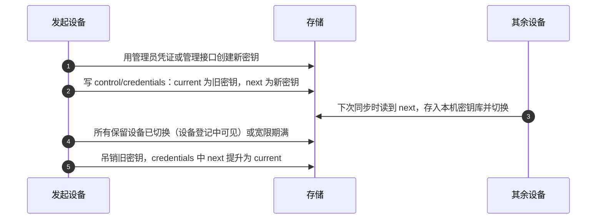

被移除设备的登记被删除，它不会再收到新密钥；旧密钥吊销后立即失去访问权限。存储不提供管理接口时，向导指导用户在存储控制台手动创建新密钥并粘贴，后续流程相同。

### 8.4 配合 workroam-server（v0.3）

服务端保存一个管理员凭证（只在服务端，不进入客户端），提供：

- `POST /pair`：已登录设备申请 6 位一次性配对码（10 分钟有效）；
- `POST /pair/redeem`：新设备用配对码换取为它单独创建的访问密钥与加密的工作区信息；
- `DELETE /devices/<id>`：吊销该设备的密钥。

工作区加密密码从不经过服务端；配对兑换得到的工作区信息仍需加密密码才能解锁仓库。

## 9. 同步协议

### 9.1 租约

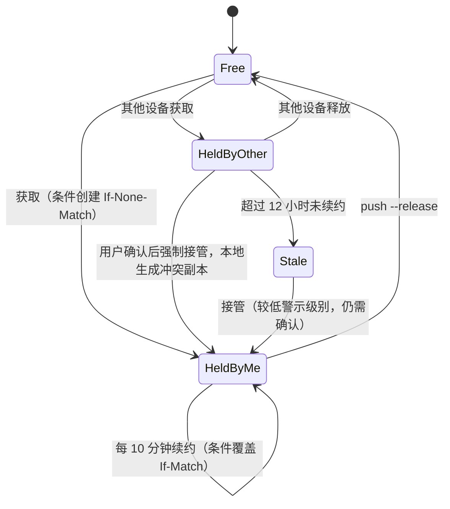

- 获取：`PUT control/projects/<pid>/lease` 带 `If-None-Match: *`；已存在则读取：本机持有则续约，`state = released` 视为空闲并以 `If-Match` 覆盖，否则进入“他人持有”流程。
- 续约、接管、释放都以 `If-Match: <ETag>` 覆盖写入，保证并发下只有一方成功；释放写入 `state = released`，不依赖条件删除。
- 只读设备不获取租约，拉取时只读取 `head`。
- 降级（不支持条件写）：不使用租约；写 `head` 前读取并比对父快照，服务器上的 `head` 不是本机快照的父快照即视为分叉。

### 9.2 推送

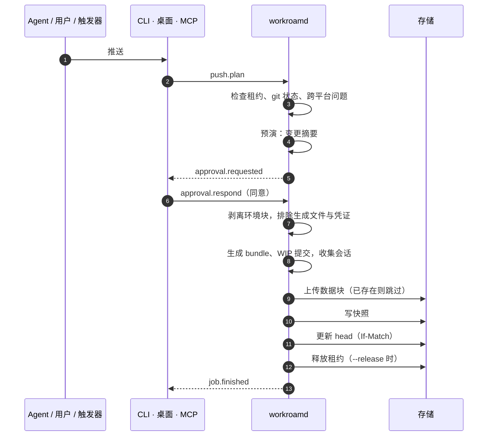

“写快照”之前任何一步中断，都只会留下未被引用的数据块，下次推送复用，清理时删除。

### 9.3 拉取

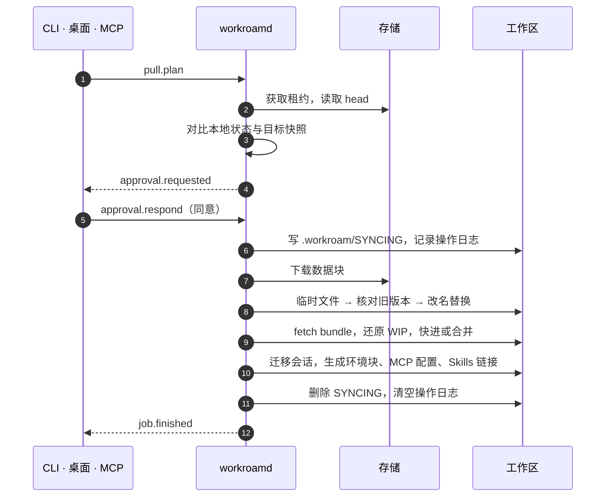

操作日志（`.workroam/local/oplog`）逐条记录已完成的替换；进程中断后重启时先重放日志、完成剩余步骤，再接受新作业。

### 9.4 冲突处理

| 对象 | 判定 | 处理 |
| --- | --- | --- |
| 文本文件 | 本地相对上次快照有修改，且目标快照也有修改 | 以上次快照为共同祖先三方合并；无法自动合并时保留两份（如 `xxx.conflict-home-mac.md`），交给 Agent 合并 |
| 二进制文件 | 同上 | 保留两份 |
| 代码 | git 分支分叉 | 交给 git 的 merge / rebase |
| 快照分叉 | 降级模式下同一父快照被推送两次 | 拉取时提示选择保留哪条线；另一条仍在历史中 |

### 9.5 防中断

- 同步期间阻止休眠（macOS `IOPMAssertion`、Windows `SetThreadExecutionState`、Linux `systemd-inhibit`）；
- Windows 关机时通过 `ShutdownBlockReasonCreate` 显示“Workroam 正在同步”（v0.3）；
- git 仓库处于 rebase 或 merge 中途时拒绝同步；
- 拉取期间的 `.workroam/SYNCING` 让 Agent 暂停写入（约定写在 `AGENTS.md` 共享正文中）。

## 10. 归档与恢复

| 能力 | 解决什么 | 首次交付 |
| --- | --- | --- |
| 从快照恢复 | 误删文件、改坏代码、想回到某次同步 | v0.1 |
| 项目归档 | 已完成的项目从各设备和日常同步中移出，永久保留，随时原样恢复 | v0.2（归档包 v0.3） |
| 异地备份（可选） | 存储本身整体丢失 | v0.3 |

### 10.1 从快照恢复（v0.1）

`restore.plan` 接收快照（快照 ID，或 `<项目>@<时间>` 取该时间之前最近的快照）、路径过滤和恢复目标：

| 目标 | 流程 |
| --- | --- |
| 原位置 | 获取租约 → 选中路径中本地有未同步改动的文件先另存为冲突副本 → 从快照还原选中路径（与拉取相同：临时文件、核对、改名替换、操作日志）→ 涉及代码仓库时，把当前分支位置另存为 `workroam/before-restore/<时间>` 分支，再用快照中的 bundle 与 WIP 提交还原 → 以当前 `head` 为父快照推送一个新快照，清单记录 `restored_from` |
| 其他目录 | 不获取租约、不写任何控制对象；把快照完整还原到指定目录，代码仓库从 bundle 克隆，并生成本机配置；只读设备也可执行 |

恢复从不删除或改写已有快照，所以一次恢复本身也可以被撤销。

### 10.2 项目归档（v0.2）

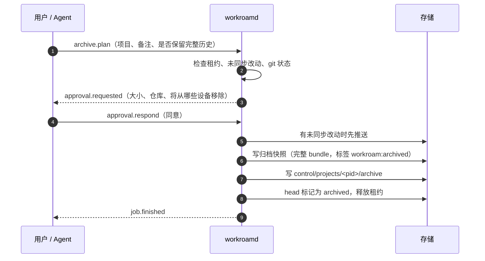

- **自包含**：日常同步的 bundle 是增量的，单个快照无法独立恢复。归档快照为每个仓库重新生成完整 bundle（遵守历史档位，`recent` / `snapshot` 档位的重建映射表一并保存），包含选定分支与 WIP 提交；remote 与 files 模式的仓库也打包，不依赖 origin 或中转库将来仍然存在。
- **内容**：项目文件、`AGENTS.md`、`.workroam/`、`.agents/skills/`、`HANDOFF.md`；按适配器白名单收集的会话（启用会话迁移时）。生成文件不保存，恢复时按当时的适配器重新生成。
- **状态**：`head` 写入 `state = archived`。对已归档项目的推送、拉取与自动触发一律拒绝（退出码 17），到达检测跳过该项目。
- **其他设备**：下次轮询读到 `archived` 后，把项目标记为已归档并停止同步，只发一条通知。归档从不删除、移动或修改任何设备上的本地文件，也不会自动发起；是否清理本地副本由用户自己决定。
- **保留**：`prune` 跳过带 `workroam:archived` 标签的快照。`keep_history = false` 时，归档之前的快照照常按保留策略过期；为 `true` 时，整条快照序列都不清理。
- **删除归档**：删除归档记录、归档快照与 `head`，下一次 `prune` 释放不再被引用的数据块。

### 10.3 恢复归档（v0.2）

`archive.restore` 先运行 `archive.restore_plan`，检查目标目录（默认是本机对该项目的绑定目录，没有绑定时为 `<root>/<项目名>`）并判定场景，结果放进确认卡片：

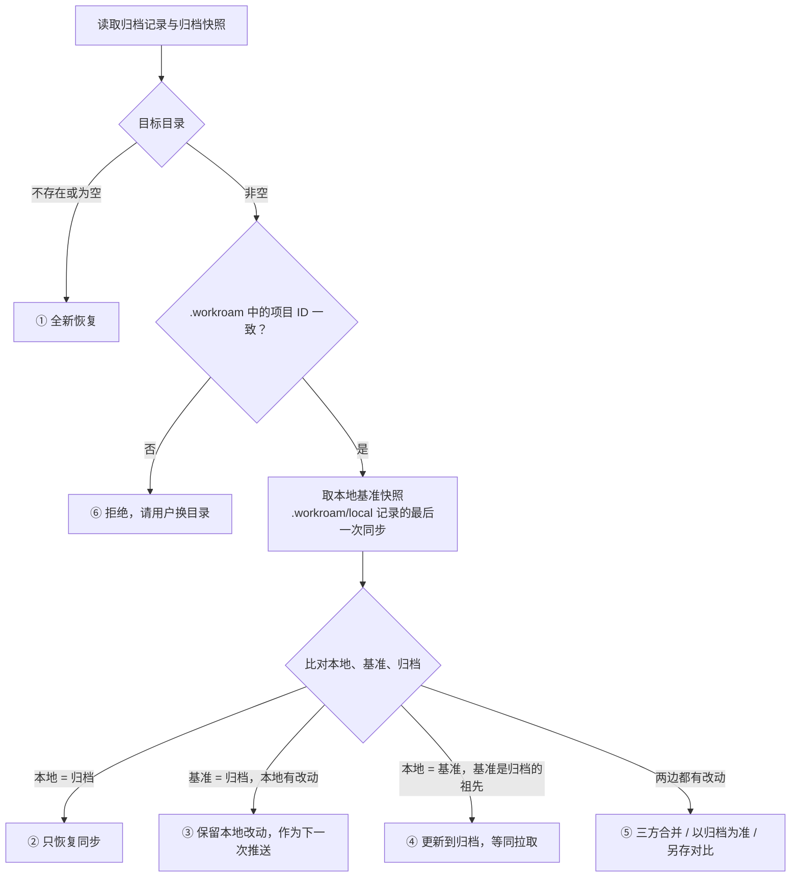

| 场景 | 实现 |
| --- | --- |
| ① 全新恢复 | 还原归档快照 → 从完整 bundle 克隆每个仓库，按 `workroam.toml` 恢复同步模式，remote 模式重新设置远端 |
| ② 一致 | 不下载文件，只写入本机状态 |
| ③ 本地较新 | 不改动本地文件；恢复同步后，本地改动在下一次推送中上传。用户改选“以归档为准”时按 ⑤ 的同名选项处理 |
| ④ 本地较旧 | 走正常拉取流程（§9.3），目标为归档快照 |
| ⑤ 两边都改过 | 合并：以基准快照为共同祖先，按 §9.4 三方合并或保留两份；以归档为准：被覆盖的本地文件先移到 `<项目名>.before-restore-<时间>/` 再还原；另存对比：转为 `archive.extract` 到用户指定的另一个目录，原目录不动，项目保持归档状态 |
| ⑥ 目录被占用 | 不写入任何文件，返回退出码 2 并说明原因 |

- **基准未知**：本地 `.workroam/local/` 缺失（例如手动复制过来的文件夹）时，以归档快照为基准逐文件比对：与归档相同的文件视为未改，不同的文件按 ⑤ 处理，绝不直接覆盖。
- **代码仓库**单独判定：本地没有仓库 → 从归档 bundle 克隆；有仓库 → `git fetch` 归档 bundle 到 `refs/workroam/archive/*` 后逐分支比较：本地包含归档提交则不动；归档领先则快进；分叉则不合并，建立 `workroam/archive/<分支名>` 分支，在环境块和卡片中提示用 git 合并。本地未提交的改动始终保留；归档中的 WIP 与本地未提交改动冲突时，WIP 另存为 `workroam/archive-wip` 分支。仓库处于 rebase 或 merge 中途时拒绝恢复（退出码 15）。
- **收尾**（①～⑤）：按本机当前的适配器生成环境块、MCP 配置、Skills 链接与规则引用 → 以归档快照为父推送一个新快照，`head` 恢复为 `active`，本机持有租约，删除归档记录 → 其他设备收到“项目已恢复”的提醒，可在项目列表中选择拉取；它们本地的旧副本同样按上述规则判定。
- **换电脑或换路径**：新设备先加入工作区；目标目录由用户选择，会话按新路径改写（§12.4）。

| 操作 | 流程 |
| --- | --- |
| 导出查看（`archive.extract`） | 与 §10.1 的“其他目录”相同：不获取租约、不改变归档状态，只读设备也可执行 |

归档只保存规则、MCP 与 Skills 的定义源，所以 Agent 升级、适配器格式变化后，恢复出来的配置仍然与本机匹配。

### 10.4 归档包（v0.3）

- `workroam archive export <项目> <文件>`：新建一个只含该项目归档快照的临时 rustic 仓库，打包为单个文件（`.wrarchive`），用导出时设置的密码加密（默认沿用工作区加密密码）；
- `workroam archive import <文件>`：用导出密码解锁，把快照复制进当前工作区的仓库，写入归档记录；可以导入到另一个工作区；
- 适合离线长期保存，或把项目交给使用另一个工作区的自己。

### 10.5 异地备份（可选，v0.3）

只用于存储本身整体丢失的情况，例如自建单盘存储损坏或桶被误删。使用云对象存储时通常不需要开启。

```toml
# ~/.workroam/machine.toml（只写在执行镜像的那台设备上）
[backup]
kind = "s3"                      # s3 | local
endpoint = "https://s3.eu-central-1.amazonaws.com"
bucket = "workroam-mirror-8k2d"
prefix = ""
# kind = "local" 时：path = "/Volumes/nas/workroam"
schedule = "daily"
delete_delay_days = 30
```

- **对象级镜像**：rustic 的数据包按内容寻址、写入后不再变化，镜像只需复制新增对象，不需要解密；`credentials` 与 `lease` 不复制。复制顺序为数据包与索引 → 快照 → 控制对象，保证镜像中的每个 `head` 引用的快照都已存在。镜像使用相同的密钥文件，可以用同一个加密密码或恢复密钥解锁。
- **删除延迟**：主存储中已删除的对象，在镜像中记录删除时间，满 `delete_delay_days` 天后才删除；误删或被恶意删除后仍可从镜像找回。
- **凭证**：镜像的访问密钥只存在执行镜像那台设备的系统密钥库中，不写入主存储，拿到主存储密钥的人无法访问镜像。
- **恢复**：初始化向导“从异地备份恢复”：连接镜像 → 用加密密码或恢复密钥解锁 → 运行全部能力检查 → 镜像成为新的主存储，写入新的 `credentials` 并生成新的配对码。其他设备重新加入时可选择“作为原设备”，保留设备 ID 与本机项目，本地文件与最新快照比对后只拉取差异。也可以先把镜像复制到一个新桶，再用新桶作为主存储。
- **校验**：`workroam verify [--backup] [--read-data <百分比>]` 检查索引、数据包与快照树互相一致，控制对象都能解密，每个 `head` 与归档引用的快照都存在；发现损坏时以退出码 22 结束。

## 11. 代码仓库同步

每台机器各自维护 `.git`；git 操作一律调用本机 git 命令行。

### 11.1 bundle 模式（v0.1）

- 首次：生成完整 bundle（按历史档位裁剪后）放入快照；另一端从该文件 `git clone`；
- 之后：只打包“上次交换点”之后的新提交与 WIP 提交，另一端 `git fetch` 后快进；
- 交换点记录在清单 `repos.<name>.exchanged`；
- 仓库目录不走文件同步，只有 `extras` 中的被忽略文件走文件同步。

### 11.2 历史档位

| 档位 | 家里能看到什么 | 首次传输量 | 回到内网设备时 |
| --- | --- | --- | --- |
| `full` | 全部分支和提交 | 约等于 `.git` 大小 | 直接快进，两边提交号一致 |
| `recent:N` | 选定分支最近 N 次提交，说明和作者保留 | 当前代码 + N 次改动 | 自动变基回真实历史 |
| `snapshot` | 只有当前代码 | 当前代码的压缩体积 | 自动变基回真实历史 |

`recent` 与 `snapshot` 的实现：

1. 取真实分支最近 N 个提交，用完全相同的树、说明和作者逐个 `git commit-tree` 重建，最底下一个作为新根；`snapshot` 即 N = 0；
2. 映射表“重建提交 ↔ 真实提交”随快照加密保存（清单 `rebuild_map`），任何能访问内网的设备都能使用；
3. 家里得到普通仓库，可正常 log、diff、多次提交；
4. 回到内网设备时执行 `git rebase --onto <真实提交> <重建提交> <分支>`，树相同不产生冲突；
5. 内网有新提交时，生成新的重建提交挂在家里上次的最新提交之后，保持增量。

默认值：内网仓库 `recent:50`；高度敏感仓库 `snapshot`；自己的项目与公开仓库 `full`。

### 11.3 WIP 提交

```bash
GIT_INDEX_FILE=.git/workroam-index git add -A
tree=$(GIT_INDEX_FILE=.git/workroam-index git write-tree)
wip=$(git commit-tree "$tree" -p HEAD -m "workroam wip")
```

用临时索引生成，不碰用户暂存区和业务分支；未跟踪但未被忽略的新文件也包含在内。bundle 模式一并打包；remote 模式推到 `workroam/wip/<分支名>`。到达后还原为未提交改动，再删除 WIP。

### 11.4 remote 模式（v0.2）

- origin 两地都能连：直接用 origin 中转；
- origin 是内网仓库：增加中转远端（Gitea 或私有托管仓库）；家里只与中转库交互，回到内网设备后先从中转库拉取，再推送 origin；
- Gitea 的 LFS 与附件存储可配置为 S3，指向同一个存储。

### 11.5 files 模式（v0.2）

- `git ls-files -co --exclude-standard` 列文件，自动遵守 `.gitignore`；
- 离开时记录分支与 HEAD 作为基线；回来时若 HEAD 与工作区都没动则直接覆盖，否则以基线为共同祖先用 `git merge-file` 逐文件合并；
- 可生成只含基线的影子仓库供 Agent 查看 diff，环境块注明“不要提交”。

### 11.6 模式推荐

`workroam init` 根据 origin 主机名和各设备 `reachable`：两地都能连 origin → `remote`；内网仓库 → `bundle` + `recent:50`；标记为敏感 → `bundle` + `snapshot`；无远端或轻量 → `files`。推荐结果写入环境块，告诉 Agent 每个仓库在本机能否推送。

### 11.7 注意事项

- 统一仓库级 `user.email`：内网 git 服务器常校验提交邮箱域名；
- 各仓库统一 `.gitattributes`（`* text=auto eol=lf`），各机器 `core.autocrlf=false`；
- 不会被带走：stash、未选中的分支、hooks、`.git/config`。

## 12. Agent 适配层

### 12.1 适配器数据文件

每个 Agent 一个 TOML 文件，放在 `adapters/` 并编译进二进制；用户可在 `~/.workroam/adapters/` 覆盖。

```toml
# adapters/claude-code.toml
id = "claude"
name = "Claude Code"
adapter_version = 1
agent_versions = ">=2.1.0"
detect = { command = "claude --version" }

[rules]
read = ["AGENTS.md"]
generate = [{ path = "CLAUDE.md", template = "@AGENTS.md\n", when = "missing" }]
import = ["CLAUDE.md"]

[skills]
source = ".agents/skills"
link = ".claude/skills"

[mcp]
path = ".mcp.json"
format = "claude-mcp-json"
import = true

[sessions]
dir = "~/.claude/projects/{path_key}/"
path_key = "claude-path-key"
rewrite_fields = ["cwd"]

[exclude]
paths = ["~/.claude/.credentials.json"]

[connect]
kind = "local"
skill = true                  # 链接 Workroam Skill（经 [skills].link）
mcp = "stdio"                 # 可选：把 workroam mcp 写入 [mcp].path
```

云端个人 Agent 的适配器只有 `[connect]` 段，没有规则、Skills、MCP 与会话的生成，因为它们不在本机读写项目：

```toml
# adapters/grok-bot.toml
id = "grok-bot"
name = "Grok Bot"
adapter_version = 1

[connect]
kind = "cloud"
transport = "streamable-http"
auth = "oauth"
setup = { open_url = "https://grok.com/connectors" }   # 打开连接器设置页
skill_upload = "manual"                                # 提示用户上传 Workroam Skill
webhook = "optional"                                   # 支持例行任务 webhook 触发

# adapters/muse.toml（节选）
# [connect]
# kind = "cloud"
# transport = "streamable-http"
# auth = "oauth"
# setup = { chat_prompt = "connect-remote-mcp" }      # 生成一段粘贴给 Agent 的设置说明
```

### 12.2 适配矩阵（实现时逐项实测确认）

| Agent | 规则 | 项目级 Skills | 项目级 MCP | 会话位置 | 版本 |
| --- | --- | --- | --- | --- | --- |
| Claude Code | `CLAUDE.md` 一行 `@AGENTS.md` | `.claude/skills`（链接） | `.mcp.json` | `~/.claude/projects/<路径键>/` | v0.1 |
| Codex | `AGENTS.md` 原生 | `.agents/skills` 原生 | `.codex/config.toml`（项目受信任后加载） | `~/.codex/sessions/` | v0.1 |
| Grok Build | `AGENTS.md`，也读 `CLAUDE.md` | `.grok/skills`，兼容 Claude Code | `.grok/config.toml`，也读 `.mcp.json` | `~/.grok/sessions/<路径键>/` | v0.2 |
| Antigravity | `AGENTS.md`；`.agents/rules` 引用 | `.agents/skills` 原生 | `.agents/mcp_config.json` | 实现时实测 | v0.2 |
| ZCode | 项目根 `AGENTS.md` | 实现时实测 | 实现时实测 | 实现时实测 | v0.2 |
| Pi | `AGENTS.md` | 实现时实测 | 实现时实测 | 实现时实测 | v0.2 |

云端个人 Agent（Grok Bot、Muse）的接入方式见 §16.4，首次交付 v0.3。

### 12.3 导入、生成与剥离

- **导入**（`workroam init`）：读取适配器 `import` 声明的已有文件，合并进 `AGENTS.md`、`.workroam/mcp.toml`、`.agents/skills/`，冲突时列出差异让用户选择；
- **生成**（每次拉取后）：渲染环境块；按当前系统合并 MCP 覆盖项、解析 `${secret:xxx}`，为每个目标 Agent 写原生配置；创建 Skills 链接；生成规则引用文件；全部记入本机排除列表；
- **剥离**（每次推送前）：去掉环境块，忽略全部生成文件。

### 12.4 会话迁移（v0.2）

- 每台设备上项目的绝对路径来自本机绑定（§6.7），会话中的路径按“发起设备的项目目录 ↔ 本机项目目录”映射，例如 `D:\work\proj-a` ↔ `/Users/me/code/proj-a`；
- 推送时按适配器白名单收集本项目相关会话，放入快照的 `.workroam-snapshot/sessions/`；
- 拉取时按适配器的路径键规则换成本机路径对应的目录，并改写 `rewrite_fields` 中的工作目录字段；
- 迁移失败只记录警告，不影响同步。

## 13. 自动同步与触发（v0.3）

| 触发 | 检测方式 | 动作 |
| --- | --- | --- |
| 空闲 | 文件监听发现改动，且 N 分钟内无新的写入，且无 Agent 进程在写 | 推送（不释放租约） |
| 合盖 / 睡眠 / 关机前 | macOS `NSWorkspaceWillSleepNotification`、Windows `WM_POWERBROADCAST` / `WM_QUERYENDSESSION`、Linux logind `PrepareForSleep` / `PrepareForShutdown` | 推送并释放租约 |
| 开机联网 | 网络可达变化后轮询各项目 `head`（之后每 5 分钟） | 有更新的快照时弹出到达卡片；全自动档直接拉取 |

档位决定是否弹出授权卡片：关闭（不触发）、询问（弹卡片）、全自动（直接执行，完成后提醒）。拉取会覆盖本地未同步改动时一律先询问。

## 14. 跨平台层

| 问题 | 处理 | 时机 |
| --- | --- | --- |
| 大小写冲突 | 检测并拒绝 | 推送前 |
| Windows 非法文件名 | 检测并拒绝 | 推送前 |
| 路径长度超过 260 | 提示开启 LongPathsEnabled，设置 `core.longpaths=true` | 推送前、拉取时 |
| 符号链接 | 记入快照；Windows 上目录用 junction，文件改为复制 | 拉取时 |
| 可执行位 | 记入快照；Windows 上保持原值，回到 macOS / Linux 时恢复 | 推送、拉取 |
| 换行符 | 仓库统一 `.gitattributes`，各机器 `core.autocrlf=false` | 接入项目时 |
| Unicode 规范化 | 快照内路径统一为 NFC | 推送前 |
| 文件被占用（Windows） | 重试，临时文件 + 改名替换落盘 | 拉取时 |
| 路径分隔符与根路径 | 快照统一用相对路径和 `/`；本机根路径由 machine.toml 提供 | 全程 |

平台相关的 git 配置（`core.filemode`、`core.ignorecase`、worktree 绝对路径等）留在每台机器自己的 `.git` 中。

## 15. 进程间通信协议

桌面应用、CLI、本机 MCP server、设备中继与 `workroamd` 之间使用语言无关的协议，桌面应用的实现可以独立替换（ADR-0002）。

- **传输**：macOS / Linux 使用 Unix domain socket（`$XDG_RUNTIME_DIR/workroam/workroamd.sock`；macOS 为 `~/Library/Application Support/Workroam/workroamd.sock`，权限 0600）；Windows 使用命名管道 `\\.\pipe\workroam-<用户 SID>`，ACL 仅当前用户；
- **编码**：每行一个 UTF-8 JSON 对象，遵循 JSON-RPC 2.0；服务端事件为无 `id` 的通知；
- **握手**：客户端先发 `hello { protocol: 1, client: "desktop" | "cli" | "mcp" | "relay", version }`，主版本不同则拒绝；设备中继发来的请求另带 `origin: { connection_id, agent }`，用于授权和卡片上的发起方；
- **定义**：`workroam-ipc` 中的类型同时导出 JSON Schema。

| 方法 / 事件 | 方向 | 说明 |
| --- | --- | --- |
| `setup.begin` / `setup.step` / `setup.check` / `setup.commit` / `setup.cancel` | 客户端 → 服务端 | 初始化会话：提交每一步输入、运行检查、最终写入 |
| `doctor.run` | 客户端 → 服务端 | 运行全部检查 |
| `device.pairing_code` / `device.list` / `device.remove` | 客户端 → 服务端 | 设备管理 |
| `project.scan` / `project.init` | 客户端 → 服务端 | 接入项目 |
| `project.add` / `project.list` / `project.move` / `project.remove` | 客户端 → 服务端 | 本机添加项目并选择目录、更换目录（仅 Pending）、移除项目（§6.7） |
| `status` | 客户端 → 服务端 | 后台服务、租约、最新快照、本地改动、仓库能否推送、到达的新进度；每次调用重新检查项目目录绑定 |
| `handoff.read` | 客户端 → 服务端 | 交接文档的结构化摘要与模板 |
| `lease.takeover` | 客户端 → 服务端 | 强制接管租约（先生成冲突副本） |
| `push.plan` / `pull.plan` / `restore.plan` | 客户端 → 服务端 | 预演，返回作业 ID 与变更摘要 |
| `job.start` / `job.cancel` / `job.list` | 客户端 → 服务端 | 启动、取消作业，列出进行中的作业 |
| `approval.list` / `approval.respond` | 客户端 → 服务端 | 待确认的授权；同意 / 稍后 / 拒绝，可带“1 小时内不再询问” |
| `history.list` / `history.show` | 客户端 → 服务端 | 同步历史；一次快照改动的文件 |
| `archive.plan` / `archive.list` / `archive.restore_plan` / `archive.restore` / `archive.extract` / `archive.delete` | 客户端 → 服务端 | 项目归档与恢复（v0.2） |
| `archive.export` / `archive.import` | 客户端 → 服务端 | 归档包（v0.3） |
| `backup.configure` / `backup.run` / `verify.run` | 客户端 → 服务端 | 异地备份与完整性校验（v0.3） |
| `prune.run` | 客户端 → 服务端 | 按保留策略清理快照（v0.2） |
| `config.list` / `config.get` / `config.set` | 客户端 → 服务端 | 读写本机、项目与工作区设置（§17.2） |
| `agent.webhook` | 客户端 → 服务端 | 配置云端 Agent 的事件 webhook（v0.3） |
| `credentials.update` | 客户端 → 服务端 | 验证并更新本机密钥库中的访问密钥 |
| `password.change` / `password.reset` | 客户端 → 服务端 | 修改加密密码；用恢复密钥重设（替换仓库密钥文件，不重新加密数据） |
| `sync.pause` / `sync.resume` | 客户端 → 服务端 | 暂停 / 恢复自动同步（v0.3） |
| `agent.list` / `agent.connect` / `agent.disconnect` | 客户端 → 服务端 | 本机 Agent 检测与补齐配置；云端 Agent 连接的创建、授权与撤销（§16） |
| `subscribe` | 客户端 → 服务端 | 订阅事件流 |
| `setup.check_result` | 服务端 → 客户端 | 单项检查结果（逐项推送，界面实时刷新） |
| `approval.requested` | 服务端 → 客户端 | 需要授权（卡片内容） |
| `job.progress` / `job.finished` / `job.failed` | 服务端 → 客户端 | 进度与结果 |
| `arrival` | 服务端 → 客户端 | 服务器上有更新的快照 |

### CLI 退出码

| 码 | 含义 |
| --- | --- |
| 0 | 成功 |
| 2 | 参数错误 |
| 10 | 用户拒绝 |
| 11 | 授权超时（按“稍后”处理） |
| 12 | 租约被其他设备持有 |
| 13 | 跨平台检查未通过 |
| 14 | 存在需要处理的冲突 |
| 15 | git 仓库处于 rebase / merge 中途 |
| 16 | 只读设备不能执行此操作 |
| 17 | 项目已归档 |
| 18 | 项目目录已同步，不能更换（需先移除再重新添加） |
| 20 | 网络或存储错误（可重试） |
| 21 | 检查未通过（初始化或 doctor） |
| 22 | 校验发现数据损坏 |
| 30 | 后台服务不可用 |

## 16. Agent 接入

Agent 分两类（ADR-0008）。本机 Agent 与项目在同一台电脑上，能执行命令，命令行就够用；云端个人 Agent 运行在服务商的云端，碰不到用户电脑，只能添加远程 MCP 连接器，因此由可选的 `workroam-server` 提供远程连接器，再由用户在线的设备代为执行。

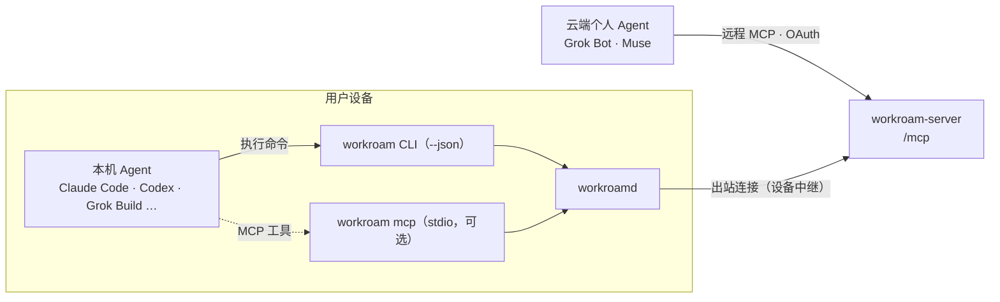

| 入口 | 适用 | 传输 | 首次交付 |
| --- | --- | --- | --- |
| CLI + `--json` + Workroam Skill | 本机 Agent（基础接口） | 子进程 | v0.1 |
| `workroam mcp` | 偏好工具调用的本机 Agent | stdio | v0.3 |
| 远程连接器 | 云端个人 Agent | Streamable HTTP + OAuth，经设备中继 | v0.3 |

所有入口最终都是 `workroamd` 的 IPC 客户端，授权规则一致；远程入口在此基础上更严格（§16.4）。

### 16.1 CLI 与 JSON 输出（v0.1）

- 所有命令支持 `--json`：标准输出只输出一个 JSON 对象（长时间作业为每行一个 JSON 事件，最后一行为结果），带 `schema_version`；人类可读的提示改走标准错误；
- 等待授权时输出 `{"event":"approval_pending","job_id":…,"timeout_s":600}`，Agent 据此提示用户去卡片上确认；
- 退出码与 §15 一致，JSON 结果中的 `code` 字段与退出码相同；
- JSON 结构由 `workroam-ipc` 的类型生成 JSON Schema，作为公开接口保持向后兼容。

### 16.2 Workroam Skill（v0.1）

- 模板在 `adapters/skills/workroam/SKILL.md`，随二进制发布；接入项目时写入 `.agents/skills/workroam/`（共享源文件，参与同步），按各适配器的 `[skills]` 链接到 Agent 的 Skills 目录；
- 内容：触发语（“我要下班了”“同步下来”等）、推送前先更新 `HANDOFF.md`、调用哪条命令与参数、怎样等待确认、怎样解读 JSON 结果与退出码、冲突时怎么办；
- `AGENTS.md` 中的“工作区同步”约定只保留几行并指向该 Skill，供不支持 Skills 的 Agent 使用；
- 同一份 Skill 也提供给云端个人 Agent 上传，云端版本把命令换成远程工具名。

### 16.3 本机 MCP server（v0.3）

`workroam mcp` 以 stdio 运行；接入项目时按适配器的 `[connect].mcp` 写入各 Agent 的项目级 MCP 配置，用户可关闭。

| 工具 | 参数 | 行为 |
| --- | --- | --- |
| `status` | — | 返回租约、最新快照、本地未同步改动、本机能推送的仓库 |
| `push` | `release: bool` | 发起推送；等待用户在卡片上确认，返回结果或“被拒绝 / 超时” |
| `pull` | — | 发起拉取；同样需要确认 |
| `history` | `limit` | 返回最近的快照列表 |
| `handoff_template` | — | 返回 HANDOFF.md 模板与本次需要填写的提示 |

MCP 调用只是另一个 IPC 客户端，授权规则与 CLI 完全相同。

### 16.4 远程连接器与设备中继（v0.3）

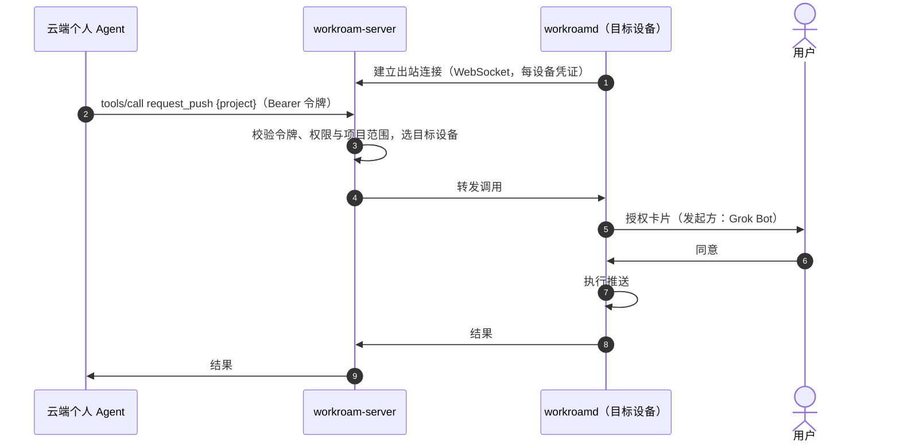

**端点与传输**

- `https://<域名>/mcp`：MCP Streamable HTTP；`https://<域名>/oauth/*`：OAuth 2.1 授权服务器（授权码 + PKCE，支持动态客户端注册）；经 Caddy 走同一个 443 端口；
- 设备中继：开启远程连接的设备由 `workroamd` 主动连接 `wss://<域名>/relay`，用绑定时登记的设备密钥（Ed25519）签名认证（§18.3），断线指数退避重连；设备不需要公网地址。

**授权（服务端没有用户账号，授权在设备上完成）**

1. 用户在桌面“设置 → Agent”中选择要连接的云端 Agent，桌面应用调用 `agent.connect`；还没有中继时先部署并绑定一个（§18.3），服务端生成该连接的地址；
2. 云端 Agent 发起 OAuth 授权，服务端授权页显示 6 位确认码，并通过中继通知在线设备；
3. 设备弹出授权卡片：Agent 名称、确认码、权限（只读 / 可请求同步）、可访问的项目（默认不选）；
4. 用户核对确认码并同意，设备用设备密钥签名授权记录发给服务端，服务端发放访问令牌（1 小时）与刷新令牌（30 天，可撤销）；
5. 授权记录（连接 ID、Agent、权限、项目范围）加密保存为控制对象，所有设备可见；撤销在任一设备上操作，服务端立即作废令牌；
6. 设备执行每个中继请求前，用自己保存的授权记录核对连接 ID、工具与项目，不信任中继转来的权限声明。中继即使被篡改，也只能调用已授权的只读工具，推送与拉取仍要在设备上确认。

**工具**

| 工具 | 权限 | 行为 |
| --- | --- | --- |
| `list_projects` | 只读 | 连接可访问的项目及各项目的租约持有设备、最近同步时间 |
| `status` | 只读 | 指定项目的状态（同 CLI `status`），并标注目标设备是否在线 |
| `history` | 只读 | 最近的快照列表（编号、时间、设备、变更概要） |
| `read_handoff` | 只读 | 返回该项目最新快照中的 `HANDOFF.md` |
| `request_push` | 可请求同步 | 请求持有租约的设备推送，可选释放租约；每次都弹出确认卡片 |
| `request_pull` | 可请求同步 | 请求指定设备拉取；每次都弹出确认卡片 |

**目标设备与离线**

- 默认目标为持有该项目租约的设备；没有租约时为用户在设置中指定的“默认代理设备”；
- 目标设备离线时，只读工具返回“设备离线”及最后在线时间；`request_push` / `request_pull` 由服务端排队，最多 24 小时，设备上线后弹出卡片，过期即丢弃；
- 服务端只在内存中转发调用，不持久化参数与结果；日志只记录连接 ID、工具名、目标设备与结果码。

**数据边界**

- TLS 在服务端终止，调用参数和结果经过中继；返回给云端 Agent 的内容本来就会进入服务商云端，不受端到端加密保护，所以把中继放在 bot 的云端电脑上不会扩大暴露范围；
- 远程连接默认关闭，在设备上按项目开启；只返回状态摘要和 `HANDOFF.md`，不返回其他文件内容，不传任何密钥；
- 远程发起的推送与拉取不受“1 小时内不再询问”影响，每次都要确认。

### 16.5 一键接入

| Agent 类型 | 用户操作 | Workroam 做的事 |
| --- | --- | --- |
| 本机 Agent | 接入项目（`workroam init` 或桌面“接入项目”）；之后新装的 Agent 在“设置 → Agent”点“接入” | 按适配器生成规则引用、MCP 配置、Skills 链接与 Workroam Skill，覆盖本机所有已接入项目 |
| 云端个人 Agent | “设置 → Agent → 连接 <Agent>”；没有中继时把部署说明发给 bot 并粘贴回它报告的地址；在对方添加连接器，回到卡片核对确认码 | 生成部署说明与绑定码并完成绑定；生成连接地址；按适配器 `[connect].setup` 打开对方的连接器页面，或复制一段可直接粘贴给 Agent 的设置说明；提供 Workroam Skill 文件；完成授权 |

### 16.6 事件 webhook（可选，v0.3）

- 用户可为某个云端 Agent 配置 webhook 地址与密钥（例如 Grok Bot 例行任务的 webhook 触发器），密钥存系统密钥库；
- 推送完成、失败、到达时，由产生事件的设备直接 POST，内容只有项目名、事件类型、设备、时间与变更概要；
- 发送失败只记录，不重试超过 3 次，不影响同步。

## 17. 命令行与界面一致性

桌面应用与命令行功能对等（PRD §8.22、ADR-0009）。逐项对照见 [cli-ui-parity.md](cli-ui-parity.md)。

### 17.1 实现原则

- **一项功能，一个 IPC 方法。** 功能的业务逻辑、校验与默认值都在 `workroamd` 一侧；桌面应用与命令行只是两个 IPC 客户端，只负责收集输入和展示结果。任何一侧都不允许自行实现另一侧没有的逻辑。
- **同一份文本。** 选项文字、校验提示、检查项的修复建议、确认提示放在 `workroam-core` 的中英双语文本资源中，桌面应用通过 IPC 结果中的文本键取用，命令行直接链接同一资源。
- **同样的确认。** 桌面上需要用户确认的操作（授权、删除归档、移除设备、权限过宽的密钥），命令行在交互模式下给出同样的提示；非交互模式必须用显式参数（`--confirm`、`--accept-broad-key` 等）确认。`--yes` 只回答命令内的一般确认，不能代替同步授权与需要输入名称的确认。
- **同一版本交付。** 一项功能的两端入口在同一版本发布；一侧未完成时，这项功能整体推迟。

### 17.2 命令结构与设置键

命令按“名词 + 动词”组织（`project add`、`archive restore`），日常高频命令保留顶层动词（`push`、`pull`、`status`、`approve`）。命令默认作用于当前目录所在的项目；`-p, --project` 指定其他项目，`--all` 作用于本机全部项目。全局参数见 PRD §8.17.2。

`workroam config` 与桌面“设置”页读写同一组键：

| 键 | 范围 | 存放位置 |
| --- | --- | --- |
| `device.name`、`root`、`reachable`、`autostart` | 本机 | `machine.toml`（`device.name` 对应顶层的 `name`；修改设备名同时更新设备登记） |
| `sync.auto`、`sync.agent_requires_approval` | 本机，项目可覆盖（`-p`） | `machine.toml` / `workroam.toml` |
| `sync.idle_minutes`、`sync.on_sleep`、`sync.on_wake`、`sync.approval_timeout` | 本机 | `machine.toml` |
| `notify.ntfy`、`notify.on_success` | 本机 | `machine.toml` |
| `ui.banner`、`ui.lang` | 本机 | `machine.toml` |
| `mcp.enabled` | 本机，项目可覆盖 | `machine.toml` / `workroam.toml`（v0.3） |
| `remote.enabled`、`remote.default_device` | 项目 / 工作区 | 连接授权记录所在的控制对象（§16.4，v0.3） |
| `retention.days`、`retention.weekly` | 工作区 | `control/settings`（加密） |

访问密钥与加密密码不经过 `config`：分别用 `workroam credentials update` 与 `workroam password change / reset`（桌面设置“存储”与“加密”），只写系统密钥库与仓库密钥文件。

### 17.3 启动横幅

**显示条件**（PRD CLI-01、CLI-02）：

```text
show_banner =
    命令 ∈ { workroam（无参数）, workroam setup（交互模式）, workroam init（交互模式） }
    且 标准输出与标准错误都是终端
    且 未指定 --json、--quiet、--no-banner
    且 环境变量 WORKROAM_NO_BANNER ≠ "1"、未设置 CI、TERM ≠ "dumb"
    且 设置 ui.banner ≠ false
```

交互模式指标准输入是终端且没有给 `--yes`。Agent 调用命令时标准输出不是终端，因此永远看不到横幅；隐藏横幅不改变其余输出。每个进程最多输出一次。

**内容**：ASCII 字标 5 行、路线 1 行、版本行 1 行，宽 52 列，左侧留 1 列空白。路线 `(o)---*---(o)` 对应 Logo 的含义：两端圆环是两台设备，中间的光点是工作区。

```text
 __        __         _
 \ \      / /__  _ __| | ___ __ ___   __ _ _ __ ___
  \ \ /\ / / _ \| '__| |/ / '__/ _ \ / _` | '_ ` _ \
   \ V  V / (_) | |  |   <| | | (_) | (_| | | | | | |
    \_/\_/ \___/|_|  |_|\_\_|  \___/ \__,_|_| |_| |_|
 (o)----------------------*-----------------------(o)
 workroam <版本> · <标语>
```

标语随界面语言：中文“带着 AI Agent 工作区，在每台电脑之间漫游”，英文 “Hand off your AI agent workspace between machines.”。版本取 `CARGO_PKG_VERSION`，开发构建附加 `-dev+<提交短哈希>`。终端宽度小于 60 列时改为单行简版 ` (o)-*-(o)  workroam <版本>`；无法取得宽度时按完整版输出。

**颜色**：

| 元素 | 颜色 |
| --- | --- |
| 字标与路线的每个非空白字符 | 按所在列从 Roam Blue `#2F6BFF`（第 1 列）经 Lagoon `#1FB6E8`（中间）线性渐变到 Mint `#2ED3B7`（第 52 列） |
| 路线中间的 `*` | 琥珀色 `#FFB547`，粗体 |
| 版本行 | `workroam` 粗体默认前景色；版本号暗色；标语默认前景色 |

终端能力按顺序判定并降级：`--color never` 或设置了 `NO_COLOR` → 单色；`COLORTERM` 为 `truecolor` / `24bit` 或在 Windows Terminal 中（`WT_SESSION`）→ 24 位色；`TERM` 含 `256color` → 取 xterm 256 色中最接近的颜色；其他 → 16 色（字标按列三等分为亮蓝、亮青、亮绿，光点为亮黄）。Windows 旧控制台由 anstream 启用虚拟终端序列，失败时输出单色。字标只用 ASCII 字符，任何代码页下都不会乱码；版本行中的中文经 Windows 控制台的宽字符接口输出。

**实现**：`crates/workroam-cli/src/banner.rs`，字标为常量，渐变颜色在编译期按列算好；横幅写到标准错误，随后空一行。不访问网络，也不连接后台服务；`workroam` 无参数时，横幅之后的状态摘要才调用 `status`，后台服务不可用时摘要改为提示，不影响横幅。

**示例**：彩色效果见 [assets/cli-banner.svg](assets/cli-banner.svg)（`workroam` 无参数时横幅与状态摘要的完整首屏）。

### 17.4 一致性检查

`crates/workroam-ipc/parity.toml` 是功能清单，每个面向用户的功能一条：

```toml
[[feature]]
id = "push.release"
ipc = "push.plan"
cli = "workroam push --release"
desktop = "project.detail.push_release"     # 桌面应用中的操作 ID
label = "推送并释放租约"
since = "0.1"

[[exempt]]
side = "cli"                                 # cli | desktop
item = "workroam mcp"
reason = "给 Agent 的 stdio 接口，不面向人"
```

CI 中的 `cargo test -p workroam-ipc parity` 检查：

1. `workroam-ipc` 中每个标记为面向用户的方法，至少出现在一条 `feature` 中；
2. 每条 `cli` 能被真实的 clap 命令定义解析（`workroam_cli::command().try_get_matches_from`）；
3. 每条 `desktop` 存在于桌面应用导出的操作清单（`apps/desktop/actions.json`，由桌面应用构建生成）；
4. 两端入口的 `since` 一致；
5. `docs/cli-ui-parity.md` 由清单生成（`cargo xtask parity-doc`），与仓库中的文件没有差异。

任何一项不通过，构建失败。

## 18. 轻量服务端（可选）

`workroam-server` 是一个可选的单文件二进制，分两种模式。云端个人 Agent 只需要中继模式；完整模式保留给自建存储的用户。

| | 中继模式（默认） | 完整模式（`--full`） |
| --- | --- | --- |
| 功能 | 远程连接器（`/mcp`、`/oauth/*`）与设备中继（`/relay`） | 中继模式全部功能，加配对码与每设备凭证（§8.4）、推送转发、Web 界面 |
| 持有的秘密 | 无存储凭证、无加密密钥；只有绑定设备的公钥、授权记录与令牌哈希 | 存储管理员凭证 |
| 读写存储 | 不读写 | 签发 / 吊销设备密钥 |
| 可以部署在 | bot 的云端电脑、任意 VPS、用户自己的服务器 | 只能是用户自己的服务器 |

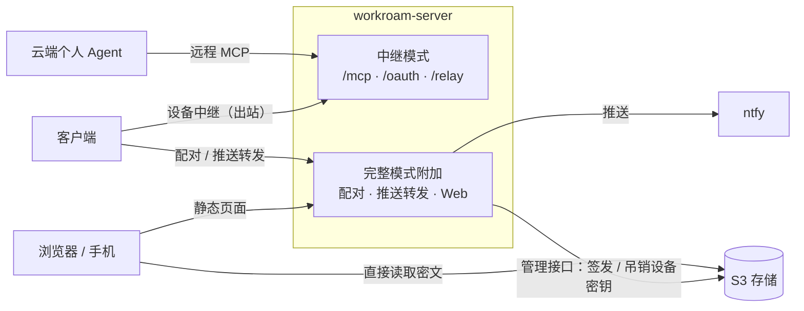

### 18.1 轻量要求

中继模式要能直接跑在 bot 的云端电脑这类受限环境里：

| 项 | 要求 |
| --- | --- |
| 形态 | 单个静态链接二进制（Linux x86_64 / aarch64 用 musl；另提供 macOS、Windows 构建和容器镜像），不超过 15 MB |
| 依赖 | 不需要 Docker、数据库、系统服务管理器或 root 权限；不依赖 OpenSSL |
| 资源 | 空闲内存不超过 30 MB，CPU 接近 0；启动不超过 1 秒 |
| 网络 | 只监听一个端口（默认 `127.0.0.1:8787`，`--listen` 可改）；只需要出站 HTTPS 和这一个入站端口 |
| 状态 | 一个 JSON 文件（默认 `~/.workroam-server/state.json`，权限 0600，小于 1 MB）：绑定设备的公钥、授权记录、令牌哈希；排队中的请求只在内存中，重启即丢弃 |
| 持久性 | 状态文件丢失或换一台机器重新部署，只需重新绑定与授权，不丢任何用户数据 |

实现上复用 `workroam-ipc` 的类型与 rmcp 的 Streamable HTTP 传输，HTTP 用 axum，TLS 用 rustls；不链接快照引擎、存储访问和 git 模块。完整模式的功能放在 cargo feature 之后，中继模式的构建不包含它们。

### 18.2 公网 HTTPS 地址

云端 Agent 从服务商的云端访问连接器，设备从各自的网络访问中继，所以中继需要一个公网 HTTPS 地址。三种方式按优先级：

1. **平台提供的端口地址**：云端电脑能把本机端口映射成公网 HTTPS 地址时，用 `--public-url <地址>` 告诉中继；
2. **内置出站隧道**：`--tunnel` 启动 cloudflared 隧道（缺少时自动下载到状态目录），无需入站端口；临时隧道的地址在重启后会变，建议配置命名隧道获得固定地址；
3. **自己的服务器**：放在 Caddy 后面，`install.sh --with-server` 自动配置。

公网地址不是 HTTPS 时，中继拒绝发放 OAuth 令牌。

### 18.3 部署到 bot 的云端电脑与绑定

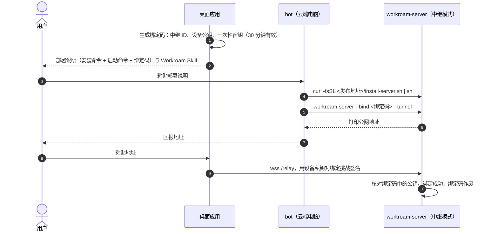

- 部署说明是一段 bot 能直接执行的文字，Workroam Skill 同时告诉 bot：保持中继在后台运行、云端电脑重启后重新启动、地址变化时告诉用户；
- 绑定之后，其他设备在桌面上点“加入这个中继”，由已绑定的设备在卡片上确认后，把新设备公钥登记到中继；
- 一个中继可以服务多个云端 Agent 连接；多个中继互不相干，撤销一个不影响其他。

### 18.4 完整模式

- **配对与设备凭证**：见 §8.4；
- **推送转发**：客户端把完成、失败、到达事件发给服务端，服务端转发到配置的 ntfy 主题；未部署服务端时客户端直接调用 ntfy；
- **Web 界面**：`apps/web` 是静态页面，快照读取与解密逻辑编译为 WASM，在浏览器中用加密密码解锁仓库并直接从 S3 读取密文（浏览器使用只读密钥，存储需配置 CORS）；服务端只提供页面与配对，永远看不到明文；
- `install.sh --with-server` 时与存储、Caddy 一起以容器部署，默认开启完整模式。

## 19. 安全架构

### 19.1 密钥层次

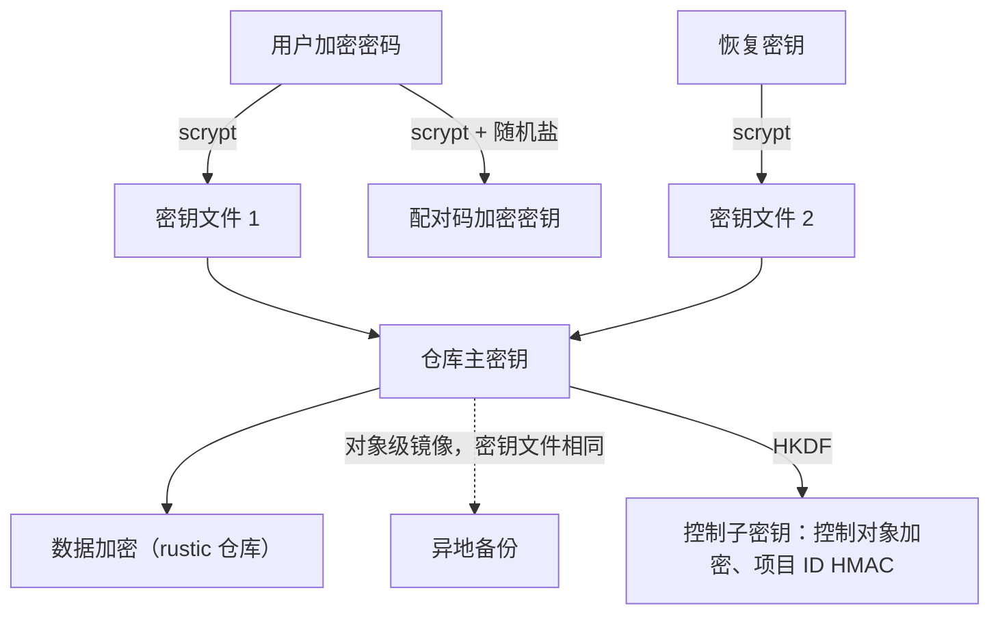

- rustic 仓库支持多个密钥文件包装同一主密钥：恢复密钥即额外的一个密钥文件，修改密码无需重新加密数据；
- 异地备份是对象级镜像，密钥文件随之复制；修改加密密码后，下一次镜像即带上新的密钥文件，旧密钥文件在删除延迟期满后才从镜像中删除；
- 访问密钥与加密密码只保存在系统密钥库；可选“每次同步都询问加密密码”。

### 19.2 威胁与对策

| 威胁 | 对策 |
| --- | --- |
| 存储被入侵或存储服务商可见数据 | 端到端加密；控制对象加密；对象键不含项目名与设备名 |
| 访问密钥泄露 | 只授权单个桶或前缀；移除设备即轮换；配合服务端时每设备独立凭证 |
| 存储整体丢失（自建单盘损坏、桶被误删） | 可选异地备份；从镜像恢复整个工作区 |
| 主存储密钥被盗后数据被删除或被勒索 | 异地备份的凭证只在执行镜像的设备本机，主存储密钥无法访问镜像；删除延迟 30 天同步 |
| 管理员凭证泄露 | 客户端只在初始化或轮换时短暂使用，不落盘；服务端部署时仅存在于服务端容器 |
| 配对码泄露 | 配对码以加密密码加密；服务端配对码一次性且 10 分钟过期 |
| Agent 误操作或被项目文件诱导执行同步 | 默认人工确认；卡片显示发起方；超时按“稍后” |
| 凭证被同步到其他机器 | 适配器强制排除；MCP 密钥 `${secret:xxx}` 本机解析，生成文件不同步 |
| 本机其他用户调用后台服务 | socket 权限 0600 / 命名管道 ACL 仅当前用户 |
| 云端个人 Agent 被提示注入或令牌泄露 | 远程工具最小化、不返回文件内容；连接限定项目与权限；推送与拉取每次在设备上确认；令牌短期有效、可随时撤销 |
| 未经同意连接远程连接器 | OAuth 授权必须在设备卡片上核对确认码；服务端无法自行发放令牌 |
| 内容经云端 Agent 外流 | 远程连接默认关闭、按项目开启并明确提示；只返回状态摘要与 `HANDOFF.md` |
| 中继部署在第三方云端电脑上，被服务商或 bot 读取、篡改 | 中继不持有存储凭证与密钥，状态文件只有公钥与令牌哈希；设备按自己签发的授权核对每个请求（§16.4），推送与拉取在设备上确认；经过中继的内容本来就会返回给该服务商 |
| 传输被窃听 | 全部 HTTPS |
| 内网代码外流的合规风险 | 按项目开启；`snapshot` 历史档位；文档明确提示 |

## 20. 部署架构

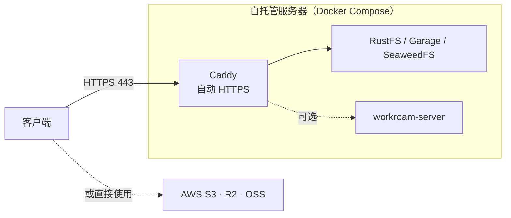

- `install.sh --domain sync.example.com --storage rustfs|garage|seaweedfs [--with-server]`：生成 Compose 与 Caddyfile，启动服务，输出端点与管理员凭证，提示在客户端向导中选择“由 Workroam 创建专用密钥”；
- 已有云存储时不需要部署任何东西，直接在向导中选择对应预设；
- 只给云端个人 Agent 用：在 bot 的云端电脑或任意 VPS 上运行中继模式的 `workroam-server`（§18.3），不需要 Docker；
- 没有公网 IP：Cloudflare Tunnel 暴露 443（v0.2）；Kubernetes：Helm Chart（v0.2）；remote 模式中转库：附带 Gitea 的 Compose（v0.2）；
- Garage 等 AGPL 存储只作为独立容器启动，属于并列分发，不影响 Workroam 代码的许可证。

## 21. 可观测性

- 本地结构化日志（`tracing`），按天滚动，默认保留 14 天，不记录文件内容与密钥；
- `workroam status`：后台服务、租约持有者、最新快照、本地未同步改动、最近一次作业结果、已归档项目数、最近一次异地备份（开启时）；
- `workroam doctor` 与桌面“检查”页：§7.5 全部检查项；
- 托盘图标三态：正常 / 同步中 / 警示；同步失败、异地备份失败或超过 3 天未成功时进入警示。

## 22. 测试策略

| 层次 | 内容 | 环境 |
| --- | --- | --- |
| 单元测试 | 清单、跨平台检查、环境块、适配器生成与导入、配对码编解码、桶名校验、退出码 | 三系统 CI |
| 初始化检查 | 每个检查项在“通过 / 警告 / 失败”下的结果与修复建议；不支持条件写的模拟存储 | Linux CI，Docker 启动 RustFS，另用代理注入故障 |
| 集成测试 | 推送 / 拉取 / 租约 / 降级路径 / 密钥轮换 | Linux CI，RustFS；定期跑 Garage、SeaweedFS |
| git 场景 | bundle 增量、`recent:N` 重建与回变基、WIP 还原、remote 与 files 模式 | 三系统 CI |
| 恢复与归档 | 恢复到原位置与其他目录；归档后在另一台设备恢复（含 `recent:N` 与 remote 模式仓库），仓库、规则与 Agent 配置直接可用；归档不改动任何本地文件；恢复归档的六种目录场景与代码仓库的克隆 / 不动 / 快进 / 分叉；清理不影响归档；归档包导出导入 | Linux CI + 三系统端到端 |
| 异地备份 | 增量镜像、删除延迟、从镜像恢复整个工作区、修改密码后镜像仍可解锁 | Linux CI，两个 RustFS 实例分别作主存储与镜像 |
| 故障注入 | 推送 / 拉取 / 归档中随机终止进程、断网，验证可恢复且无数据丢失 | Linux CI |
| 跨平台端到端 | Windows 推送 → macOS 拉取 → 修改 → Windows 拉取 | GitHub Actions 三系统矩阵，共用一个 RustFS |
| 适配器一致性 | 生成结果与快照文件比对；Agent 版本识别 | 三系统 CI |
| 桌面应用 | 向导、主窗口与卡片的端到端测试 | 三系统 CI |
| 界面与命令行一致性 | 功能清单检查（§17.4）；同一场景分别经桌面与命令行执行，IPC 请求与结果一致 | Linux CI |
| 启动横幅 | 四种颜色级别 × 完整 / 单行的快照测试；显示条件矩阵；管道与 `--json` 输出中不含横幅 | 三系统 CI |
| 许可证 | `cargo-deny` | CI |

## 23. 技术选型

| 领域 | 选型 | 理由 |
| --- | --- | --- |
| 语言 | Rust | 单文件跨平台二进制；对文件系统细节的掌控力强 |
| 存储访问 | Apache OpenDAL | 多后端；支持 `If-Match` / `If-None-Match` 条件写；rustic 后端同样基于它 |
| 快照引擎 | rustic_core | 内容寻址分块、去重、加密、快照历史成熟；restic 兼容格式可用官方工具应急恢复（ADR-0003）；快照标签与清理规则直接用于项目归档（ADR-0007） |
| git 操作 | 本机 git 命令行 | 行为与用户本地 git 完全一致 |
| 桌面应用 | Tauri v2 + tray、notification、autostart、positioner 插件 | 体积小、三系统、与 Rust 同栈（ADR-0002） |
| IPC | JSON-RPC 2.0（换行分隔）over UDS / 命名管道 | 语言无关 |
| 命令行交互 | clap + dialoguer + indicatif + anstream / anstyle + terminal_size | 参数解析、交互式向导、进度条；终端能力检测与颜色降级（含 Windows 控制台）、终端宽度 |
| MCP server | rmcp（stdio 与 Streamable HTTP） | Rust 官方 MCP SDK；本机 MCP server 与远程连接器共用 |
| 远程连接器授权 | OAuth 2.1（授权码 + PKCE） | MCP 规范要求的授权方式，云端 Agent 普遍支持 |
| 密钥库 | keyring | 统一访问三系统密钥库 |
| 配对码加密 | scrypt + XChaCha20-Poly1305 | 与仓库密钥派生方式一致，抗暴力破解 |
| 异步运行时 | Tokio | 生态成熟 |
| 日志 | tracing | 结构化日志 |
| Web 界面 | WASM（复用快照读取代码） | 浏览器内解密 |
| 依赖许可证检查 | cargo-deny | CI 自动检查 |

## 24. 架构决策记录

见 [adr/README.md](adr/README.md)。
