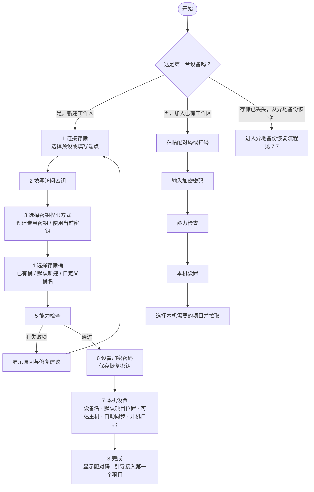
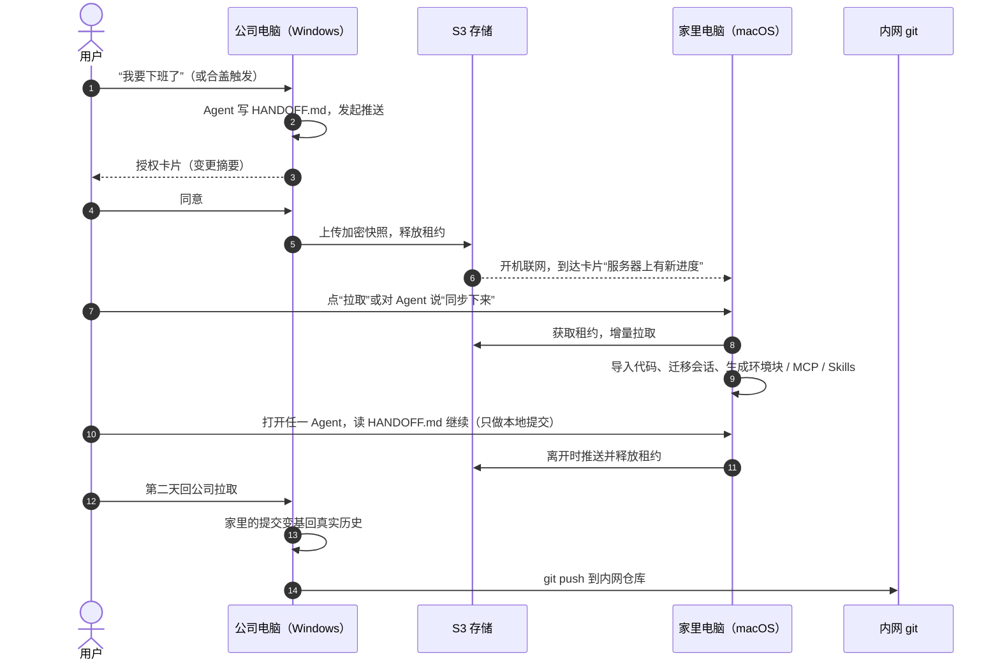
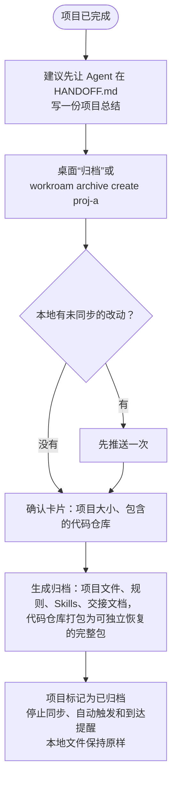
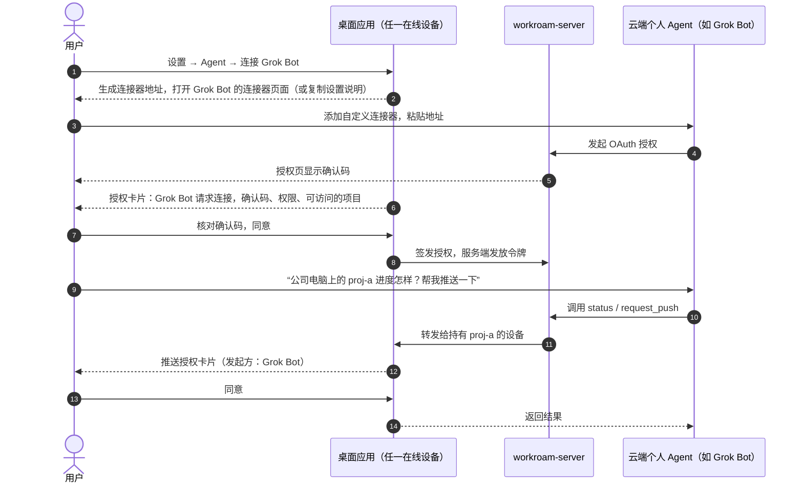
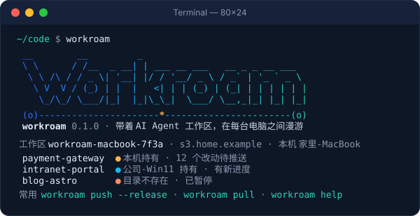

# Workroam 产品需求文档（PRD）

| 项目 | 内容 |
| --- | --- |
| 版本 | 1.3（新增 Agent 接入；界面与命令行一致性、命令行启动横幅） |
| 覆盖范围 | 产品最终形态 v0.3，按 v0.1 → v0.2 → v0.3 分阶段交付 |
| 状态 | 已定稿，进入实现阶段 |
| 最后更新 | 2026-10-30 |
| 关联文档 | [技术架构](architecture.md) · [架构决策记录](adr/README.md) · [桌面应用与命令行功能对照](cli-ui-parity.md) |

---

## 目录

1. [产品概述](#1-产品概述)
2. [背景与问题](#2-背景与问题)
3. [目标用户](#3-目标用户)
4. [目标与非目标](#4-目标与非目标)
5. [核心概念与术语](#5-核心概念与术语)
6. [产品组成](#6-产品组成)
7. [用户旅程](#7-用户旅程)
8. [功能需求](#8-功能需求)
9. [非功能需求](#9-非功能需求)
10. [版本规划与验收门槛](#10-版本规划与验收门槛)
11. [成功指标](#11-成功指标)
12. [风险与应对](#12-风险与应对)

---

## 1. 产品概述

**Workroam 是一个开源、自托管的 AI Agent 工作区漫游工具。** 用户只需要一个自己的 S3 兼容存储桶，在任何一台电脑上对任何 Agent 说一句“同步下来”，项目、代码、规则、MCP / Skills 和上下文就都能接上。

一句话定位：**给“一个人 × 多台机器 × 多个 AI Agent”用的接力棒。**

v0.3 是本文定义的产品最终形态，用户可以：

- 在桌面向导里几分钟完成首次初始化：连接存储、选择或新建存储桶、设定密钥权限、设置加密密码，并逐项通过连通性与能力检查；
- 用一个配对码把第二台、第三台电脑加入同一个工作区；
- 在 Windows、macOS、Linux 任意组合之间接力，六个主流 Agent（Claude Code、Codex、Grok Build、Antigravity、ZCode、Pi）换机器后都能直接开工；
- 基本不用手动敲命令：离开时自动或一键推送，到达时收到提醒一键拉取；
- 在手机上收到提醒，并在浏览器里查看快照和交付物（数据在浏览器内解密）；
- 项目是否归档由用户决定：归档后停止同步与接力，在存储中永久保留，以后随时恢复继续开发。

## 2. 背景与问题

| # | 现状 | 痛点 |
| --- | --- | --- |
| P1 | 同时使用多个 Agent，都在本地 `projects/` 文件夹里读写代码、文档和交付物 | 每个 Agent 的规则、MCP、Skills、会话格式和位置都不同，换机器后要手动重配 |
| P2 | 在公司电脑和家里电脑之间切换，系统可能是 Windows、macOS、Linux 的任意组合 | 路径、换行符、大小写、符号链接、可执行位、Shell 都不一样 |
| P3 | 只有公司电脑能访问内网系统和内网 git 仓库 | 无法把 Agent 放在远程服务器上两地连接，必须本地优先 |
| P4 | 通用同步工具（网盘、Syncthing、rclone） | 不理解 Agent 的规则、MCP、Skills、会话，也不理解 git 和跨系统差异；同步 `.git` 目录会损坏仓库 |
| P5 | 换机器后 Agent 从零开始 | 上下文丢失，需要重新解释进度 |
| P6 | 自托管对象存储的配置门槛 | 桶、密钥、权限、地址风格、HTTPS 任何一项配错都难以排查 |

## 3. 目标用户

**主要用户：多机接力的独立开发者**

- 日常同时用 2 个以上 AI 编码 Agent；
- 至少两台电脑（例如公司 Windows + 家里 Mac），其中只有一台能访问内网；
- 能自己部署一台小服务器，或已有对象存储（AWS S3、Cloudflare R2、阿里云 OSS 等）；
- 对代码安全敏感：不愿意把内网代码明文放到第三方网盘。

**次要用户：只想在多台个人电脑之间带走 Agent 工作区的开发者**，不涉及内网，但同样需要跨系统与跨 Agent 的一致性。

## 4. 目标与非目标

### 4.1 目标

| ID | 目标 |
| --- | --- |
| G1 | 任一台机器上，项目文件夹的内容始终是最新的：代码、文档、交付物 |
| G2 | 每个项目由自己的 `AGENTS.md` 约束所有 Agent，机器差异只在本机体现 |
| G3 | 项目级 MCP、Skills 只维护一份，为每个 Agent 生成原生配置 |
| G4 | Agent 上下文不丢失：任何 Agent 都能接着上一个 Agent 的进度继续 |
| G5 | Windows、macOS、Linux 任意组合之间无缝切换 |
| G6 | 开源、自托管，首次初始化有引导和检查；有网络就同步，没网络照常工作 |
| G7 | 用户始终知情：同步前授权，同步中可见进度，完成或失败有提醒 |
| G8 | 日常无感：触发、提醒、拉取尽量自动完成，必要时才打扰用户 |
| G9 | 数据可找回：任何一次同步都能回退；已完成的项目归档后，多年后也能原样恢复 |

### 4.2 非目标

- 多人同时编辑同一项目（产品面向一个人在多台机器之间接力）；
- 实时协同或实时文件同步（同一时间只有一台机器在写）；
- 替代 git 托管平台或 CI；
- 托管 Agent 运行环境或远程开发环境。

## 5. 核心概念与术语

| 术语 | 含义 |
| --- | --- |
| 工作区（workspace） | 一个用户的全部同步数据，对应一个存储桶（或桶内前缀）和一套加密密钥；可包含多个项目和多台设备 |
| 设备（device） | 加入工作区的一台电脑，有名称、系统、权限（读写或只读） |
| 接力（handoff） | 一个人在多台机器之间先后工作，同一时间只有一台机器在写 |
| 租约（lease） | 存放在存储上的锁对象，记录当前持有项目的设备；离开时释放，到达时获取 |
| 快照（snapshot） | 一次推送的完整状态，内容寻址、写入后不再修改，可回滚 |
| 共享源文件 | 所有机器一致、参与同步的文件：代码、文档、`AGENTS.md` 正文、Skills、MCP 定义 |
| 本机生成文件 | 拉取后按本机系统和 Agent 生成、不参与同步的文件：各 Agent 原生 MCP 配置、Skills 链接、环境块 |
| 本机环境块 | `AGENTS.md` 末尾由 Workroam 写入的一段，描述当前机器（系统、Shell、能否访问内网、哪些仓库能推送），同步时剥离 |
| 交接文档 | `.handoff/HANDOFF.md`，推送前由当前 Agent 写的结构化进度说明，是跨 Agent 继续工作的可靠依据 |
| 适配器（adapter） | 描述某个 Agent 的规则、Skills、MCP、会话位置、生成方式和接入方式的声明式数据文件 |
| 本机 Agent | 运行在项目所在电脑上、能读写文件和执行命令的 Agent，例如 Claude Code、Codex、Grok Build |
| 云端个人 Agent | 运行在服务商云端、通过手机或网页对话使用的 Agent，例如 Grok Bot、Muse；碰不到用户电脑上的文件和命令，只能通过远程连接器接入 |
| Workroam Skill | 接入项目时生成的 `.agents/skills/workroam/SKILL.md`，告诉 Agent 何时、怎样调用 Workroam |
| 远程连接器 | `workroam-server` 提供的远程 MCP 地址，云端个人 Agent 通过它查询状态、请求同步，请求由用户在线的设备执行 |
| 代码同步模式 | 每个仓库可选 `bundle`、`remote`、`files` 三种之一 |
| 配对码 | 把新设备加入工作区的一段字符串或二维码，内含用加密密码保护的连接信息 |
| 恢复密钥 | 首次初始化时生成的备用密钥，加密密码丢失时用它解锁工作区 |
| 归档 | 用户选择归档的项目：停止同步与接力，在存储中永久保留、不会被清理，可随时恢复 |
| 异地备份 | 可选：把整个存储镜像到另一个桶或本地目录，只用于存储本身丢失的情况 |

## 6. 产品组成

| 组件 | 形态 | 职责 |
| --- | --- | --- |
| `workroam` 命令行 | 单文件二进制 | 给人和 Agent 使用：与桌面应用功能对等（§8.22），桌面上能做的事都有等价命令；交互式启动时显示启动横幅 |
| `workroamd` 后台服务 | 用户级服务，开机自启 | 同步引擎、租约、触发检测、文件监听、授权管理、事件推送 |
| Workroam 桌面应用 | 托盘图标 + 卡片 + 窗口（Tauri v2） | 首次初始化向导、项目接入向导、授权 / 进度 / 完成 / 到达卡片、设置与设备管理 |
| Workroam Skill | 接入项目时生成的 `SKILL.md` | 告诉本机 Agent 何时、怎样用命令行查询状态、发起推送 / 拉取、写交接文档 |
| 本机 MCP server | `workroam mcp`（stdio，可选） | 给偏好工具调用的本机 Agent 使用，能力与命令行相同 |
| 存储 | 任意 S3 兼容存储 | 保存加密快照、租约和控制对象；默认部署 RustFS + Caddy |
| `workroam-server`（可选） | 单个容器 | 设备配对码与每设备独立凭证、手机推送、Web 界面（浏览器内解密查看快照与交付物）、给云端个人 Agent 用的远程连接器 |

## 7. 用户旅程

### 7.1 首次使用：初始化引导

首次启动桌面应用时自动打开**初始化向导**；没有图形界面的机器使用等价的 `workroam setup`。

**形态决策：桌面向导为主，命令行等价。**

| 考量 | 结论 |
| --- | --- |
| 初始化只做一次，但选项多（存储、桶、密钥权限、加密） | 向导逐步呈现、每步可回退，比命令行问答更不易出错 |
| 能力检查有十余项，需要直观呈现通过 / 警告 / 失败及修复建议 | UI 列表更清晰 |
| 恢复密钥必须确认已保存；配对码最好能显示二维码 | 只有 UI 能做好 |
| 桌面应用随安装包提供，装完即可弹出向导 | 无额外成本 |
| Linux 服务器、无图形界面的机器、批量部署 | 提供 `workroam setup`：交互式问答，或通过参数非交互执行 |

两者调用同一套初始化与检查逻辑，结果完全一致。不只是初始化：桌面应用中的每一项功能都有等价的命令，命令行的每一项功能也都有桌面入口（§8.22，逐项对照见 [cli-ui-parity.md](cli-ui-parity.md)）。

**向导流程：**



**步骤要点：**

1. **连接存储**：预设有“自建（install.sh 部署）”“AWS S3”“Cloudflare R2”“阿里云 OSS”“其他 S3 兼容”；自动识别地址风格与区域；自建服务器显示部署命令。
2. **访问密钥**：填写 Access Key 与 Secret；密钥只保存到系统密钥库。
3. **密钥权限方式**：
   - **由 Workroam 创建专用密钥（推荐）**：用户提供一次具备管理权限的密钥，Workroam 为本工作区创建只授权该桶（或该前缀）的专用密钥，管理员密钥用完即丢弃、不保存；可选“读写”或“只读”。存储不支持时自动隐藏此项。
   - **使用当前密钥**：Workroam 检查其权限范围，权限过宽（例如可访问账号下所有桶）时给出明确警告和收窄建议，由用户确认后继续。
4. **存储桶**：
   - **选择已有桶**：列出密钥可见的桶（无列举权限时手动输入）；
   - **默认新建**：桶名为 `workroam-<设备名>-<4 位随机>`，避免全局重名；
   - **自定义桶名**：实时校验 S3 命名规则（3–63 位、小写字母数字与连字符）和可用性；
   - 可选“桶内前缀”，用于和其他数据共用一个桶；
   - 如果所选位置已经是一个 Workroam 工作区，提示改为“加入已有工作区”；如果非空但不是工作区，要求设置前缀或换桶。
5. **能力检查**：逐项显示结果与修复建议（见 ONB-06）。读写类失败阻止继续；条件写不支持时警告并说明降级行为。
6. **加密**：设置加密密码并显示强度；生成恢复密钥，用户必须下载、打印或复制，并输入恢复密钥中的指定几位以确认已保存。
7. **本机设置**：设备名（默认取主机名）、默认项目位置（新项目默认放在这里，每个项目仍可单独选择目录，见 7.2）、可达主机（自动从本机 git 远端探测并测试连通性）、自动同步档位、开机自启、检测到的 Agent 列表。
8. **完成**：显示配对码（文本 + 二维码），引导“接入第一个项目”。

### 7.2 接入项目

在桌面应用中选择项目文件夹，或在项目文件夹中执行 `workroam init`：

1. 确认项目目录：就是用户选择的文件夹，可以放在任意位置，不要求在默认项目位置下（目录规则见下方）；
2. 扫描项目内的 git 仓库，为每个仓库推荐代码同步模式和历史档位，用户可修改；
3. 检测项目已有的 `CLAUDE.md`、`.mcp.json`、`.codex/config.toml` 等，导入为统一的 `AGENTS.md`、`.workroam/mcp.toml`、`.agents/skills/`，原文件改由 Workroam 生成；
4. 生成 `.workroam/workroam.toml` 和 `.handoff/HANDOFF.md` 模板，在 `AGENTS.md` 中写入“工作区同步”约定；
5. 运行跨平台检查并给出报告；
6. 发起第一次推送。

**在其他设备上添加项目**：在桌面应用的项目列表中勾选项目，或执行 `workroam project add <项目> [--path <目录>]`，为这个项目选择本机目录，添加后立即拉取。默认是“默认项目位置/项目名”，也可以自定义任意目录。每台设备的目录各自独立，例如公司电脑放在 `D:\work\proj-a`，家里电脑放在 `~/code/proj-a`。

**项目目录规则：**

| 情况 | 能否更换目录 | 说明 |
| --- | --- | --- |
| 已选目录但还是空的（还没拉取，或拉取前） | 可以随时更换 | 没有同步过任何内容，更换不影响任何东西 |
| 目录已有内容并已同步 | 不能更换 | 已同步的目录是本机比对改动的基准，直接换目录会把整个项目误判为删除或新增 |
| 确实需要换位置 | 先在本机“移除项目”，再重新添加并选择新目录 | 移除只解除本机与该项目的关联，不删除、不修改任何文件；重新添加时按 7.6 的目录场景判断：新目录为空则直接拉取，里面已是这个项目（例如用户自己把文件夹搬了过去）则只比对差异 |

选择目录时的检查：

- 目录必须可写；
- 不能位于另一个项目目录之内，也不能包含另一个项目目录；
- 不能是磁盘根目录、用户主目录或系统目录；
- 位于 OneDrive、iCloud、Dropbox 等网盘同步文件夹内时给出警告，因为两套同步可能互相冲突；
- Windows 上路径过长时提示开启长路径。

项目目录被用户手动移动、改名或删除后，该项目在本机暂停同步，托盘提示“项目目录不存在”。用户可以选择移除项目后重新添加（可指向搬过去的新位置），Workroam 不会自行寻找或创建目录。

### 7.3 日常接力



### 7.4 添加与移除设备

- **添加**：在已有设备上点“添加设备”得到配对码；新设备的向导中粘贴或扫码，输入加密密码即可加入。配合 `workroam-server` 时可改用 6 位一次性配对码，并为每台设备签发独立凭证。
- **只读设备**：添加时可选“只读”，只读设备只能拉取查看，不能推送、不能持有租约，适合临时借用的电脑。
- **移除**：在设备列表中移除设备，Workroam 轮换工作区密钥，并把新密钥加密分发给其余设备；被移除的设备随即失去访问权限。

### 7.5 异常与恢复

| 场景 | 产品行为 |
| --- | --- |
| 另一台设备忘记释放租约 | 卡片说明持有者与最后活动时间，用户选择等待或强制接管；接管前在本地生成冲突副本 |
| 推送或拉取中途断网、断电 | 自动续传；再次打开时先完成未完成的操作，再接受新的同步 |
| 两边都改了同一个文件 | 能自动合并的合并；不能的保留两份，交给 Agent 合并 |
| 改坏了想回退 | 在同步历史中选任意一次快照恢复（见 7.7） |
| 忘记加密密码 | 用恢复密钥解锁，并设置新密码（设置“加密”→“使用恢复密钥重设密码”，或 `workroam password reset`） |
| 存储地址或密钥失效 | 托盘变为警示状态，打开“检查”页（`workroam doctor`）逐项定位；密钥更换后在设置“存储”→“更新访问密钥”（`workroam credentials update`）中更新 |
| 存储整体丢失（自建存储硬盘损坏、桶被误删） | 配置了异地备份时从镜像恢复整个工作区（见 7.7）；使用云对象存储时由服务商保证数据可靠 |
| 电脑丢失或重装系统 | 在新电脑上加入工作区并选择全部项目，即恢复到最后一次同步的状态 |

### 7.6 项目归档与恢复

项目做完后，是否归档完全由用户决定，Workroam 不会自动归档，也不会主动建议。常见的两种情况：

| 情况 | 建议做法 |
| --- | --- |
| 开发完成，但运维期间还可能有需求变更 | 保持正常同步；或者先归档，需要改的时候一键恢复同步，改完再归档 |
| 项目彻底结束，不再开发和运维 | 归档，作为永久留存 |

归档只影响 Workroam 对这个项目的处理：停止同步、接力、自动触发和到达提醒，在存储中留下一份永久保留、可以独立恢复的归档。**各台设备上的本地文件 Workroam 一律不删除、不修改**，是否清理由用户自己决定。

**归档：**



- 归档永久保留，不会被快照清理删除，直到用户主动删除归档；
- 归档之前的同步历史默认按保留策略照常清理，只留最终状态；需要时可以选择“保留完整历史”；
- 归档和其他项目在同一个加密仓库中去重，通常几乎不额外占用空间；
- 其他设备下次联网时得知项目已归档，同样停止同步该项目，本地文件保持原样。

**恢复：**

| 场景 | 操作 | 结果 |
| --- | --- | --- |
| 继续开发（如运维期新需求） | 在归档列表中选择项目，点击“恢复”（命令行：`workroam archive restore <项目>`） | 按本地目录的情况分场景处理（见下方）；完成后项目回到同步列表，本机持有租约；Agent 读 HANDOFF.md 就知道项目当时的状态 |
| 只想查看或取点东西 | 选择“导出到其他目录” | 在指定目录得到归档时的完整项目，归档状态不变 |
| 不再需要 | 选择“删除归档”，输入项目名确认 | 存储中的归档被删除，下一次清理时释放空间；本地文件不受影响 |
| 离线长期保存（v0.3） | 选择“导出归档包” | 得到一个加密的单文件，可以放进移动硬盘；以后在任何设备、任何工作区导入后恢复 |

**恢复归档的操作步骤：**

1. 打开桌面应用“归档”页，选中项目，点击“恢复”；或运行 `workroam archive restore <项目> [--to <目录>]`；
2. 选择恢复到哪个目录，默认是本机为该项目绑定过的目录；本机从未添加过该项目时，默认是“默认项目位置/项目名”，也可以自定义；
3. Workroam 检查这个目录，判断属于下表哪种场景，在确认卡片上说明会做什么、哪些文件会变；
4. 用户确认后执行；项目回到同步列表，其他设备收到“项目已恢复”的提醒，可以选择拉取。

**按本地目录情况分场景：**

| 场景 | 判断依据 | 处理 | 是否需要用户选择 |
| --- | --- | --- | --- |
| ① 目录不存在或是空目录 | — | 直接下载归档，从完整包克隆代码仓库，生成本机配置，继续开发 | 否 |
| ② 本地文件与归档完全一致 | 逐文件比对哈希，代码仓库的分支与归档一致 | 不下载任何文件，只恢复同步并重新生成本机配置 | 否 |
| ③ 本地比归档新：归档之后只在本地改过 | 本地文件基于归档时的版本，归档之后有改动 | 保留本地改动，恢复同步，这些改动作为下一次推送；卡片列出改动的文件 | 否（卡片中可改选“以归档为准”） |
| ④ 本地比归档旧：本机很早以前停止同步，归档来自其他设备 | 本地文件等于项目历史中某个更早的快照 | 更新到归档版本，等同于一次正常拉取 | 否 |
| ⑤ 两边都改过 | 本地基于较早的版本又做了改动，归档中也有本地没有的更新 | 与日常拉取的冲突处理相同：能自动合并的合并，不能合并的保留两份，交给 Agent 合并 | 是：合并（默认）/ 以归档为准 / 恢复到另一个目录后自己对比 |
| ⑥ 目录里是别的内容 | 目录非空，但不是这个项目 | 不写入任何文件，请用户换一个目录或新建子目录 | 是 |
| ⑦ 换了电脑或换了路径 | 新电脑先加入工作区；路径由用户选择 | 按 ①～⑥ 判断；Agent 会话按新路径改写 | 视场景 |

- “以归档为准”时，本地被覆盖的文件先另存到 `<项目名>.before-restore-<时间>/`，不会直接丢失；
- 代码仓库单独判断：本地没有仓库就从归档克隆；本地仓库比归档新则不动；归档更新则快进；两边分叉时不自动合并，归档中的提交放到 `workroam/archive/<分支名>` 分支，由用户或 Agent 用 git 合并；本地未提交的改动始终保留；
- 任何场景都不会静默覆盖本地文件。

### 7.7 回退与异地备份

**回退**：快照历史与工作区在同一个存储中，用来找回误删的文件、回到改坏之前的版本。

| 场景 | 操作 | 结果 |
| --- | --- | --- |
| 恢复单个文件或文件夹 | 在同步历史中选一次快照，勾选文件，选择“恢复到原位置”或“导出到其他目录” | 恢复到原位置时生成一次新的同步，原有历史全部保留；导出时不影响工作区 |
| 把整个项目回退到某个时间点 | 在同步历史中选一次快照，选择“恢复整个项目” | 先在本地保存当前状态的冲突副本，再恢复，并生成一次新的同步 |
| 电脑丢失或重装 | 新电脑走“加入已有工作区”，选择全部项目 | 恢复到最后一次同步的状态，本机生成的配置重新生成 |

**异地备份（可选，v0.3）**：快照和归档都已经保存在存储里，大多数用户不需要再备份一次。只有存储本身整体丢失时才需要它，例如家里自建的单盘 RustFS 硬盘损坏，或桶被误删。使用 AWS S3、R2、OSS 等云对象存储时，服务商本身有多副本，通常不需要开启。

- 开启后，在本机空闲时（默认每天一次）把整个存储增量镜像到另一个桶或本地目录（NAS、移动硬盘），镜像中仍然只有密文；
- 主存储中删除的内容在镜像中延迟 30 天才删除，误删或被恶意删除后仍有时间找回；
- 存储整体丢失时，在初始化向导中选择“从异地备份恢复”：连接镜像、输入加密密码或恢复密钥，镜像即成为新的主存储，然后其他设备用新的配对码重新加入，本地已有的文件只补齐差异。

### 7.8 接入 Agent

Agent 接入 Workroam 的目的有两个：让 Agent 自己发起推送和拉取，以及让下一个 Agent 读到 `HANDOFF.md` 接着干。按 Agent 运行的位置分两类，接入方式不同：

| | 本机 Agent | 云端个人 Agent |
| --- | --- | --- |
| 例子 | Claude Code、Codex、Grok Build、Antigravity、ZCode、Pi | Grok Bot、Muse |
| 运行位置 | 项目所在的电脑 | 服务商的云端，用户在手机或网页上对话 |
| 能否执行本机命令 | 能 | 不能 |
| 接入方式 | 命令行（`--json`）+ Workroam Skill；可选本机 MCP server | `workroam-server` 提供的远程连接器（远程 MCP）+ 上传 Workroam Skill |
| 能做什么 | 查询状态、推送、拉取、读写 `HANDOFF.md`、恢复 | 查询状态与历史、读 `HANDOFF.md`、请求某台设备推送或拉取 |
| 前提 | 安装 Workroam 客户端 | 部署了 `workroam-server`，且至少一台设备在线 |
| 首次交付 | v0.1 | v0.3 |

**本机 Agent：接入项目即接入 Agent，不需要额外操作。**

1. 初始化时 Workroam 检测本机已安装的 Agent，列在“设置 → Agent”中；
2. 接入项目（`workroam init` 或桌面“接入项目”）时，Workroam 为本机每个 Agent 生成规则引用、MCP 配置和 Skills 链接，其中包括 Workroam Skill；
3. 用户对任何 Agent 说“我要下班了”或“同步下来”，Agent 按 Workroam Skill 写好 `HANDOFF.md`，执行 `workroam push --release --json` 或 `workroam pull --json`，并在等待期间告诉用户“请在 Workroam 卡片上确认”；
4. 用户在卡片上确认，Agent 读取 JSON 结果，向用户汇报。

只要 Agent 能执行命令，用命令行就能完成全部操作；本机 MCP server（v0.3）只是给偏好工具调用的 Agent 的另一种入口，能力相同。之后装了新的 Agent，在“设置 → Agent”中点“接入”，Workroam 为已接入的项目补齐这个 Agent 的配置。

**云端个人 Agent：在设置中一键连接（v0.3）。**



- 桌面应用按适配器提供每个云端 Agent 的接入方式：能直接打开对方连接器页面的就打开；需要在对话中添加连接器的（例如 Muse），复制一段可以直接粘贴给 Agent 的设置说明；同时提供 Workroam Skill 文件，供上传到对方的 Skills；
- 远程连接默认关闭，开启时提示：返回给云端 Agent 的状态摘要和 `HANDOFF.md` 会进入服务商的云端，不再受端到端加密保护；
- 每个连接可选“只读”或“可请求同步”，并限定可访问的项目，可随时在设置中撤销；
- 远程发起的推送和拉取每次都要在设备卡片上确认；目标设备离线时，请求最多排队 24 小时，设备上线后弹出卡片；
- 可选：把完成、失败、到达事件发到云端 Agent 的 webhook（例如 Grok Bot 例行任务的 webhook 触发器），让它在手机上提醒用户。

## 8. 功能需求

“版本”列表示该需求首次交付的版本；v0.3 时全部可用。

### 8.1 初始化引导与检查（ONB）

| ID | 需求 | 版本 |
| --- | --- | --- |
| ONB-01 | 首次启动桌面应用自动打开初始化向导；`workroam setup` 提供相同步骤的交互式命令行，并支持全部参数的非交互模式 | v0.1 |
| ONB-02 | 新建工作区、加入已有工作区、从异地备份恢复三条路径 | v0.1（前两条）/ v0.3（从异地备份恢复） |
| ONB-03 | 存储预设与自定义端点；自动识别路径风格 / 虚拟主机风格与区域 | v0.1 |
| ONB-04 | 密钥权限方式：创建专用密钥（读写 / 只读，管理员密钥不保存）或使用当前密钥（权限过宽时警告）；不支持创建时隐藏该选项 | v0.1（使用当前密钥）/ v0.2（创建专用密钥） |
| ONB-05 | 存储桶：选择已有、默认新建（`workroam-<设备名>-<随机>`）、自定义桶名（实时校验）；可选桶内前缀；识别已有工作区与非空桶 | v0.1 |
| ONB-06 | 能力检查：DNS 与 TLS 证书、凭证有效、桶可访问、读 / 写 / 删除、条件创建、条件覆盖、分片上传、地址风格、时钟偏差、延迟与带宽、桶版本控制与生命周期规则的影响；每项给出通过 / 警告 / 失败与修复建议 | v0.1 |
| ONB-07 | 加密密码与强度提示；恢复密钥生成，必须确认已保存后才能继续 | v0.1 |
| ONB-08 | 本机设置：设备名、默认项目位置、可达主机自动探测、自动同步档位、开机自启、Agent 检测 | v0.1 |
| ONB-09 | 完成页显示配对码（文本 + 二维码）并引导接入第一个项目 | v0.1 |
| ONB-10 | `workroam doctor` 与桌面应用“检查”页：随时重新运行全部检查，并检查本机 git 版本、长路径设置、`core.autocrlf`、Agent 版本与适配器匹配情况 | v0.1 |

### 8.2 设备与凭证（DEV）

| ID | 需求 | 版本 |
| --- | --- | --- |
| DEV-01 | 配对码：包含端点、桶、前缀与访问密钥，以加密密码派生的密钥加密；新设备凭配对码 + 加密密码加入 | v0.1 |
| DEV-02 | 设备列表：名称、系统、权限、最后同步时间、当前是否持有租约 | v0.1 |
| DEV-03 | 只读设备：只能拉取，不能推送或持有租约；环境块中注明 | v0.2 |
| DEV-04 | 移除设备与密钥轮换：生成新密钥，加密分发给其余设备后吊销旧密钥 | v0.2 |
| DEV-05 | 配合 `workroam-server`：6 位一次性配对码、每设备独立凭证、单独吊销 | v0.3 |

### 8.3 项目接入（PROJ）

| ID | 需求 | 版本 |
| --- | --- | --- |
| PROJ-01 | `workroam init` 与桌面“接入项目”向导：生成 `.workroam/workroam.toml`、`.workroam/mcp.toml`、`.workroam/env/`、`.agents/skills/`、`.handoff/HANDOFF.md` | v0.1 |
| PROJ-02 | 扫描 git 仓库，按 origin 主机与各设备可达主机推荐同步模式与历史档位 | v0.1 |
| PROJ-03 | 导入已有的 Agent 规则、MCP 与 Skills 配置为统一定义源 | v0.1（Claude Code、Codex）/ v0.2（其余 Agent） |
| PROJ-04 | 在 `AGENTS.md` 共享正文写入“工作区同步”约定；需要时生成一行 `@AGENTS.md` 的 `CLAUDE.md` | v0.1 |
| PROJ-05 | 每台设备可选择本机需要的项目，未选择的项目不下载 | v0.1 |
| PROJ-06 | 每个项目在每台设备上可自定义本地目录，默认“默认项目位置/项目名”；选择时检查可写、不与其他项目目录嵌套、不是根目录 / 主目录 / 系统目录，位于网盘同步文件夹时警告 | v0.1 |
| PROJ-07 | 目录为空、尚未同步时可以更换；已有内容并已同步后不能更换，只能在本机移除项目后重新添加 | v0.1 |
| PROJ-08 | 移除项目：只解除本机关联，不删除、不修改本地文件；重新添加时按目录场景判断（空目录直接拉取，已是该项目则只比对差异） | v0.1 |
| PROJ-09 | 项目目录被移动、改名或删除时，本机暂停该项目的同步并提示用户 | v0.1 |

### 8.4 推送（PUSH）

| ID | 需求 | 版本 |
| --- | --- | --- |
| PUSH-01 | 推送前检查租约、git 仓库状态（rebase / merge 中途时拒绝）、跨平台问题 | v0.1 |
| PUSH-02 | 预演：计算变更摘要（文件数与大小、仓库提交数、预计耗时），发起授权 | v0.1 |
| PUSH-03 | 剥离 `AGENTS.md` 环境块，排除本机生成文件与凭证 | v0.1 |
| PUSH-04 | 按仓库同步模式打包代码（bundle、WIP 提交等） | v0.1 |
| PUSH-05 | 上传数据块（已存在的跳过），最后写入快照并更新“最新快照”指针 | v0.1 |
| PUSH-06 | `--release` 时释放租约并发送完成提醒 | v0.1 |
| PUSH-07 | 中断后续传 | v0.1 |
| PUSH-08 | HANDOFF.md 自上次推送以来未更新时，在授权卡片上提示 | v0.1 |

### 8.5 拉取（PULL）

| ID | 需求 | 版本 |
| --- | --- | --- |
| PULL-01 | 获取租约，写入 `.workroam/SYNCING` 标记 | v0.1 |
| PULL-02 | 对比本地状态与目标快照，得出增、删、改列表 | v0.1 |
| PULL-03 | 文件先写临时位置再改名替换，覆盖前核对本地是否仍是预期的旧版本 | v0.1 |
| PULL-04 | 导入代码：fetch bundle、还原 WIP、快进或合并分支 | v0.1 |
| PULL-05 | 生成本机文件：环境块、各 Agent MCP 配置、Skills 链接 | v0.1 |
| PULL-06 | 删除 `.workroam/SYNCING`，发送完成提醒 | v0.1 |
| PULL-07 | 拉取会碰到本地尚未同步的改动时，无论自动同步处于哪一档都先询问 | v0.1 |

### 8.6 租约（LEASE）

| ID | 需求 | 版本 |
| --- | --- | --- |
| LEASE-01 | 用 S3 条件写原子获取、续约、释放租约；租约记录项目、设备、获取时间、续约时间 | v0.1 |
| LEASE-02 | 持有租约的设备在线时每 10 分钟续约；超过 12 小时未续约视为“可能已遗忘” | v0.1 |
| LEASE-03 | 他人持有租约时弹出警告，用户选择等待或强制接管；接管时生成冲突副本，从不静默覆盖；“可能已遗忘”的租约以较低警示级别提示 | v0.1 |
| LEASE-04 | 存储不支持条件写时降级为乐观并发：快照记录父快照，分叉在下次拉取时交给用户处理 | v0.1 |

### 8.7 快照与历史（SNAP）

| ID | 需求 | 版本 |
| --- | --- | --- |
| SNAP-01 | 内容寻址分块、去重、客户端加密、快照历史 | v0.1 |
| SNAP-02 | 每个项目一条独立的快照序列；所有项目共用一个加密仓库，跨项目去重 | v0.1 |
| SNAP-03 | 本地缓存文件哈希，避免每次全量计算 | v0.1 |
| SNAP-04 | `workroam history` / `workroam restore`：查看历史；把单个文件、文件夹或整个项目恢复到原位置（先保存当前状态的冲突副本，恢复结果作为一次新的同步，历史不被改写），或导出到其他目录（不需要租约，不影响工作区） | v0.1 |
| SNAP-05 | 桌面应用中的同步历史：时间线、来源设备、变更概要；展开快照勾选文件恢复或导出、恢复整个项目（与 `history` / `restore` 同版本交付，见 PAR-03） | v0.1 |
| SNAP-06 | 快照保留策略与清理（默认保留最近 30 天内全部快照、此前每周一个）；归档永不清理 | v0.2 |

### 8.8 项目归档与恢复（ARC）

| ID | 需求 | 版本 |
| --- | --- | --- |
| ARC-01 | 归档项目：有未同步改动时先推送；生成可独立恢复的归档（所有代码仓库按历史档位打包为完整包，不依赖 origin 或中转库将来仍然存在）；可填写备注 | v0.2 |
| ARC-02 | 归档前提示 Agent 在 `HANDOFF.md` 写项目总结，供以后恢复时阅读 | v0.2 |
| ARC-03 | 已归档项目在所有设备上停止同步、自动触发与到达提醒；Workroam 不删除、不修改任何设备上的本地文件；是否归档只由用户决定，不自动归档 | v0.2 |
| ARC-04 | 归档列表：项目名、归档时间、归档设备、大小、备注；`workroam archive list` | v0.2 |
| ARC-05 | 恢复归档：检查目标目录并按场景处理（目录为空、与归档一致、本地较新、本地较旧、两边都改过、目录被其他内容占用），任何情况下不静默覆盖本地文件；代码仓库按克隆、不动、快进、分叉分别处理；按本机当前的 Agent 与适配器生成配置；项目回到同步列表 | v0.2 |
| ARC-06 | 导出归档到其他目录查看，不改变归档状态；只读设备也可执行 | v0.2 |
| ARC-07 | 归档永久保留，不受快照清理影响；默认清理归档前的同步历史，可选保留完整历史 | v0.2 |
| ARC-08 | 删除归档：输入项目名二次确认，下一次清理时释放空间 | v0.2 |
| ARC-09 | 桌面“归档”页：列表、搜索、归档、恢复（显示场景判定与选项）、导出、删除（与 `workroam archive` 同版本交付，见 PAR-03） | v0.2 |
| ARC-10 | 导出 / 导入归档包：单个加密文件，可离线保存，可导入到任意工作区；桌面“归档”页与 `workroam archive export / import` | v0.3 |

### 8.9 异地备份（BAK，可选）

| ID | 需求 | 版本 |
| --- | --- | --- |
| BAK-01 | 把整个存储增量镜像到另一个 S3 兼容桶或本地目录；内容仍是密文；在配置它的设备上空闲时执行，默认每天一次 | v0.3 |
| BAK-02 | 主存储中删除的内容在镜像中延迟 30 天才删除 | v0.3 |
| BAK-03 | 初始化向导“从异地备份恢复”：镜像成为新的主存储，重新生成配对码；其他设备可作为原设备重新加入 | v0.3 |
| BAK-04 | `workroam verify` 与桌面“检查”页“校验数据完整性”：检查主存储或镜像的完整性（结构检查，可选抽样读取数据） | v0.3 |
| BAK-05 | 镜像失败或超过 3 天未成功时，托盘变为警示状态 | v0.3 |

### 8.10 代码仓库同步（GIT）

| ID | 需求 | 版本 |
| --- | --- | --- |
| GIT-01 | 每台机器各自维护 `.git`，不对 `.git` 目录做文件级同步 | v0.1 |
| GIT-02 | `bundle` 模式：首次完整 bundle，之后只打包新提交与 WIP 提交 | v0.1 |
| GIT-03 | `bundle` 历史档位 `full`、`recent:N`、`snapshot`；后两者回到可访问内网的设备时自动变基回真实历史 | v0.1 |
| GIT-04 | `extras`：被 `.gitignore` 忽略但需要带走的文件走文件同步 | v0.1 |
| GIT-05 | WIP 提交：不碰用户暂存区和业务分支，包含未跟踪且未被忽略的文件；到达后还原为未提交改动 | v0.1 |
| GIT-06 | `remote` 模式：经 origin 或中转远端同步，WIP 推到 `workroam/wip/<分支名>` | v0.2 |
| GIT-07 | `files` 模式：只同步工作区，基线三方合并，可生成只读影子仓库 | v0.2 |
| GIT-08 | 在本机环境块中写明每个仓库在本机能否推送 | v0.1 |

### 8.11 规则与交接（RULE）

| ID | 需求 | 版本 |
| --- | --- | --- |
| RULE-01 | 每个项目根目录一份 `AGENTS.md`；不修改任何 Agent 的全局规则文件 | v0.1 |
| RULE-02 | 拉取后在 `AGENTS.md` 末尾写入本机环境块，推送时剥离 | v0.1 |
| RULE-03 | `.handoff/HANDOFF.md` 模板：更新时间 / 机器 / Agent、当前目标、已完成、进行中、下一步、未决问题、注意事项 | v0.1 |

### 8.12 Agent 适配（ADPT）

| ID | 需求 | 版本 |
| --- | --- | --- |
| ADPT-01 | 每个 Agent 一个声明式适配器文件：规则、Skills、MCP、会话位置、排除项、生成模板、接入方式、支持的版本范围 | v0.1 |
| ADPT-02 | 适配器：Claude Code、Codex | v0.1 |
| ADPT-03 | 适配器：Grok Build、Antigravity、ZCode、Pi | v0.2 |
| ADPT-04 | `.workroam/mcp.toml` 是 MCP 唯一定义，含各系统覆盖项；拉取后为每个 Agent 生成原生配置 | v0.1 |
| ADPT-05 | `.agents/skills/` 是 Skills 唯一来源；为需要的 Agent 生成链接（Windows 目录用 junction，文件用复制） | v0.1 |
| ADPT-06 | `${secret:xxx}` 密钥引用在本机解析，绝不同步 | v0.1 |
| ADPT-07 | 适配器带版本号与一致性测试，能识别 Agent 版本，版本不在支持范围时提示 | v0.2 |

### 8.13 Agent 会话迁移（SESS）

| ID | 需求 | 版本 |
| --- | --- | --- |
| SESS-01 | 按适配器白名单同步本项目相关的会话与记忆文件，排除凭证 | v0.2 |
| SESS-02 | 拉取时把会话目录换成本机路径对应的编码键，并改写会话中的工作目录字段 | v0.2 |
| SESS-03 | 会话迁移尽力而为，失败不影响同步；上下文以 HANDOFF.md 为准 | v0.2 |

### 8.14 跨平台（XP）

| ID | 需求 | 版本 |
| --- | --- | --- |
| XP-01 | 推送前检测并拒绝大小写冲突 | v0.1 |
| XP-02 | 推送前检测并拒绝 Windows 非法文件名（保留名、`<>:"\|?*`、以点或空格结尾） | v0.1 |
| XP-03 | 路径长度超过 260 字符时提示开启 LongPathsEnabled 并设置 `core.longpaths=true` | v0.1 |
| XP-04 | 符号链接、可执行位记入快照；Windows 上目录用 junction、文件改为复制，可执行位保持不动，回到 macOS / Linux 时恢复 | v0.1 |
| XP-05 | 快照内路径统一为 NFC、相对路径和 `/` 分隔符 | v0.1 |
| XP-06 | Windows 文件被占用时重试，并用临时文件 + 改名替换落盘 | v0.1 |

### 8.15 交互：授权、进度与提醒（UX）

| ID | 需求 | 版本 |
| --- | --- | --- |
| UX-01 | 授权卡片：项目、发起方、文件数与大小、仓库提交数、目标存储、预计耗时与注意事项；操作：查看详情 / 稍后 / 同意，可勾选“本项目 1 小时内不再询问”；详情窗口列出变更文件，并提供“拒绝” | v0.1 |
| UX-02 | 进度卡片：当前阶段、已传 / 总量、速度、剩余时间、“已阻止休眠，断网自动续传”；可取消 | v0.1 |
| UX-03 | 完成卡片：快照编号、耗时、租约状态；失败时卡片常驻、提供重试、托盘图标变为警示 | v0.1 |
| UX-04 | 到达卡片：来源设备、时间、变更概要、是否有冲突；操作：稍后 / 拉取 | v0.3 |
| UX-05 | 主动弹出的卡片固定在屏幕角落（Windows 右下、macOS 右上、Linux 右上），不抢键盘焦点，不设回车默认按钮，超时一律按“稍后” | v0.1 |
| UX-06 | Agent 发起的同步默认需要确认；命令行输出“等待在 Workroam 卡片上确认…（10 分钟后超时）”，每约 10% 输出一行进度 | v0.1 |
| UX-07 | 无图形界面时在终端确认（同意 / 稍后 / 拒绝 / 查看详情，选项与卡片一致），或用 `workroam approval list`、`approve <id>`、`later <id>`、`deny <id>` 处理 | v0.1 |
| UX-08 | 同步期间阻止休眠；Windows 关机时显示“Workroam 正在同步” | v0.1（阻止休眠）/ v0.3（关机提示） |
| UX-09 | 设置界面：本机（设备名、默认项目位置、可达主机、开机自启）、存储（检查、更新访问密钥、快照保留与清理）、加密（修改密码、用恢复密钥重设）、设备、项目、自动同步、通知、Agent、异地备份；每一项都可用 `workroam config` 或对应命令修改（§8.22） | v0.1 |

### 8.16 自动同步（AUTO）

| ID | 需求 | 版本 |
| --- | --- | --- |
| AUTO-01 | 三档：关闭 / 询问（默认）/ 全自动；全局默认在本机配置，项目可覆盖 | v0.3 |
| AUTO-02 | 触发条件：本地有改动并空闲 N 分钟（默认 15）；合盖或关机前；开机联网后发现服务器上有更新的快照 | v0.3 |
| AUTO-03 | 全自动档不询问，完成时提醒；拉取会碰到本地未同步改动时仍先询问 | v0.3 |
| AUTO-04 | 暂停自动同步：托盘“暂停自动同步 1 小时”与 `workroam pause [--for <时长>]`，可随时恢复（`workroam resume`） | v0.3 |

### 8.17 命令行（CLI）

命令行与桌面应用功能对等（§8.22）：下表每条命令在桌面应用中都有对应入口，逐项对照见 [cli-ui-parity.md](cli-ui-parity.md)。

#### 8.17.1 命令

| 命令 | 说明 | 版本 |
| --- | --- | --- |
| `workroam` | 无参数：显示启动横幅与工作区、项目状态摘要和常用命令；尚未加入工作区时询问是否开始 `workroam setup`（对应桌面首次启动自动打开向导） | v0.1 |
| `workroam setup [--new \| --join \| --from-backup]` | 首次初始化或加入工作区：交互式问答，或用参数非交互执行；参数与向导的每个选项一一对应（技术架构 §7.1） | v0.1（`--from-backup` v0.3） |
| `workroam init [<目录>] [--dry-run] [--repo <路径>=<模式>[:<历史档位>]]` | 接入项目；`--dry-run` 只扫描并报告；`--repo` 修改推荐的同步模式 | v0.1 |
| `workroam project list` | 工作区内全部项目（含未添加到本机的），以及本机目录与状态 | v0.1 |
| `workroam project add <项目> [--path <目录>]` | 在本机添加已有项目并选择目录，随后拉取 | v0.1 |
| `workroam project move <项目> --path <目录>` | 更换本机目录，仅在目录为空、尚未同步时允许 | v0.1 |
| `workroam project remove <项目>` | 在本机移除项目，不删除文件 | v0.1 |
| `workroam status` | 后台服务、租约、最新快照、本地未同步改动、代码仓库在本机能否推送、服务器上的新进度、最近一次作业结果 | v0.1 |
| `workroam handoff [--template]` | 显示 `HANDOFF.md` 的结构化摘要，或输出模板 | v0.1 |
| `workroam push [--release] [--all] [--dry-run]` | 推送快照；`--release` 释放租约；`--all` 推送本机全部项目；`--dry-run` 只显示变更摘要 | v0.1 |
| `workroam pull [--all] [--dry-run] [--wait [<时长>] \| --takeover]` | 拉取最新快照并获取租约（只读设备不获取）；租约被占用时等待释放或强制接管 | v0.1 |
| `workroam lease takeover` | 只强制接管租约，不拉取 | v0.1 |
| `workroam approval list` / `approval show <id>` | 待确认的授权与详情 | v0.1 |
| `workroam approve <id> [--skip-ask 1h]` / `later <id>` / `deny <id>` | 同意 / 稍后 / 拒绝，与授权卡片的操作一致 | v0.1 |
| `workroam job list` / `job cancel <id>` | 后台作业列表，取消作业 | v0.1 |
| `workroam history [--limit <N>]` / `history show <快照>` | 快照历史；某次快照改动的文件 | v0.1 |
| `workroam restore <快照> [--path <文件或目录>]… [--to <目录>]` | 恢复到原位置或导出到其他目录 | v0.1 |
| `workroam archive create <项目> [--note <备注>] [--keep-history]` | 归档项目 | v0.2 |
| `workroam archive list [--search <关键词>]` | 归档列表 | v0.2 |
| `workroam archive restore <项目> [--to <目录>] [--dry-run] [--prefer local\|merge\|archive]` | 恢复归档；先输出目录场景判定，`--prefer` 对应确认卡片中的选项 | v0.2 |
| `workroam archive extract <项目> --to <目录>` / `delete <项目> [--confirm <项目名>]` | 导出查看、删除归档 | v0.2 |
| `workroam archive export <项目> <文件>` / `import <文件>` | 导出与导入归档包 | v0.3 |
| `workroam device list` / `add [--read-only] [--qr]` / `remove <设备>` | 设备管理；`--qr` 在终端显示配对二维码 | v0.1（list / add）/ v0.2（`--read-only`、remove） |
| `workroam doctor` | 运行全部检查 | v0.1 |
| `workroam verify [--backup] [--read-data <百分比>]` | 完整性校验 | v0.3 |
| `workroam config list` / `get <键>` / `set <键> <值>` | 读写本机设置，加 `-p` 读写项目覆盖；与桌面“设置”页同一组键 | v0.1 |
| `workroam agent list` / `connect <agent>` / `disconnect <agent>` | 检测到的 Agent、版本与适配器匹配情况；接入本机 Agent，连接或撤销云端个人 Agent（见 8.18） | v0.1（本机）/ v0.3（云端） |
| `workroam agent webhook <agent> --url <地址> --secret-stdin` | 配置云端 Agent 的事件 webhook | v0.3 |
| `workroam credentials update` | 更新本机保存的访问密钥 | v0.1 |
| `workroam password change` / `password reset --recovery-key-stdin` | 修改加密密码；忘记密码时用恢复密钥重设 | v0.1 |
| `workroam pause [--for <时长>]` / `resume` | 暂停（默认 1 小时）/ 恢复自动同步 | v0.3 |
| `workroam prune` | 按保留策略清理快照 | v0.2 |
| `workroam backup add / list / remove / run` | 异地备份 | v0.3 |
| `workroam mcp` | 启动给本机 Agent 用的 MCP server | v0.3 |
| `workroam completions <shell>` | 生成 shell 补全脚本 | v0.1 |

#### 8.17.2 全局参数与输出

| 参数 | 说明 |
| --- | --- |
| `-p, --project <项目>` | 指定项目；默认取当前目录所在的项目 |
| `--json` | 输出带版本号的稳定 JSON（AGT-01、技术架构 §16.1），不显示进度条与横幅 |
| `-q, --quiet` | 只输出错误与最终结果，不显示横幅 |
| `-y, --yes` | 对本命令内的确认提示回答“是”；不能代替同步授权（SEC-05），也不能代替删除归档等需要输入名称的确认 |
| `--color auto\|always\|never` | 颜色，默认 `auto`；遵守 `NO_COLOR` |
| `--no-banner` | 本次不显示启动横幅 |
| `--lang zh\|en` | 界面语言，默认跟随系统 |

命令行区分终端（进度条）与非终端（Agent 调用，每约 10% 一行）输出，并用稳定的退出码表达“被拒绝 / 超时 / 租约冲突 / 检查未通过 / 存在冲突”等结果（定义见架构文档）。

#### 8.17.3 启动横幅

命令行的品牌标识，对应桌面应用的应用图标。只在人交互式启动时出现，不干扰 Agent 与脚本。

| ID | 需求 | 版本 |
| --- | --- | --- |
| CLI-01 | 交互式启动时显示 Workroam 字符画横幅：`workroam`（无参数），以及 `workroam setup`、`workroam init` 的交互模式；每个进程最多显示一次 | v0.1 |
| CLI-02 | 以下情况不显示：标准输出或标准错误不是终端（被 Agent、脚本或管道调用）、`--json`、`--quiet`、`--no-banner`、环境变量 `WORKROAM_NO_BANNER=1`、设置 `ui.banner = false`、存在 `CI` 环境变量、`TERM=dumb`；隐藏横幅不改变命令的其他输出 | v0.1 |
| CLI-03 | 字符画只用 ASCII 字符，宽 52 列：字标 5 行 + 路线 1 行 + 版本行；终端宽度不足 60 列时改为单行简版 | v0.1 |
| CLI-04 | 颜色沿用品牌色：字标与路线按列从 Roam Blue 经 Lagoon 渐变到 Mint，路线中间代表工作区的光点用琥珀色 `#FFB547`；按终端能力降级为 256 色、16 色或单色，遵守 `NO_COLOR` 与 `--color` | v0.1 |
| CLI-05 | 最后一行显示 `workroam <版本>` 与一句话标语（随界面语言）；横幅写到标准错误，从不进入标准输出 | v0.1 |
| CLI-06 | `push`、`pull`、`status` 等日常命令不显示横幅 | v0.1 |

横幅示例（终端宽度 ≥ 60 列）：

```text
 __        __         _
 \ \      / /__  _ __| | ___ __ ___   __ _ _ __ ___
  \ \ /\ / / _ \| '__| |/ / '__/ _ \ / _` | '_ ` _ \
   \ V  V / (_) | |  |   <| | | (_) | (_| | | | | | |
    \_/\_/ \___/|_|  |_|\_\_|  \___/ \__,_|_| |_| |_|
 (o)----------------------*-----------------------(o)
 workroam 0.1.0 · 带着 AI Agent 工作区，在每台电脑之间漫游
```

单行简版（终端宽度 < 60 列）：

```text
 (o)-*-(o)  workroam 0.1.0
```

彩色效果见 [assets/cli-banner.svg](assets/cli-banner.svg)：



### 8.18 Agent 接入（AGT）

| ID | 需求 | 版本 |
| --- | --- | --- |
| AGT-01 | 命令行是本机 Agent 的基础接口：所有命令支持 `--json`，输出带版本号的稳定结构；配合稳定退出码，非交互可用 | v0.1 |
| AGT-02 | 接入项目时生成 Workroam Skill（`.agents/skills/workroam/SKILL.md`）：何时推送 / 拉取、怎样写 `HANDOFF.md`、怎样等待确认与解读结果；按适配器链接到各 Agent；`AGENTS.md` 中的“工作区同步”约定指向它 | v0.1 |
| AGT-03 | “设置 → Agent”：列出检测到的本机 Agent 与已连接的云端 Agent；为新装的本机 Agent 一键补齐已接入项目的配置；`workroam agent list / connect <agent> / disconnect <agent>` 等价 | v0.1（本机）/ v0.3（云端） |
| AGT-04 | 本机 MCP server：`workroam mcp` 以 stdio 方式提供工具 `status`、`push`、`pull`、`history`、`handoff_template`；接入项目时按适配器加入各 Agent 的项目级 MCP 配置（可关闭） | v0.3 |
| AGT-05 | 远程连接器：`workroam-server` 在 `https://<域名>/mcp` 提供 Streamable HTTP 的远程 MCP 端点，自身作为 OAuth 授权服务器 | v0.3 |
| AGT-06 | 设备中继：开启远程连接的设备与服务端保持出站连接；服务端把工具调用转发给目标设备（默认为持有该项目租约的设备，其次为用户指定的设备）执行；服务端不保存调用内容 | v0.3 |
| AGT-07 | 远程工具只包括 `list_projects`、`status`、`history`、`read_handoff`、`request_push`、`request_pull`；不返回其他项目文件内容，不暴露任何密钥 | v0.3 |
| AGT-08 | 连接授权在设备上完成：OAuth 授权页显示确认码，用户在设备卡片上核对并选择权限（只读 / 可请求同步）与可访问的项目；每个连接独立、可撤销，卡片上显示为发起方 | v0.3 |
| AGT-09 | 远程发起的推送与拉取每次都需在设备卡片上确认，不受“1 小时内不再询问”影响；目标设备离线时请求最多排队 24 小时 | v0.3 |
| AGT-10 | 一键连接云端 Agent：按适配器打开对方的连接器设置页，或复制可直接粘贴给 Agent 的设置说明；提供 Workroam Skill 文件供上传 | v0.3 |
| AGT-11 | 云端 Agent 适配器：Grok Bot、Muse | v0.3 |
| AGT-12 | 可选事件 webhook：把完成、失败、到达事件（只含项目名、设备、时间与变更概要）发到云端 Agent 的 webhook，由设备直接发送 | v0.3 |

### 8.19 轻量服务端（SRV，可选）

| ID | 需求 | 版本 |
| --- | --- | --- |
| SRV-01 | `workroam-server` 作为可选容器随部署脚本提供，不部署时其他功能不受影响 | v0.3 |
| SRV-02 | 6 位一次性配对码与每设备独立凭证（见 DEV-05） | v0.3 |
| SRV-03 | 手机推送：通过 ntfy 等自建推送服务发送完成、失败、到达提醒；不部署服务端时客户端也可直接推送到 ntfy | v0.3 |
| SRV-04 | Web 界面：浏览快照、同步历史与交付物；数据在浏览器内用加密密码解密，服务器看不到明文 | v0.3 |
| SRV-05 | 远程连接器与设备中继（见 AGT-05 ～ AGT-09） | v0.3 |

### 8.20 部署（DEP）

| ID | 需求 | 版本 |
| --- | --- | --- |
| DEP-01 | 一条命令部署：`install.sh --domain <域名> --storage rustfs\|garage\|seaweedfs [--with-server]`，用 Docker Compose 启动存储与 Caddy（自动 HTTPS），打印管理员凭证与向导中需要填写的端点 | v0.1 |
| DEP-02 | 全部流量走单一域名的 443 端口 | v0.1 |
| DEP-03 | 客户端安装：三系统安装包与二进制；Homebrew、Scoop / winget | v0.1（安装包）/ v0.2（包管理器） |
| DEP-04 | 没有公网 IP 时的 Cloudflare Tunnel 方案；附带 Gitea 的 Compose（remote 模式中转库）；Helm Chart | v0.2 |

### 8.21 安全（SEC）

| ID | 需求 | 版本 |
| --- | --- | --- |
| SEC-01 | 端到端加密：数据在客户端加密，密钥由用户密码派生，存储上只有密文 | v0.1 |
| SEC-02 | 控制对象（租约、最新快照指针、设备列表）同样加密，对象键不暴露项目名与设备名 | v0.1 |
| SEC-03 | 凭证排除：各 Agent 的登录凭证、OAuth 令牌、`.env` 中的密钥由适配器强制排除 | v0.1 |
| SEC-04 | 最小权限：访问密钥只授权工作区所在的桶或前缀；管理员密钥只在初始化时使用、不保存 | v0.1 |
| SEC-05 | Agent 发起的推送和拉取默认需要在卡片上确认，可按项目放宽 | v0.1 |
| SEC-06 | 全部流量 HTTPS | v0.1 |
| SEC-07 | 文档中明确合规提示：内网代码离开公司网络前需确认公司规定 | v0.1 |
| SEC-08 | 云端个人 Agent 的远程连接默认关闭，按项目开启；开启时明确提示返回给云端 Agent 的内容（状态摘要、`HANDOFF.md`）不受端到端加密保护；加密密码与密钥永远不交给云端 Agent | v0.3 |

### 8.22 界面与命令行一致性（PAR）

| ID | 需求 | 版本 |
| --- | --- | --- |
| PAR-01 | 每一项面向用户的功能在桌面应用与命令行中都有入口，两者调用同一个 IPC 方法，选项、默认值、校验规则与结果一致；逐项对照见 [cli-ui-parity.md](cli-ui-parity.md) | v0.1 |
| PAR-02 | 只在一侧提供的能力仅限对照表中的豁免清单：展示形式（托盘图标、卡片位置、外观）、输入方式（扫描二维码）、给机器用的接口（`workroam mcp`、`--json`、退出码、shell 补全） | v0.1 |
| PAR-03 | 同一功能在两端同一版本交付 | v0.1 |
| PAR-04 | 命令行交互式提问与桌面界面的选项文字、默认值、校验规则与修复建议来自同一份中英双语文本 | v0.1 |
| PAR-05 | 桌面上的确认步骤（授权、删除归档时输入项目名、移除设备、权限过宽的密钥）在命令行中有同样的确认；非交互模式必须用显式参数确认，不能静默跳过 | v0.1 |
| PAR-06 | 功能清单随代码维护：CI 检查每个面向用户的 IPC 方法都登记了命令行命令与桌面入口，缺一侧时构建失败（ADR-0009） | v0.1 |

## 9. 非功能需求

| 类别 | 要求 |
| --- | --- |
| 可靠性 | 任何中断（断网、断电、进程被杀）都不能留下半个快照或损坏工作区；从不静默覆盖 |
| 性能 | 小改动（100 个文件以内）的增量推送 / 拉取在普通家庭宽带下 30 秒内完成；无变化时 `workroam status` 2 秒内返回 |
| 资源 | 后台服务空闲时 CPU 接近 0，内存低于 100 MB |
| 兼容性 | Windows 10 及以上、macOS 13 及以上、主流 Linux 发行版（x86_64 与 aarch64）；S3 存储在初始化时探测能力并按需降级 |
| 易用性 | 首次初始化（已有存储时）10 分钟内完成；每个检查失败项都给出可执行的修复建议 |
| 离线 | 没有网络时一切照常工作，联网后再同步 |
| 可观测性 | 本地结构化日志；`workroam status` 与托盘可见最近一次同步结果 |
| 可维护性 | Agent 差异全部用适配器数据描述，社区以 PR 贡献 |
| 分发 | 单文件二进制；依赖许可证由 cargo-deny 在 CI 中检查 |
| 国际化 | 界面与文档中英双语 |

## 10. 版本规划与验收门槛

门槛是可验证的使用结果，不是日期。

| 版本 | 主题 | 主要内容 | 门槛 |
| --- | --- | --- | --- |
| **v0.1** | 我自己每天在用 | 初始化向导与 `workroam setup`；能力检查与 `doctor`；配对码加入设备；CLI：init / push / pull / status / history / restore，与桌面应用功能对等，交互式启动显示横幅；快照、租约、端到端加密；恢复到原位置或其他目录（桌面同步历史与命令行同步交付）；项目文件同步与跨平台检查；bundle 模式；环境块与 HANDOFF.md；Claude Code、Codex 适配器；命令行 `--json` 与 Workroam Skill；授权 / 进度 / 完成卡片 | 公司 Windows 与家里 Mac 之间连续使用两周，没有丢过数据 |
| **v0.2** | 多 Agent | Grok Build、Antigravity、ZCode、Pi 适配器；会话迁移；remote 与 files 模式；创建专用密钥、只读设备、移除设备与密钥轮换；快照清理；项目归档与恢复（桌面归档页与命令行同步交付）；包管理器分发；Gitea 与 Tunnel 部署方案 | 六个 Agent 换机器后都能直接开工 |
| **v0.3** | 无感同步（最终形态） | 自动同步三档与触发；到达卡片；暂停自动同步；本机 MCP server；云端个人 Agent 远程连接器（Grok Bot、Muse）；手机推送；归档包；可选异地备份；可选 `workroam-server`：配对码、每设备凭证、Web 界面 | 日常基本不用手动敲命令 |

v0.3 之后的方向：冻结仓库格式与适配器规范发布 1.0、团队交接（把项目连同 Agent 上下文交给同事）、托管版。

## 11. 成功指标

| 指标 | 目标 |
| --- | --- |
| 数据丢失事件 | 0 |
| 首次初始化完成率（开始向导的用户中） | ≥ 90% |
| 首次初始化耗时（已有存储） | ≤ 10 分钟 |
| 每次接力的手动操作 | v0.1：推送与拉取各 1 句话 + 1 次确认；v0.3：拉取 1 次点击，推送零操作或 1 次确认 |
| 换机器后 Agent 能直接汇报进度并继续 | v0.1：Claude Code、Codex；v0.2 起：六个 Agent |
| 云端个人 Agent 首次连接耗时 | ≤ 2 分钟（v0.3，已部署 `workroam-server`） |
| 中断后自动续传成功率 | 100% |
| 归档项目恢复成功率 | 100%：恢复后代码仓库、规则与 Agent 配置直接可用（任何一次失败都按严重缺陷处理） |

## 12. 风险与应对

| 风险 | 应对 |
| --- | --- |
| Agent 内部格式变化快 | 适配器识别 Agent 版本；会话迁移只做到尽力而为；以 HANDOFF.md 兜底 |
| 公司合规 | 端到端加密、按项目开启、`snapshot` 历史档位、文档明确提示 |
| Windows 边界情况多 | 测试成本的大头；CI 覆盖三系统与端到端接力 |
| 大仓库首次同步慢 | 分块去重、续传；后续考虑 LFS 支持 |
| 各 S3 实现能力不一 | 初始化时逐项检查；不支持条件写时降级 |
| 加密密码丢失 | 初始化时强制保存恢复密钥 |
| 存储整体丢失 | 云对象存储由服务商保证多副本；自建单盘存储建议开启异地备份（v0.3） |
| 归档多年后 Agent 与配置格式已变化 | 归档只保存规则、MCP 与 Skills 的定义源，恢复时按当前适配器重新生成；代码仓库打包为标准 git 包 |
| 访问密钥泄露 | 最小权限；移除设备即轮换密钥；配合服务端时每设备独立凭证 |
| 云端 Agent 的连接器入口与认证方式由服务商决定、变化快 | 接入方式写在适配器数据里，随适配器更新；远程连接器遵循标准 MCP 与 OAuth，不依赖某个服务商的私有接口 |
| 云端 Agent 被提示注入后滥用连接 | 远程工具最小化；推送与拉取每次在设备上确认；连接可限定项目、可随时撤销 |
| 快照引擎依赖尚未 1.0 | 锁定版本并封装在接口之后（ADR-0003） |
