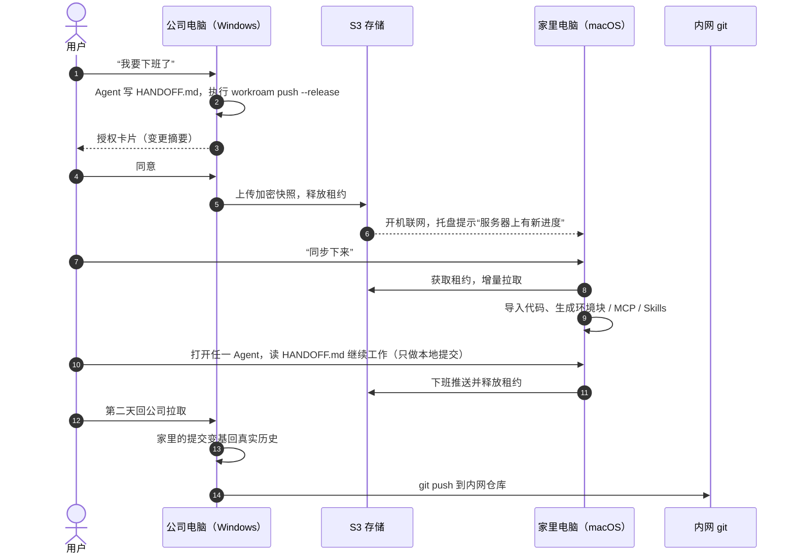

# Workroam 产品需求文档（PRD）

| 项目 | 内容 |
| --- | --- |
| 文档状态 | 草案（v0.1 范围已确定，部分事项待决，见 [§12 待决事项](#12-待决事项)） |
| 适用版本 | v0.1 – v1.0 |
| 最后更新 | 2026-10-29 |
| 关联文档 | [技术架构](architecture.md) · [架构决策记录](adr/README.md) |

---

## 目录

1. [产品概述](#1-产品概述)
2. [背景与问题](#2-背景与问题)
3. [目标用户](#3-目标用户)
4. [目标与非目标](#4-目标与非目标)
5. [核心概念与术语](#5-核心概念与术语)
6. [使用场景与用户故事](#6-使用场景与用户故事)
7. [功能需求](#7-功能需求)
8. [非功能需求](#8-非功能需求)
9. [版本规划与验收门槛](#9-版本规划与验收门槛)
10. [成功指标](#10-成功指标)
11. [风险](#11-风险)
12. [待决事项](#12-待决事项)
13. [已否决方案](#13-已否决方案)

---

## 1. 产品概述

**Workroam 是一个开源、自托管的 AI Agent 工作区漫游工具。** 用户只需要一台自己的 S3 兼容存储，在任何一台电脑上对任何 Agent 说一句“同步下来”，项目、代码、规则、MCP / Skills 和上下文就都能接上。

一句话定位：**给“一个人 × 多台机器 × 多个 AI Agent”用的接力棒。**

产品形态：

- `workroam` 命令行：给人和 Agent 使用；
- `workroamd` 后台服务：同步引擎、租约、文件监听、触发检测；
- Workroam 托盘应用：授权、进度、完成、到达四种卡片和设置面板；
- 服务端：任意 S3 兼容存储（RustFS、Garage、SeaweedFS、AWS S3、Cloudflare R2、阿里云 OSS 等），外加 Caddy 提供 HTTPS，一条命令部署。

## 2. 背景与问题

| # | 现状 | 痛点 |
| --- | --- | --- |
| P1 | 同时使用多个 Agent（Claude Code、Codex、Antigravity、Grok Build、Pi、ZCode 等），都在本地 `projects/` 文件夹里读写代码、文档和交付物 | 每个 Agent 的规则、MCP、Skills、会话格式和位置都不同，换机器后要手动重配 |
| P2 | 在公司电脑和家里电脑之间切换，系统可能是 Windows、macOS、Linux 的任意组合 | 路径、换行符、大小写、符号链接、可执行位、Shell 都不一样 |
| P3 | 只有公司电脑能访问内网系统和内网 git 仓库 | “Agent 跑在远程服务器、两地远程连接”行不通，必须本地优先 |
| P4 | 网盘、Syncthing、rclone 等通用同步工具 | 不理解 Agent 的规则 / MCP / Skills / 会话，也不理解 git 和跨系统差异；同步 `.git` 目录会损坏仓库 |
| P5 | 换机器后 Agent 从零开始 | 上下文丢失，需要重新解释进度 |

## 3. 目标用户

**主要用户画像：多机接力的独立开发者**

- 日常同时用 2 个以上 AI 编码 Agent；
- 至少两台电脑（例如公司 Windows + 家里 Mac），其中只有一台能访问内网；
- 能自己部署一台小服务器或已有对象存储；
- 对代码安全敏感：不愿意把内网代码明文放到第三方网盘。

**次要用户**（v1.0 之后）：需要把项目连同 Agent 上下文交给同事的小团队。

## 4. 目标与非目标

### 4.1 目标

| ID | 目标 |
| --- | --- |
| G1 | 任一台机器上，项目文件夹的内容始终是最新的：代码、文档、交付物 |
| G2 | 每个项目由自己的 `AGENTS.md` 约束所有 Agent，机器差异只在本机体现 |
| G3 | 项目级 MCP、Skills 按需同步，并为每个 Agent 生成原生配置 |
| G4 | Agent 上下文不丢失：任何 Agent 都能接着上一个 Agent 的进度继续 |
| G5 | Windows、macOS、Linux 任意组合之间无缝切换 |
| G6 | 开源，每人一台自己的服务器即可一键部署；有网络就同步，没网络照常工作 |
| G7 | 用户始终知情：同步前授权，同步中可见进度，完成或失败有提醒 |

### 4.2 非目标

- 多人同时编辑同一项目（第一版只支持一个人在多台机器间接力）；
- 替代 git 托管平台或 CI；
- 托管 Agent 运行环境或远程开发环境；
- 实时协同（同一时间只有一台机器在写）。

## 5. 核心概念与术语

| 术语 | 含义 |
| --- | --- |
| 接力（handoff） | 一个人在多台机器之间先后工作，同一时间只有一台机器在写 |
| 租约（lease） | 存放在服务器上的锁对象，记录当前持有项目的机器；离开时释放，到达时获取 |
| 快照（snapshot） | 一次推送的完整状态清单，内容寻址、写入后不再修改，可回滚 |
| 共享源文件 | 所有机器一致、参与同步的文件：代码、文档、`AGENTS.md` 正文、Skills、MCP 定义 |
| 本机生成文件 | 拉取后按本机系统和 Agent 生成、不参与同步的文件：各 Agent 原生 MCP 配置、Skills 链接、环境块 |
| 本机环境块 | `AGENTS.md` 末尾由 Workroam 写入的一段，描述当前机器（系统、Shell、能否访问内网），同步时剥离 |
| 交接文档 | `.handoff/HANDOFF.md`，推送前由当前 Agent 写的结构化进度说明，是跨 Agent 继续工作的可靠依据 |
| 适配器（adapter） | 描述某个 Agent 的规则、Skills、MCP、会话位置和生成方式的声明式数据文件 |
| 代码同步模式 | 每个仓库可选 `bundle`、`remote`、`files` 三种之一 |

## 6. 使用场景与用户故事

### 6.1 典型的一天

### 6.2 用户故事

| ID | 作为… | 我希望… | 以便… | 版本 |
| --- | --- | --- | --- | --- |
| US-01 | 下班的开发者 | 对任一 Agent 说一句“我要下班了”就完成推送 | 不用记命令 | v0.1 |
| US-02 | 到家的开发者 | 开机后收到提醒并一键拉取 | 马上接着干 | v0.1（提醒 v0.3） |
| US-03 | 换了 Agent 的开发者 | 新 Agent 能读到上一个 Agent 的进度 | 上下文不丢 | v0.1 |
| US-04 | 内网项目的开发者 | 家里能看到最近的提交历史并能本地提交，回公司后能正常推送内网 | 不违反内网隔离，又不丢工作 | v0.1 |
| US-05 | 关心安全的开发者 | 服务器上只有密文、凭证永远不同步 | 服务器泄露也不泄露代码 | v0.1 |
| US-06 | 谨慎的用户 | Agent 发起的同步也必须由我在卡片上确认 | 防止 Agent 误解或被项目文件诱导 | v0.1 |
| US-07 | 跨系统的用户 | 推送前就发现 Windows 不兼容的文件名、大小写冲突 | 不在另一台机器上才出问题 | v0.1 |
| US-08 | 同时用多个 Agent 的用户 | 只维护一份 MCP / Skills 定义，各 Agent 都能用 | 不用为每个 Agent 各配一遍 | v0.1（Claude Code、Codex）/ v0.2（其余） |
| US-09 | 忘记释放租约的用户 | 在另一台机器上看到警告并可强制接管，且不会静默覆盖 | 不被锁死也不丢数据 | v0.1 |
| US-10 | 不想手动操作的用户 | 空闲、合盖、开机时自动发起同步 | 日常无感 | v0.3 |
| US-11 | 出错后想回退的用户 | 回滚到任意一次同步 | 数据可恢复 | v0.1（CLI）|
| US-12 | 自托管用户 | 一条命令在自己的服务器上部署好存储和 HTTPS | 部署门槛低 | v0.1 |

## 7. 功能需求

优先级：**P0** = v0.1 必须；**P1** = v0.2；**P2** = v0.3；**P3** = v1.0 及以后。

### 7.1 部署与登录（DEP）

| ID | 需求 | 优先级 |
| --- | --- | --- |
| DEP-01 | 服务端一条命令部署：`install.sh --domain <域名> --storage rustfs\|garage\|seaweedfs\|external`，用 Docker Compose 启动存储与 Caddy（自动申请 HTTPS 证书），创建 bucket 与只授权该 bucket 的访问密钥，最后打印配对信息 | P0 |
| DEP-02 | 全部流量走单一域名的 443 端口 | P0 |
| DEP-03 | `workroam login`：完成设备注册、存储能力探测（条件写、分片上传、路径风格 / 虚拟主机风格）、加密密码设置 | P0 |
| DEP-04 | 配对码登录（`workroam login <域名> --code XXXX`）与每设备独立、可单独吊销的凭证 | P0 → 见 **D-02**，v0.1 默认改为“配对串”方式 |
| DEP-05 | 恢复密钥导出（密码丢失时的唯一恢复手段） | P0 |
| DEP-06 | 客户端安装：Homebrew、Scoop / winget、三系统二进制直接下载，托盘应用随安装包提供 | P0（直接下载）/ P1（包管理器） |
| DEP-07 | 可选部署：Cloudflare Tunnel、Helm Chart、附带 Gitea 的 Compose | P1 / P2 |

### 7.2 项目初始化（INIT）

| ID | 需求 | 优先级 |
| --- | --- | --- |
| INIT-01 | `workroam init`：在项目根生成 `.workroam/workroam.toml`、`.workroam/mcp.toml`、`.workroam/env/`、`.agents/skills/`、`.handoff/HANDOFF.md` 模板 | P0 |
| INIT-02 | 扫描项目内 git 仓库，根据 origin 主机名与各机器 `machine.toml` 的 `reachable` 推荐代码同步模式，用户可覆盖 | P0 |
| INIT-03 | 在 `AGENTS.md` 共享正文中写入“工作区同步”约定段落（何时推送、何时拉取、`.workroam/SYNCING` 时暂停写入） | P0 |
| INIT-04 | 需要时生成一行 `@AGENTS.md` 的 `CLAUDE.md` | P0 |

### 7.3 推送（PUSH）

| ID | 需求 | 优先级 |
| --- | --- | --- |
| PUSH-01 | 推送前检查租约、git 仓库状态（rebase / merge 中途时拒绝）、跨平台问题 | P0 |
| PUSH-02 | 预演：计算变更摘要（文件数与大小、仓库提交数、预计耗时），发起授权 | P0 |
| PUSH-03 | 剥离 `AGENTS.md` 环境块，排除本机生成文件与凭证 | P0 |
| PUSH-04 | 按仓库同步模式打包代码（bundle、WIP 提交等） | P0 |
| PUSH-05 | 上传数据块（已存在的自动跳过），最后写入快照清单并更新“最新快照”指针 | P0 |
| PUSH-06 | `--release` 时释放租约并发送完成提醒 | P0 |
| PUSH-07 | 中断后重试时已上传的数据块自动跳过（续传） | P0 |

### 7.4 拉取（PULL）

| ID | 需求 | 优先级 |
| --- | --- | --- |
| PULL-01 | 获取租约，写入 `.workroam/SYNCING` 标记 | P0 |
| PULL-02 | 对比本地清单与目标快照，得出增、删、改列表 | P0 |
| PULL-03 | 文件先写临时位置再改名替换，覆盖前核对本地是否仍是预期的旧版本 | P0 |
| PULL-04 | 导入代码：fetch bundle、还原 WIP、快进或合并分支 | P0 |
| PULL-05 | 生成本机文件：环境块、各 Agent MCP 配置、Skills 链接 | P0 |
| PULL-06 | 迁移 Agent 会话（改写路径键与工作目录字段，尽力而为） | P1 |
| PULL-07 | 删除 `.workroam/SYNCING`，发送完成提醒 | P0 |
| PULL-08 | 拉取会碰到本地尚未同步的改动时，无论自动同步处于哪一档都先询问 | P0 |

### 7.5 租约（LEASE）

| ID | 需求 | 优先级 |
| --- | --- | --- |
| LEASE-01 | 锁对象记录项目、机器 ID、获取时间、过期时间；用 S3 条件写原子抢锁 | P0 |
| LEASE-02 | 他人持有租约时弹出警告，用户选择等待或强制接管；接管时生成冲突副本，从不静默覆盖 | P0 |
| LEASE-03 | 存储不支持条件写时降级为乐观并发：快照记录父快照，同一父快照被推送两次即视为分叉，下次拉取时交给用户处理 | P0 |
| LEASE-04 | 租约过期策略（见 **D-06**） | P0 |

### 7.6 快照与恢复（SNAP）

| ID | 需求 | 优先级 |
| --- | --- | --- |
| SNAP-01 | 内容寻址分块、去重、客户端加密、快照历史（复用 rustic_core，见 ADR-0003） | P0 |
| SNAP-02 | 快照清单记录路径 → 内容哈希、权限位、符号链接等元数据及父快照 | P0 |
| SNAP-03 | 本地缓存“路径、大小、修改时间 → 哈希”，避免每次全量计算 | P0 |
| SNAP-04 | `workroam history` / `workroam restore <快照>`：查看历史、回滚到任意一次同步 | P0 |
| SNAP-05 | 快照保留与清理策略（`workroam prune`） | P1 |

### 7.7 代码仓库同步（GIT）

| ID | 需求 | 优先级 |
| --- | --- | --- |
| GIT-01 | 每台机器各自维护 `.git`，不对 `.git` 目录做文件级同步 | P0 |
| GIT-02 | `bundle` 模式：首次完整 bundle，之后只打包上次交换之后的新提交和 WIP 提交；“上次交换到的提交”记录在快照清单中 | P0 |
| GIT-03 | `bundle` 模式历史档位：`full`、`recent:N`、`snapshot`；`recent` / `snapshot` 重建提交并保存映射表，回公司时自动 `git rebase --onto` 回真实历史 | P0 |
| GIT-04 | `extras`：被 `.gitignore` 忽略但需要带走的文件走文件同步 | P0 |
| GIT-05 | WIP 提交：用临时索引生成，不碰用户暂存区和业务分支，包含未跟踪且未被忽略的文件；到达后还原为未提交改动 | P0 |
| GIT-06 | `remote` 模式：经 origin 或中转远端（Gitea / GitHub 私有库）同步，WIP 推到 `workroam/wip/<分支名>` | P1 |
| GIT-07 | `files` 模式：`git ls-files -co --exclude-standard` 列文件，基线三方合并，可生成只读影子仓库 | P1 |
| GIT-08 | 在本机环境块中写明每个仓库在本机能否推送 | P0 |

### 7.8 规则与交接（RULE）

| ID | 需求 | 优先级 |
| --- | --- | --- |
| RULE-01 | 每个项目根目录一份 `AGENTS.md`；不修改任何 Agent 的全局规则文件 | P0 |
| RULE-02 | 拉取后在 `AGENTS.md` 末尾写入本机环境块（`<!-- workroam:env:begin -->` … `<!-- workroam:env:end -->`），推送时剥离 | P0 |
| RULE-03 | `.handoff/HANDOFF.md` 模板：更新时间 / 机器 / Agent、当前目标、已完成、进行中、下一步、未决问题、注意事项 | P0 |
| RULE-04 | 推送前提示 Agent 更新 HANDOFF.md；文件未更新时在授权卡片上提示 | P0 |

### 7.9 Agent 适配（ADPT）

| ID | 需求 | 优先级 |
| --- | --- | --- |
| ADPT-01 | 每个 Agent 一个声明式适配器文件：规则、Skills、MCP、会话位置、排除项、生成模板、支持的版本范围 | P0 |
| ADPT-02 | v0.1 适配器：Claude Code、Codex | P0 |
| ADPT-03 | v0.2 适配器：Grok Build、Antigravity、ZCode、Pi | P1 |
| ADPT-04 | `.workroam/mcp.toml` 是 MCP 唯一定义，含各系统覆盖项；拉取后为每个 Agent 生成原生配置并加入排除列表 | P0 |
| ADPT-05 | `.agents/skills/` 是 Skills 唯一来源；为 Claude Code 生成 `.claude/skills` 链接（Windows 目录用 junction，文件用复制） | P0 |
| ADPT-06 | `${secret:xxx}` 密钥引用在本机解析，绝不同步 | P0 |
| ADPT-07 | 适配器带版本号与一致性测试，能识别 Agent 版本 | P1 |

### 7.10 跨平台（XP）

| ID | 需求 | 优先级 |
| --- | --- | --- |
| XP-01 | 推送前检测并拒绝大小写冲突（如 `README.md` 与 `Readme.md`） | P0 |
| XP-02 | 推送前检测并拒绝 Windows 非法文件名（`CON`、`AUX`、含 `:` 或 `?`、以点或空格结尾） | P0 |
| XP-03 | 路径长度超过 260 字符时提示开启 LongPathsEnabled 并设置 `core.longpaths=true` | P0 |
| XP-04 | 符号链接、可执行位记入清单；Windows 上目录用 junction、文件改为复制，可执行位保持不动，回到 macOS / Linux 时恢复 | P0 |
| XP-05 | 清单内路径统一为 NFC、相对路径和 `/` 分隔符 | P0 |
| XP-06 | Windows 文件被占用时重试，并用临时文件 + 改名替换落盘 | P0 |

### 7.11 交互：授权、进度与提醒（UX）

| ID | 需求 | 优先级 |
| --- | --- | --- |
| UX-01 | 授权卡片：项目、发起方、文件数与大小、仓库提交数、目标服务器、预计耗时与注意事项；操作：查看详情 / 稍后 / 同意，可勾选“本项目 1 小时内不再询问” | P0 |
| UX-02 | 进度卡片：当前阶段、已传 / 总量、速度、剩余时间、“已阻止休眠，断网自动续传”；可取消 | P0 |
| UX-03 | 完成卡片：快照编号、耗时、租约状态；失败时卡片常驻、提供重试、托盘图标变为警示 | P0 |
| UX-04 | 到达卡片：来源机器、时间、变更概要、是否有冲突 | P2 |
| UX-05 | 主动弹出的卡片固定在屏幕角落（Windows 右下、macOS 右上），不抢键盘焦点，不设回车默认按钮，超时一律按“稍后” | P0 |
| UX-06 | Agent 发起的同步默认也需要确认；CLI 输出“等待在 Workroam 卡片上确认…（10 分钟后超时）”，每约 10% 输出一行进度 | P0 |
| UX-07 | 无图形界面时退回终端确认或 `workroam approve <id>` | P0 |
| UX-08 | 自动同步三档：关闭 / 询问（默认）/ 全自动；触发条件：空闲 N 分钟、合盖或关机前、开机联网发现新快照 | P2 |
| UX-09 | 同步期间阻止休眠；Windows 关机时显示“Workroam 正在同步” | P0（阻止休眠）/ P2（关机提示） |
| UX-10 | 手机推送（如 ntfy） | P2 |

### 7.12 命令行（CLI）

| 命令 | 说明 | 优先级 |
| --- | --- | --- |
| `workroam login` | 登录服务器、注册设备、设置加密密码 | P0 |
| `workroam init` | 初始化项目 | P0 |
| `workroam push [--release]` | 推送快照，可选释放租约 | P0 |
| `workroam pull [--acquire]` | 拉取最新快照并获取租约 | P0 |
| `workroam status` | 租约、最新快照、本地未同步改动、后台服务状态 | P0 |
| `workroam approve <id>` / `workroam deny <id>` | 无图形界面时确认或拒绝 | P0 |
| `workroam history` / `workroam restore` | 快照历史与回滚 | P0 |
| `workroam lease takeover` | 强制接管租约 | P0 |
| `workroam doctor` | 环境与存储能力自检 | P1 |
| `workroam prune` | 快照清理 | P1 |

CLI 必须区分终端（进度条）与非终端（Agent 调用，每约 10% 一行）输出，并以稳定的退出码表达“被拒绝 / 超时 / 租约冲突 / 检查失败 / 需要解决冲突”等结果（定义见架构文档）。

### 7.13 安全（SEC）

| ID | 需求 | 优先级 |
| --- | --- | --- |
| SEC-01 | 端到端加密：数据在客户端加密，密钥由用户密码派生，服务器只存密文 | P0 |
| SEC-02 | 凭证排除：各 Agent 的登录凭证（如 `~/.grok/auth.json`）、OAuth 令牌、`.env` 中的密钥由适配器强制排除 | P0 |
| SEC-03 | 最小权限：访问密钥只授权单个 bucket | P0 |
| SEC-04 | 人工确认：Agent 发起的推送和拉取默认需要在授权卡片上确认，可按项目放宽 | P0 |
| SEC-05 | 全部流量 HTTPS 443 | P0 |
| SEC-06 | 文档中明确合规提示：内网代码离开公司网络前需确认公司规定 | P0 |

## 8. 非功能需求

| 类别 | 要求 |
| --- | --- |
| 可靠性 | 任何中断（断网、断电、进程被杀）都不能留下半个快照或损坏工作区；推送“先传块、后写清单”，拉取“临时文件 + 改名 + 操作日志” |
| 数据安全 | 从不静默覆盖：冲突一律保留两份或交给用户 / Agent 处理；所有历史快照可回滚 |
| 性能 | 小改动（< 100 个文件变化）的增量推送 / 拉取在普通家庭宽带下 30 秒内完成；无变化时 `workroam status` 在 2 秒内返回（目标值，v0.1 实测后校准） |
| 资源 | 后台服务空闲时 CPU 接近 0，内存 < 100 MB |
| 兼容性 | Windows 10+、macOS 13+、主流 Linux 发行版（x86_64 与 aarch64）；S3 存储需在登录时探测能力并降级 |
| 可用性 | 离线时一切照常工作，联网后再同步；所有出错信息给出下一步操作建议 |
| 可观测性 | 本地结构化日志，`workroam status` 与托盘可见最近一次同步结果 |
| 可维护性 | Agent 差异全部用数据（适配器）描述，社区以 PR 贡献 |
| 分发 | 单文件二进制；依赖许可证由 cargo-deny 在 CI 中检查 |
| 国际化 | 界面与文档中英双语 |

## 9. 版本规划与验收门槛

门槛是可验证的使用结果，不是日期。

| 版本 | 主题 | 主要内容 | 门槛 |
| --- | --- | --- | --- |
| **v0.1** | 我自己每天在用 | CLI：init / login / push / pull / status；快照引擎、租约、端到端加密；项目文件同步与跨平台检查；bundle 模式（full / recent / snapshot）；`AGENTS.md` 环境块与 HANDOFF.md；Claude Code、Codex 适配器；托盘授权 / 进度 / 完成卡片，终端确认备用；服务端只需 S3 + Caddy | 公司 Windows 与家里 Mac 之间连续使用两周，没有丢过数据 |
| v0.2 | 多 Agent | Grok Build、Antigravity、ZCode、Pi 适配器；MCP / Skills 按 Agent 生成；Agent 会话迁移；remote 与 files 模式；附带 Gitea 的部署配置 | 六个 Agent 换机器后都能直接开工 |
| v0.3 | 无感同步 | 自动触发同步、到达提醒卡片、同步历史；给 Agent 用的 MCP server；手机推送；可选轻量服务端（Web 界面） | 日常基本不用手动敲命令 |
| v1.0 | 格式稳定 | 冻结仓库格式与适配器规范 v1，提供迁移工具；系统 × Agent 的 CI 测试矩阵；中英文文档 | 可以放心推荐给别人用 |
| 之后 | 扩展 | 团队交接；托管版 | — |

托盘授权卡片放在 v0.1：每次同步都需要确认，没有卡片就无法日常使用。

## 10. 成功指标

| 指标 | v0.1 目标 |
| --- | --- |
| 数据丢失事件 | 0 |
| 连续接力天数（作者本人） | ≥ 14 天 |
| 每次接力的手动操作 | 推送 1 句话 + 1 次确认；拉取 1 句话 + 1 次确认 |
| 换机器后 Agent 能直接汇报进度并继续 | Claude Code、Codex 100% |
| 同步失败后可自动续传 | 100% |

## 11. 风险

| 风险 | 应对 |
| --- | --- |
| Agent 内部格式变化快 | 适配器识别 Agent 版本；会话迁移只做到尽力而为；以 HANDOFF.md 兜底 |
| 公司合规 | 端到端加密、按项目开启、`snapshot` 历史档位、文档明确说明 |
| Windows 边界情况 | 测试成本大头；CI 覆盖三系统 |
| 大仓库首次同步 | 分块去重；后续考虑 LFS 支持 |
| 存储兼容性 | 登录时探测能力；不支持条件写时降级 |
| 加密密码丢失 | 提供恢复密钥导出 |
| 快照引擎依赖尚未 1.0 | 锁定版本并封装在接口之后（见 ADR-0003） |

## 12. 待决事项

“状态”为 **已决定** 的事项已写入架构文档；为 **待确认** 的事项，文档按“默认方案”编写，确认后再更新。

| ID | 问题 | 默认方案 | 状态 |
| --- | --- | --- | --- |
| D-01 | 项目名称：原仓库名 `botan` 与设计稿中的 Baton 在 crates.io 均已被占用 | 定名 **Workroam**（工作区漫游）：命令 `workroam`，后台服务 `workroamd`，crate 前缀 `workroam-`；crates.io / npm / GitHub 均未被占用；仓库已改名为 `kverona-ai/workroam` | 已决定 |
| D-02 | v0.1 服务端只有 S3 + Caddy，无法兑换配对码、动态签发每设备凭证 | v0.1：安装脚本输出一个“配对串”（端点、bucket、只授权该 bucket 的密钥），`workroam login --pair <配对串>` 粘贴登录；所有设备共用该密钥。配对码与每设备独立凭证随 v0.3 轻量服务端提供 | 待确认 |
| D-03 | 快照引擎：rustic_core 还是 kopia | rustic_core（Rust 库可直接嵌入；restic 格式成熟，可用 restic 官方工具应急恢复）。kopia 为 Go，需另带二进制，不再作为备选 | 已决定（ADR-0003） |
| D-04 | v0.1 适配器是否同步 Agent 会话 | v0.1 只负责规则、Skills、MCP 生成与凭证排除；会话不同步，上下文靠 HANDOFF.md；会话迁移在 v0.2 | 待确认 |
| D-05 | 快照粒度 | 每个项目一条独立的快照序列与一把租约；所有项目共用一个加密仓库（跨项目去重） | 待确认 |
| D-06 | 租约过期时长 | 后台服务在线时每 10 分钟续约；超过 12 小时未续约视为“可能已遗忘”，接管时仍需确认但不再显示高危警告 | 待确认 |
| D-07 | Linux 客户端是否属于 v0.1 | CLI 与后台服务在 Linux 上可用并进入 CI；托盘在 Linux 上尽力而为；v0.1 门槛只验证 Windows ↔ macOS | 待确认 |
| D-08 | 租约、最新快照指针等元数据是否加密 | 对象内容用仓库密钥加密，对象键使用项目名的 HMAC，避免在服务器上暴露项目名与机器名 | 待确认 |
| D-09 | 托盘框架：Tauri、GPUI 还是 MyGo | v0.1 使用 Tauri v2；托盘与 `workroamd` 之间使用语言无关的 JSON 协议，以后可以换掉托盘实现 | 已决定（ADR-0002） |
| D-10 | v0.1 实施方式 | 先评审本 PRD 与架构文档，再按里程碑实现 | 待确认 |

## 13. 已否决方案

| 方案 | 否决原因 |
| --- | --- |
| 工作区不动、人远程连接 | 只有公司电脑能访问内网，家里无法连接 |
| 整体同步 `.git` 目录 | 跨系统配置冲突、索引锁、worktree 绝对路径等问题多；改为每台机器自有 `.git` |
| 用 stdio 版 rustfs-mcp 作为主通道 | 按本地路径上传，不适合跨机器和移动端 |
| 在各 Agent 全局规则文件中注入同步指令 | 各机器环境和约束不同，改为项目级 `AGENTS.md` + 本机环境块 |
| 绑定 RustFS | 改为任意 S3 兼容存储，RustFS 只是默认选项之一 |
| 自研存储格式 | 加密、去重、续传都有成熟实现，自研风险大、周期长 |
