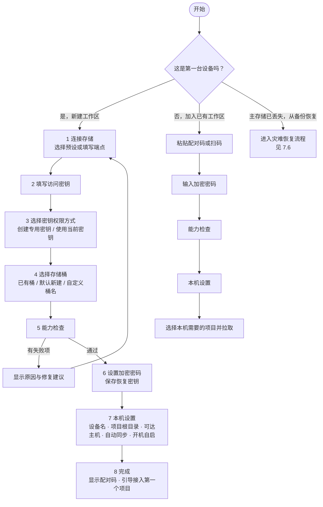
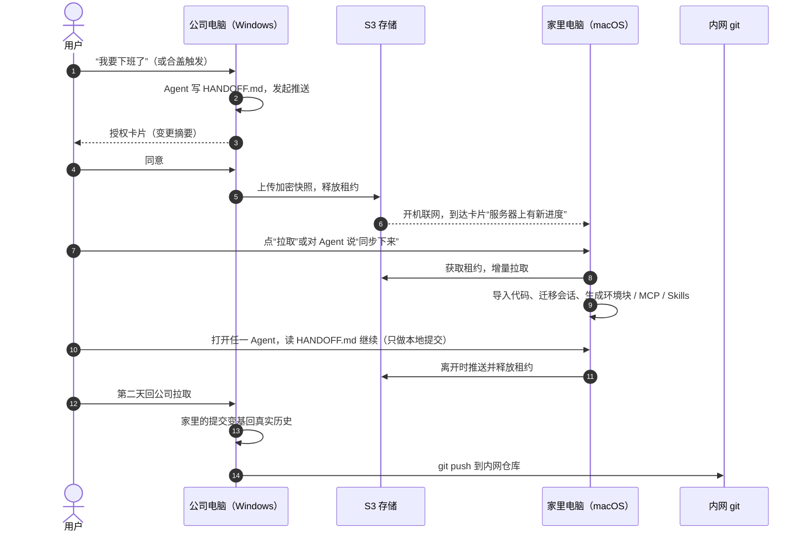
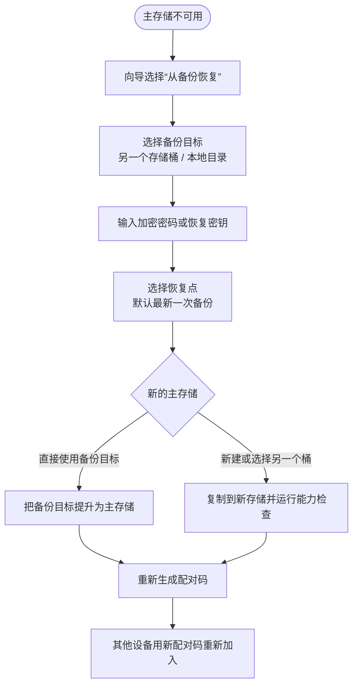

# Workroam 产品需求文档（PRD）

| 项目 | 内容 |
| --- | --- |
| 版本 | 1.1（新增工作区备份与恢复） |
| 覆盖范围 | 产品最终形态 v0.3，按 v0.1 → v0.2 → v0.3 分阶段交付 |
| 状态 | 已定稿，进入实现阶段 |
| 最后更新 | 2026-10-29 |
| 关联文档 | [技术架构](architecture.md) · [架构决策记录](adr/README.md) |

---

## 目录

1. [产品概述](#1-产品概述)
2. [背景与问题](#2-背景与问题)
3. [目标用户](#3-目标用户)
4. [目标与非目标](#4-目标与非目标)
5. [核心概念与术语](#5-核心概念与术语)
6. [产品组成](#6-产品组成)
7. [用户旅程](#7-用户旅程)
8. [功能需求](#8-功能需求)
9. [非功能需求](#9-非功能需求)
10. [版本规划与验收门槛](#10-版本规划与验收门槛)
11. [成功指标](#11-成功指标)
12. [风险与应对](#12-风险与应对)

---

## 1. 产品概述

**Workroam 是一个开源、自托管的 AI Agent 工作区漫游工具。** 用户只需要一个自己的 S3 兼容存储桶，在任何一台电脑上对任何 Agent 说一句“同步下来”，项目、代码、规则、MCP / Skills 和上下文就都能接上。

一句话定位：**给“一个人 × 多台机器 × 多个 AI Agent”用的接力棒。**

v0.3 是本文定义的产品最终形态，用户可以：

- 在桌面向导里几分钟完成首次初始化：连接存储、选择或新建存储桶、设定密钥权限、设置加密密码，并逐项通过连通性与能力检查；
- 用一个配对码把第二台、第三台电脑加入同一个工作区；
- 在 Windows、macOS、Linux 任意组合之间接力，六个主流 Agent（Claude Code、Codex、Grok Build、Antigravity、ZCode、Pi）换机器后都能直接开工；
- 基本不用手动敲命令：离开时自动或一键推送，到达时收到提醒一键拉取；
- 在手机上收到提醒，并在浏览器里查看快照和交付物（数据在浏览器内解密）；
- 把整个工作区自动备份到第二个位置（另一个存储桶或本地 NAS / 移动硬盘），误删、改坏、存储损坏、电脑丢失时都能找回。

## 2. 背景与问题

| # | 现状 | 痛点 |
| --- | --- | --- |
| P1 | 同时使用多个 Agent，都在本地 `projects/` 文件夹里读写代码、文档和交付物 | 每个 Agent 的规则、MCP、Skills、会话格式和位置都不同，换机器后要手动重配 |
| P2 | 在公司电脑和家里电脑之间切换，系统可能是 Windows、macOS、Linux 的任意组合 | 路径、换行符、大小写、符号链接、可执行位、Shell 都不一样 |
| P3 | 只有公司电脑能访问内网系统和内网 git 仓库 | 无法把 Agent 放在远程服务器上两地连接，必须本地优先 |
| P4 | 通用同步工具（网盘、Syncthing、rclone） | 不理解 Agent 的规则、MCP、Skills、会话，也不理解 git 和跨系统差异；同步 `.git` 目录会损坏仓库 |
| P5 | 换机器后 Agent 从零开始 | 上下文丢失，需要重新解释进度 |
| P6 | 自托管对象存储的配置门槛 | 桶、密钥、权限、地址风格、HTTPS 任何一项配错都难以排查 |

## 3. 目标用户

**主要用户：多机接力的独立开发者**

- 日常同时用 2 个以上 AI 编码 Agent；
- 至少两台电脑（例如公司 Windows + 家里 Mac），其中只有一台能访问内网；
- 能自己部署一台小服务器，或已有对象存储（AWS S3、Cloudflare R2、阿里云 OSS 等）；
- 对代码安全敏感：不愿意把内网代码明文放到第三方网盘。

**次要用户：只想在多台个人电脑之间带走 Agent 工作区的开发者**，不涉及内网，但同样需要跨系统与跨 Agent 的一致性。

## 4. 目标与非目标

### 4.1 目标

| ID | 目标 |
| --- | --- |
| G1 | 任一台机器上，项目文件夹的内容始终是最新的：代码、文档、交付物 |
| G2 | 每个项目由自己的 `AGENTS.md` 约束所有 Agent，机器差异只在本机体现 |
| G3 | 项目级 MCP、Skills 只维护一份，为每个 Agent 生成原生配置 |
| G4 | Agent 上下文不丢失：任何 Agent 都能接着上一个 Agent 的进度继续 |
| G5 | Windows、macOS、Linux 任意组合之间无缝切换 |
| G6 | 开源、自托管，首次初始化有引导和检查；有网络就同步，没网络照常工作 |
| G7 | 用户始终知情：同步前授权，同步中可见进度，完成或失败有提醒 |
| G8 | 日常无感：触发、提醒、拉取尽量自动完成，必要时才打扰用户 |
| G9 | 数据可恢复：任何一次同步都能回退；主存储整体丢失时，也能从备份恢复整个工作区 |

### 4.2 非目标

- 多人同时编辑同一项目（产品面向一个人在多台机器之间接力）；
- 实时协同或实时文件同步（同一时间只有一台机器在写）；
- 替代 git 托管平台或 CI；
- 托管 Agent 运行环境或远程开发环境。

## 5. 核心概念与术语

| 术语 | 含义 |
| --- | --- |
| 工作区（workspace） | 一个用户的全部同步数据，对应一个存储桶（或桶内前缀）和一套加密密钥；可包含多个项目和多台设备 |
| 设备（device） | 加入工作区的一台电脑，有名称、系统、权限（读写或只读） |
| 接力（handoff） | 一个人在多台机器之间先后工作，同一时间只有一台机器在写 |
| 租约（lease） | 存放在存储上的锁对象，记录当前持有项目的设备；离开时释放，到达时获取 |
| 快照（snapshot） | 一次推送的完整状态，内容寻址、写入后不再修改，可回滚 |
| 共享源文件 | 所有机器一致、参与同步的文件：代码、文档、`AGENTS.md` 正文、Skills、MCP 定义 |
| 本机生成文件 | 拉取后按本机系统和 Agent 生成、不参与同步的文件：各 Agent 原生 MCP 配置、Skills 链接、环境块 |
| 本机环境块 | `AGENTS.md` 末尾由 Workroam 写入的一段，描述当前机器（系统、Shell、能否访问内网、哪些仓库能推送），同步时剥离 |
| 交接文档 | `.handoff/HANDOFF.md`，推送前由当前 Agent 写的结构化进度说明，是跨 Agent 继续工作的可靠依据 |
| 适配器（adapter） | 描述某个 Agent 的规则、Skills、MCP、会话位置和生成方式的声明式数据文件 |
| 代码同步模式 | 每个仓库可选 `bundle`、`remote`、`files` 三种之一 |
| 配对码 | 把新设备加入工作区的一段字符串或二维码，内含用加密密码保护的连接信息 |
| 恢复密钥 | 首次初始化时生成的备用密钥，加密密码丢失时用它解锁工作区 |
| 主存储 | 工作区日常同步使用的存储桶 |
| 备份目标 | 工作区的第二份加密副本所在位置：另一个 S3 兼容桶，或本地目录（NAS、移动硬盘） |
| 恢复点 | 可以恢复到的一个时间点：主存储中的任意一次快照，或备份目标中的任意一次备份 |

## 6. 产品组成

| 组件 | 形态 | 职责 |
| --- | --- | --- |
| `workroam` 命令行 | 单文件二进制 | 给人和 Agent 使用：初始化、接入项目、推送、拉取、状态、历史、设备管理 |
| `workroamd` 后台服务 | 用户级服务，开机自启 | 同步引擎、租约、触发检测、文件监听、授权管理、事件推送 |
| Workroam 桌面应用 | 托盘图标 + 卡片 + 窗口（Tauri v2） | 首次初始化向导、项目接入向导、授权 / 进度 / 完成 / 到达卡片、设置与设备管理 |
| Agent 用 MCP server | `workroam mcp`（stdio） | 让 Agent 通过 MCP 工具查询状态、发起推送 / 拉取、读写交接文档 |
| 存储 | 任意 S3 兼容存储 | 保存加密快照、租约和控制对象；默认部署 RustFS + Caddy |
| `workroam-server`（可选） | 单个容器 | 设备配对码与每设备独立凭证、手机推送、Web 界面（浏览器内解密查看快照与交付物） |

## 7. 用户旅程

### 7.1 首次使用：初始化引导

首次启动桌面应用时自动打开**初始化向导**；没有图形界面的机器使用等价的 `workroam setup`。

**形态决策：桌面向导为主，命令行等价。**

| 考量 | 结论 |
| --- | --- |
| 初始化只做一次，但选项多（存储、桶、密钥权限、加密） | 向导逐步呈现、每步可回退，比命令行问答更不易出错 |
| 能力检查有十余项，需要直观呈现通过 / 警告 / 失败及修复建议 | UI 列表更清晰 |
| 恢复密钥必须确认已保存；配对码最好能显示二维码 | 只有 UI 能做好 |
| 桌面应用随安装包提供，装完即可弹出向导 | 无额外成本 |
| Linux 服务器、无图形界面的机器、批量部署 | 提供 `workroam setup`：交互式问答，或通过参数非交互执行 |

两者调用同一套初始化与检查逻辑，结果完全一致。

**向导流程：**

**步骤要点：**

1. **连接存储**：预设有“自建（install.sh 部署）”“AWS S3”“Cloudflare R2”“阿里云 OSS”“其他 S3 兼容”；自动识别地址风格与区域；自建服务器显示部署命令。
2. **访问密钥**：填写 Access Key 与 Secret；密钥只保存到系统密钥库。
3. **密钥权限方式**：
   - **由 Workroam 创建专用密钥（推荐）**：用户提供一次具备管理权限的密钥，Workroam 为本工作区创建只授权该桶（或该前缀）的专用密钥，管理员密钥用完即丢弃、不保存；可选“读写”或“只读”。存储不支持时自动隐藏此项。
   - **使用当前密钥**：Workroam 检查其权限范围，权限过宽（例如可访问账号下所有桶）时给出明确警告和收窄建议，由用户确认后继续。
4. **存储桶**：
   - **选择已有桶**：列出密钥可见的桶（无列举权限时手动输入）；
   - **默认新建**：桶名为 `workroam-<设备名>-<4 位随机>`，避免全局重名；
   - **自定义桶名**：实时校验 S3 命名规则（3–63 位、小写字母数字与连字符）和可用性；
   - 可选“桶内前缀”，用于和其他数据共用一个桶；
   - 如果所选位置已经是一个 Workroam 工作区，提示改为“加入已有工作区”；如果非空但不是工作区，要求设置前缀或换桶。
5. **能力检查**：逐项显示结果与修复建议（见 ONB-06）。读写类失败阻止继续；条件写不支持时警告并说明降级行为。
6. **加密**：设置加密密码并显示强度；生成恢复密钥，用户必须下载、打印或复制，并输入恢复密钥中的指定几位以确认已保存。
7. **本机设置**：设备名（默认取主机名）、项目根目录、可达主机（自动从本机 git 远端探测并测试连通性）、自动同步档位、开机自启、检测到的 Agent 列表。
8. **完成**：显示配对码（文本 + 二维码），引导“接入第一个项目”。

### 7.2 接入项目

在桌面应用中选择项目文件夹，或在项目根目录执行 `workroam init`：

1. 扫描项目内的 git 仓库，为每个仓库推荐代码同步模式和历史档位，用户可修改；
2. 检测项目已有的 `CLAUDE.md`、`.mcp.json`、`.codex/config.toml` 等，导入为统一的 `AGENTS.md`、`.workroam/mcp.toml`、`.agents/skills/`，原文件改由 Workroam 生成；
3. 生成 `.workroam/workroam.toml` 和 `.handoff/HANDOFF.md` 模板，在 `AGENTS.md` 中写入“工作区同步”约定；
4. 运行跨平台检查并给出报告；
5. 发起第一次推送。

### 7.3 日常接力

### 7.4 添加与移除设备

- **添加**：在已有设备上点“添加设备”得到配对码；新设备的向导中粘贴或扫码，输入加密密码即可加入。配合 `workroam-server` 时可改用 6 位一次性配对码，并为每台设备签发独立凭证。
- **只读设备**：添加时可选“只读”，只读设备只能拉取查看，不能推送、不能持有租约，适合临时借用的电脑。
- **移除**：在设备列表中移除设备，Workroam 轮换工作区密钥，并把新密钥加密分发给其余设备；被移除的设备随即失去访问权限。

### 7.5 异常与恢复

| 场景 | 产品行为 |
| --- | --- |
| 另一台设备忘记释放租约 | 卡片说明持有者与最后活动时间，用户选择等待或强制接管；接管前在本地生成冲突副本 |
| 推送或拉取中途断网、断电 | 自动续传；再次打开时先完成未完成的操作，再接受新的同步 |
| 两边都改了同一个文件 | 能自动合并的合并；不能的保留两份，交给 Agent 合并 |
| 改坏了想回退 | 在同步历史中选任意一次快照恢复（见 7.6） |
| 忘记加密密码 | 用恢复密钥解锁，并设置新密码 |
| 存储地址或密钥失效 | 托盘变为警示状态，打开“检查”页逐项定位并修复 |
| 主存储损坏、桶被误删或服务商停止服务 | 从备份目标恢复整个工作区（见 7.6） |
| 电脑丢失或重装系统 | 在新电脑上加入工作区并选择全部项目，即恢复到最后一次同步的状态 |

### 7.6 工作区备份与恢复

快照历史解决的是“回到之前的某个版本”，但它和工作区存放在同一个存储桶里。备份解决的是“这个存储桶本身出事了怎么办”。Workroam 提供三层保护：

| 层次 | 保护什么 | 位置 | 默认 |
| --- | --- | --- | --- |
| 快照历史 | 误删文件、改坏代码、想回到某次同步 | 主存储 | 开启，按保留策略保存 |
| 备份目标 | 主存储损坏、桶被误删、服务商停服、密钥被盗后数据被删 | 另一个 S3 兼容桶，或本地目录（NAS、移动硬盘） | 初始化完成后提示配置，建议至少一个 |
| 恢复密钥 | 忘记加密密码 | 用户自己保存 | 初始化时强制保存 |

**配置备份**：在桌面应用“备份”页或 `workroam backup add` 添加备份目标，选择备份频率（默认每天一次，在本机空闲时进行）和保留策略（默认最近 30 天每天一份、26 周每周一份、12 个月每月一份）。备份是增量的，内容保持端到端加密，备份目标上同样只有密文。建议备份目标与主存储使用不同的服务商或不同的物理位置。

**恢复场景：**

| 场景 | 操作 | 结果 |
| --- | --- | --- |
| 恢复单个文件或文件夹 | 在同步历史中选恢复点，勾选文件，选择“恢复到原位置”或“另存到其他目录” | 恢复到原位置时生成一次新的同步，原有历史全部保留；另存时不影响工作区 |
| 把整个项目回退到某个时间点 | 在同步历史中选恢复点，选择“恢复整个项目” | 先在本地保存当前状态的冲突副本，再恢复，并生成一次新的同步 |
| 只想看看过去的样子 | 选择“恢复到其他目录” | 在指定目录得到那个时间点的完整项目，不需要租约，也不影响任何设备 |
| 电脑丢失或重装 | 新电脑走“加入已有工作区”，选择全部项目 | 恢复到最后一次同步的状态，本机生成的配置重新生成 |
| 主存储整体丢失 | 在向导中选择“从备份恢复”（见下方流程） | 从备份目标恢复整个工作区，并选择新的主存储 |
| 更换存储服务商 | 桌面应用“存储”页选择“迁移到新存储” | 复制到新存储并自动切换，其他设备下次同步时自动跟随 |

**灾难恢复流程：**

**校验**：Workroam 定期校验主存储和每个备份目标的完整性（默认每周检查结构、每月抽样读取 5% 的数据），结果显示在“检查”页；最近一次备份或校验失败时托盘变为警示状态。用户也可以随时运行 `workroam verify`，或在“备份”页发起一次“恢复演练”：把最新备份恢复到临时目录并比对，确认真的能恢复。

## 8. 功能需求

“版本”列表示该需求首次交付的版本；v0.3 时全部可用。

### 8.1 初始化引导与检查（ONB）

| ID | 需求 | 版本 |
| --- | --- | --- |
| ONB-01 | 首次启动桌面应用自动打开初始化向导；`workroam setup` 提供相同步骤的交互式命令行，并支持全部参数的非交互模式 | v0.1 |
| ONB-02 | 新建工作区、加入已有工作区、从备份恢复三条路径 | v0.1（前两条）/ v0.2（从备份恢复） |
| ONB-03 | 存储预设与自定义端点；自动识别路径风格 / 虚拟主机风格与区域 | v0.1 |
| ONB-04 | 密钥权限方式：创建专用密钥（读写 / 只读，管理员密钥不保存）或使用当前密钥（权限过宽时警告）；不支持创建时隐藏该选项 | v0.1（使用当前密钥）/ v0.2（创建专用密钥） |
| ONB-05 | 存储桶：选择已有、默认新建（`workroam-<设备名>-<随机>`）、自定义桶名（实时校验）；可选桶内前缀；识别已有工作区与非空桶 | v0.1 |
| ONB-06 | 能力检查：DNS 与 TLS 证书、凭证有效、桶可访问、读 / 写 / 删除、条件创建、条件覆盖、分片上传、地址风格、时钟偏差、延迟与带宽、桶版本控制与生命周期规则的影响；每项给出通过 / 警告 / 失败与修复建议 | v0.1 |
| ONB-07 | 加密密码与强度提示；恢复密钥生成，必须确认已保存后才能继续 | v0.1 |
| ONB-08 | 本机设置：设备名、项目根目录、可达主机自动探测、自动同步档位、开机自启、Agent 检测 | v0.1 |
| ONB-09 | 完成页显示配对码（文本 + 二维码），引导接入第一个项目，并提示配置备份目标 | v0.1 |
| ONB-10 | `workroam doctor` 与桌面应用“检查”页：随时重新运行全部检查，并检查本机 git 版本、长路径设置、`core.autocrlf`、Agent 版本与适配器匹配情况 | v0.1 |

### 8.2 设备与凭证（DEV）

| ID | 需求 | 版本 |
| --- | --- | --- |
| DEV-01 | 配对码：包含端点、桶、前缀与访问密钥，以加密密码派生的密钥加密；新设备凭配对码 + 加密密码加入 | v0.1 |
| DEV-02 | 设备列表：名称、系统、权限、最后同步时间、当前是否持有租约 | v0.1 |
| DEV-03 | 只读设备：只能拉取，不能推送或持有租约；环境块中注明 | v0.2 |
| DEV-04 | 移除设备与密钥轮换：生成新密钥，加密分发给其余设备后吊销旧密钥 | v0.2 |
| DEV-05 | 配合 `workroam-server`：6 位一次性配对码、每设备独立凭证、单独吊销 | v0.3 |

### 8.3 项目接入（PROJ）

| ID | 需求 | 版本 |
| --- | --- | --- |
| PROJ-01 | `workroam init` 与桌面“接入项目”向导：生成 `.workroam/workroam.toml`、`.workroam/mcp.toml`、`.workroam/env/`、`.agents/skills/`、`.handoff/HANDOFF.md` | v0.1 |
| PROJ-02 | 扫描 git 仓库，按 origin 主机与各设备可达主机推荐同步模式与历史档位 | v0.1 |
| PROJ-03 | 导入已有的 Agent 规则、MCP 与 Skills 配置为统一定义源 | v0.1（Claude Code、Codex）/ v0.2（其余 Agent） |
| PROJ-04 | 在 `AGENTS.md` 共享正文写入“工作区同步”约定；需要时生成一行 `@AGENTS.md` 的 `CLAUDE.md` | v0.1 |
| PROJ-05 | 每台设备可选择本机需要的项目，未选择的项目不下载 | v0.1 |

### 8.4 推送（PUSH）

| ID | 需求 | 版本 |
| --- | --- | --- |
| PUSH-01 | 推送前检查租约、git 仓库状态（rebase / merge 中途时拒绝）、跨平台问题 | v0.1 |
| PUSH-02 | 预演：计算变更摘要（文件数与大小、仓库提交数、预计耗时），发起授权 | v0.1 |
| PUSH-03 | 剥离 `AGENTS.md` 环境块，排除本机生成文件与凭证 | v0.1 |
| PUSH-04 | 按仓库同步模式打包代码（bundle、WIP 提交等） | v0.1 |
| PUSH-05 | 上传数据块（已存在的跳过），最后写入快照并更新“最新快照”指针 | v0.1 |
| PUSH-06 | `--release` 时释放租约并发送完成提醒 | v0.1 |
| PUSH-07 | 中断后续传 | v0.1 |
| PUSH-08 | HANDOFF.md 自上次推送以来未更新时，在授权卡片上提示 | v0.1 |

### 8.5 拉取（PULL）

| ID | 需求 | 版本 |
| --- | --- | --- |
| PULL-01 | 获取租约，写入 `.workroam/SYNCING` 标记 | v0.1 |
| PULL-02 | 对比本地状态与目标快照，得出增、删、改列表 | v0.1 |
| PULL-03 | 文件先写临时位置再改名替换，覆盖前核对本地是否仍是预期的旧版本 | v0.1 |
| PULL-04 | 导入代码：fetch bundle、还原 WIP、快进或合并分支 | v0.1 |
| PULL-05 | 生成本机文件：环境块、各 Agent MCP 配置、Skills 链接 | v0.1 |
| PULL-06 | 删除 `.workroam/SYNCING`，发送完成提醒 | v0.1 |
| PULL-07 | 拉取会碰到本地尚未同步的改动时，无论自动同步处于哪一档都先询问 | v0.1 |

### 8.6 租约（LEASE）

| ID | 需求 | 版本 |
| --- | --- | --- |
| LEASE-01 | 用 S3 条件写原子获取、续约、释放租约；租约记录项目、设备、获取时间、续约时间 | v0.1 |
| LEASE-02 | 持有租约的设备在线时每 10 分钟续约；超过 12 小时未续约视为“可能已遗忘” | v0.1 |
| LEASE-03 | 他人持有租约时弹出警告，用户选择等待或强制接管；接管时生成冲突副本，从不静默覆盖；“可能已遗忘”的租约以较低警示级别提示 | v0.1 |
| LEASE-04 | 存储不支持条件写时降级为乐观并发：快照记录父快照，分叉在下次拉取时交给用户处理 | v0.1 |

### 8.7 快照与历史（SNAP）

| ID | 需求 | 版本 |
| --- | --- | --- |
| SNAP-01 | 内容寻址分块、去重、客户端加密、快照历史 | v0.1 |
| SNAP-02 | 每个项目一条独立的快照序列；所有项目共用一个加密仓库，跨项目去重 | v0.1 |
| SNAP-03 | 本地缓存文件哈希，避免每次全量计算 | v0.1 |
| SNAP-04 | `workroam history` / `workroam restore`：查看历史、恢复到任意一次同步（恢复方式见 BAK） | v0.1 |
| SNAP-05 | 桌面应用中的同步历史：时间线、来源设备、变更概要、一键恢复 | v0.3 |
| SNAP-06 | 快照保留策略与清理（默认保留最近 30 天内全部快照、此前每周一个） | v0.2 |

### 8.8 备份与恢复（BAK）

| ID | 需求 | 版本 |
| --- | --- | --- |
| BAK-01 | 恢复到原位置：单个文件、文件夹或整个项目；恢复前保存当前状态的冲突副本，恢复结果作为一次新的同步，历史不被改写 | v0.1 |
| BAK-02 | 恢复到其他目录：把任意恢复点导出到指定目录，不需要租约，不影响工作区 | v0.1 |
| BAK-03 | 备份目标：支持另一个 S3 兼容桶和本地目录；可配置多个；凭证保存在系统密钥库 | v0.2 |
| BAK-04 | 自动备份：增量、端到端加密，默认每天一次、在本机空闲时进行；由一台指定设备执行，该设备长期离线时提醒用户改派 | v0.2 |
| BAK-05 | 备份保留策略：默认最近 30 天每天一份、26 周每周一份、12 个月每月一份，可调整 | v0.2 |
| BAK-06 | 从备份恢复整个工作区：初始化向导“从备份恢复”路径，选择恢复点与新的主存储（提升备份目标或复制到新桶），然后重新生成配对码 | v0.2 |
| BAK-07 | 完整性校验：定期检查主存储与备份目标（默认每周检查结构、每月抽样读取 5%）；`workroam verify` 随时运行 | v0.2 |
| BAK-08 | 恢复演练：把最新备份恢复到临时目录并比对，报告是否可完整恢复 | v0.2 |
| BAK-09 | 存储迁移：把工作区复制到新的主存储并切换，其他设备下次同步时自动跟随 | v0.3 |
| BAK-10 | 桌面“备份”页：备份目标、最近一次备份与校验结果、立即备份、恢复演练 | v0.3 |
| BAK-11 | 最近一次备份或校验失败、备份超过 3 天未成功时，托盘变为警示状态并发送提醒 | v0.2 |

### 8.9 代码仓库同步（GIT）

| ID | 需求 | 版本 |
| --- | --- | --- |
| GIT-01 | 每台机器各自维护 `.git`，不对 `.git` 目录做文件级同步 | v0.1 |
| GIT-02 | `bundle` 模式：首次完整 bundle，之后只打包新提交与 WIP 提交 | v0.1 |
| GIT-03 | `bundle` 历史档位 `full`、`recent:N`、`snapshot`；后两者回到可访问内网的设备时自动变基回真实历史 | v0.1 |
| GIT-04 | `extras`：被 `.gitignore` 忽略但需要带走的文件走文件同步 | v0.1 |
| GIT-05 | WIP 提交：不碰用户暂存区和业务分支，包含未跟踪且未被忽略的文件；到达后还原为未提交改动 | v0.1 |
| GIT-06 | `remote` 模式：经 origin 或中转远端同步，WIP 推到 `workroam/wip/<分支名>` | v0.2 |
| GIT-07 | `files` 模式：只同步工作区，基线三方合并，可生成只读影子仓库 | v0.2 |
| GIT-08 | 在本机环境块中写明每个仓库在本机能否推送 | v0.1 |

### 8.10 规则与交接（RULE）

| ID | 需求 | 版本 |
| --- | --- | --- |
| RULE-01 | 每个项目根目录一份 `AGENTS.md`；不修改任何 Agent 的全局规则文件 | v0.1 |
| RULE-02 | 拉取后在 `AGENTS.md` 末尾写入本机环境块，推送时剥离 | v0.1 |
| RULE-03 | `.handoff/HANDOFF.md` 模板：更新时间 / 机器 / Agent、当前目标、已完成、进行中、下一步、未决问题、注意事项 | v0.1 |

### 8.11 Agent 适配（ADPT）

| ID | 需求 | 版本 |
| --- | --- | --- |
| ADPT-01 | 每个 Agent 一个声明式适配器文件：规则、Skills、MCP、会话位置、排除项、生成模板、支持的版本范围 | v0.1 |
| ADPT-02 | 适配器：Claude Code、Codex | v0.1 |
| ADPT-03 | 适配器：Grok Build、Antigravity、ZCode、Pi | v0.2 |
| ADPT-04 | `.workroam/mcp.toml` 是 MCP 唯一定义，含各系统覆盖项；拉取后为每个 Agent 生成原生配置 | v0.1 |
| ADPT-05 | `.agents/skills/` 是 Skills 唯一来源；为需要的 Agent 生成链接（Windows 目录用 junction，文件用复制） | v0.1 |
| ADPT-06 | `${secret:xxx}` 密钥引用在本机解析，绝不同步 | v0.1 |
| ADPT-07 | 适配器带版本号与一致性测试，能识别 Agent 版本，版本不在支持范围时提示 | v0.2 |

### 8.12 Agent 会话迁移（SESS）

| ID | 需求 | 版本 |
| --- | --- | --- |
| SESS-01 | 按适配器白名单同步本项目相关的会话与记忆文件，排除凭证 | v0.2 |
| SESS-02 | 拉取时把会话目录换成本机路径对应的编码键，并改写会话中的工作目录字段 | v0.2 |
| SESS-03 | 会话迁移尽力而为，失败不影响同步；上下文以 HANDOFF.md 为准 | v0.2 |

### 8.13 跨平台（XP）

| ID | 需求 | 版本 |
| --- | --- | --- |
| XP-01 | 推送前检测并拒绝大小写冲突 | v0.1 |
| XP-02 | 推送前检测并拒绝 Windows 非法文件名（保留名、`<>:"\|?*`、以点或空格结尾） | v0.1 |
| XP-03 | 路径长度超过 260 字符时提示开启 LongPathsEnabled 并设置 `core.longpaths=true` | v0.1 |
| XP-04 | 符号链接、可执行位记入快照；Windows 上目录用 junction、文件改为复制，可执行位保持不动，回到 macOS / Linux 时恢复 | v0.1 |
| XP-05 | 快照内路径统一为 NFC、相对路径和 `/` 分隔符 | v0.1 |
| XP-06 | Windows 文件被占用时重试，并用临时文件 + 改名替换落盘 | v0.1 |

### 8.14 交互：授权、进度与提醒（UX）

| ID | 需求 | 版本 |
| --- | --- | --- |
| UX-01 | 授权卡片：项目、发起方、文件数与大小、仓库提交数、目标存储、预计耗时与注意事项；操作：查看详情 / 稍后 / 同意，可勾选“本项目 1 小时内不再询问” | v0.1 |
| UX-02 | 进度卡片：当前阶段、已传 / 总量、速度、剩余时间、“已阻止休眠，断网自动续传”；可取消 | v0.1 |
| UX-03 | 完成卡片：快照编号、耗时、租约状态；失败时卡片常驻、提供重试、托盘图标变为警示 | v0.1 |
| UX-04 | 到达卡片：来源设备、时间、变更概要、是否有冲突；操作：稍后 / 拉取 | v0.3 |
| UX-05 | 主动弹出的卡片固定在屏幕角落（Windows 右下、macOS 右上、Linux 右上），不抢键盘焦点，不设回车默认按钮，超时一律按“稍后” | v0.1 |
| UX-06 | Agent 发起的同步默认需要确认；命令行输出“等待在 Workroam 卡片上确认…（10 分钟后超时）”，每约 10% 输出一行进度 | v0.1 |
| UX-07 | 无图形界面时在终端确认，或用 `workroam approve <id>` 确认 | v0.1 |
| UX-08 | 同步期间阻止休眠；Windows 关机时显示“Workroam 正在同步” | v0.1（阻止休眠）/ v0.3（关机提示） |
| UX-09 | 设置界面：存储与检查、设备、项目、自动同步、通知、Agent | v0.1 |

### 8.15 自动同步（AUTO）

| ID | 需求 | 版本 |
| --- | --- | --- |
| AUTO-01 | 三档：关闭 / 询问（默认）/ 全自动；全局默认在本机配置，项目可覆盖 | v0.3 |
| AUTO-02 | 触发条件：本地有改动并空闲 N 分钟（默认 15）；合盖或关机前；开机联网后发现服务器上有更新的快照 | v0.3 |
| AUTO-03 | 全自动档不询问，完成时提醒；拉取会碰到本地未同步改动时仍先询问 | v0.3 |

### 8.16 命令行（CLI）

| 命令 | 说明 | 版本 |
| --- | --- | --- |
| `workroam setup` | 首次初始化或加入工作区 | v0.1 |
| `workroam init` | 接入项目 | v0.1 |
| `workroam push [--release]` | 推送快照，可选释放租约 | v0.1 |
| `workroam pull [--acquire]` | 拉取最新快照并获取租约 | v0.1 |
| `workroam status` | 租约、最新快照、本地未同步改动、后台服务状态 | v0.1 |
| `workroam approve <id>` / `deny <id>` | 无图形界面时确认或拒绝 | v0.1 |
| `workroam history` | 快照历史 | v0.1 |
| `workroam restore <恢复点> [--path <文件或目录>] [--to <目录>]` | 恢复到原位置或导出到其他目录 | v0.1 |
| `workroam backup add / list / remove / run` | 管理备份目标、立即备份 | v0.2 |
| `workroam verify [--target <备份目标>] [--drill]` | 完整性校验；`--drill` 执行恢复演练 | v0.2 |
| `workroam storage migrate` | 迁移到新的主存储 | v0.3 |
| `workroam lease takeover` | 强制接管租约 | v0.1 |
| `workroam doctor` | 运行全部检查 | v0.1 |
| `workroam device add / list / remove` | 设备管理 | v0.1（add / list）/ v0.2（remove） |
| `workroam prune` | 按保留策略清理快照 | v0.2 |
| `workroam mcp` | 启动给 Agent 用的 MCP server | v0.3 |

命令行区分终端（进度条）与非终端（Agent 调用，每约 10% 一行）输出，并用稳定的退出码表达“被拒绝 / 超时 / 租约冲突 / 检查未通过 / 存在冲突”等结果（定义见架构文档）。

### 8.17 Agent 用 MCP server（MCPS）

| ID | 需求 | 版本 |
| --- | --- | --- |
| MCPS-01 | `workroam mcp` 以 stdio 方式提供工具：`status`、`push`、`pull`、`history`、`handoff_template` | v0.3 |
| MCPS-02 | 通过 MCP 发起的推送与拉取同样需要用户在卡片上确认 | v0.3 |
| MCPS-03 | 接入项目时自动把该 MCP server 加入各 Agent 的项目级 MCP 配置 | v0.3 |

### 8.18 轻量服务端（SRV，可选）

| ID | 需求 | 版本 |
| --- | --- | --- |
| SRV-01 | `workroam-server` 作为可选容器随部署脚本提供，不部署时其他功能不受影响 | v0.3 |
| SRV-02 | 6 位一次性配对码与每设备独立凭证（见 DEV-05） | v0.3 |
| SRV-03 | 手机推送：通过 ntfy 等自建推送服务发送完成、失败、到达提醒；不部署服务端时客户端也可直接推送到 ntfy | v0.3 |
| SRV-04 | Web 界面：浏览快照、同步历史与交付物；数据在浏览器内用加密密码解密，服务器看不到明文 | v0.3 |

### 8.19 部署（DEP）

| ID | 需求 | 版本 |
| --- | --- | --- |
| DEP-01 | 一条命令部署：`install.sh --domain <域名> --storage rustfs\|garage\|seaweedfs [--with-server]`，用 Docker Compose 启动存储与 Caddy（自动 HTTPS），打印管理员凭证与向导中需要填写的端点 | v0.1 |
| DEP-02 | 全部流量走单一域名的 443 端口 | v0.1 |
| DEP-03 | 客户端安装：三系统安装包与二进制；Homebrew、Scoop / winget | v0.1（安装包）/ v0.2（包管理器） |
| DEP-04 | 没有公网 IP 时的 Cloudflare Tunnel 方案；附带 Gitea 的 Compose（remote 模式中转库）；Helm Chart | v0.2 |

### 8.20 安全（SEC）

| ID | 需求 | 版本 |
| --- | --- | --- |
| SEC-01 | 端到端加密：数据在客户端加密，密钥由用户密码派生，存储上只有密文 | v0.1 |
| SEC-02 | 控制对象（租约、最新快照指针、设备列表）同样加密，对象键不暴露项目名与设备名 | v0.1 |
| SEC-03 | 凭证排除：各 Agent 的登录凭证、OAuth 令牌、`.env` 中的密钥由适配器强制排除 | v0.1 |
| SEC-04 | 最小权限：访问密钥只授权工作区所在的桶或前缀；管理员密钥只在初始化时使用、不保存 | v0.1 |
| SEC-05 | Agent 发起的推送和拉取默认需要在卡片上确认，可按项目放宽 | v0.1 |
| SEC-06 | 全部流量 HTTPS | v0.1 |
| SEC-07 | 文档中明确合规提示：内网代码离开公司网络前需确认公司规定 | v0.1 |

## 9. 非功能需求

| 类别 | 要求 |
| --- | --- |
| 可靠性 | 任何中断（断网、断电、进程被杀）都不能留下半个快照或损坏工作区；从不静默覆盖 |
| 性能 | 小改动（100 个文件以内）的增量推送 / 拉取在普通家庭宽带下 30 秒内完成；无变化时 `workroam status` 2 秒内返回 |
| 资源 | 后台服务空闲时 CPU 接近 0，内存低于 100 MB |
| 兼容性 | Windows 10 及以上、macOS 13 及以上、主流 Linux 发行版（x86_64 与 aarch64）；S3 存储在初始化时探测能力并按需降级 |
| 易用性 | 首次初始化（已有存储时）10 分钟内完成；每个检查失败项都给出可执行的修复建议 |
| 离线 | 没有网络时一切照常工作，联网后再同步 |
| 可观测性 | 本地结构化日志；`workroam status` 与托盘可见最近一次同步结果 |
| 可维护性 | Agent 差异全部用适配器数据描述，社区以 PR 贡献 |
| 分发 | 单文件二进制；依赖许可证由 cargo-deny 在 CI 中检查 |
| 国际化 | 界面与文档中英双语 |

## 10. 版本规划与验收门槛

门槛是可验证的使用结果，不是日期。

| 版本 | 主题 | 主要内容 | 门槛 |
| --- | --- | --- | --- |
| **v0.1** | 我自己每天在用 | 初始化向导与 `workroam setup`；能力检查与 `doctor`；配对码加入设备；CLI：init / push / pull / status / history / restore；快照、租约、端到端加密；恢复到原位置或其他目录；项目文件同步与跨平台检查；bundle 模式；环境块与 HANDOFF.md；Claude Code、Codex 适配器；授权 / 进度 / 完成卡片 | 公司 Windows 与家里 Mac 之间连续使用两周，没有丢过数据 |
| **v0.2** | 多 Agent | Grok Build、Antigravity、ZCode、Pi 适配器；会话迁移；remote 与 files 模式；创建专用密钥、只读设备、移除设备与密钥轮换；快照清理；备份目标、自动备份、校验与恢复演练、从备份恢复整个工作区；包管理器分发；Gitea 与 Tunnel 部署方案 | 六个 Agent 换机器后都能直接开工 |
| **v0.3** | 无感同步（最终形态） | 自动同步三档与触发；到达卡片；桌面同步历史；Agent 用 MCP server；手机推送；存储迁移与桌面备份页；可选 `workroam-server`：配对码、每设备凭证、Web 界面 | 日常基本不用手动敲命令 |

v0.3 之后的方向：冻结仓库格式与适配器规范发布 1.0、团队交接（把项目连同 Agent 上下文交给同事）、托管版。

## 11. 成功指标

| 指标 | 目标 |
| --- | --- |
| 数据丢失事件 | 0 |
| 首次初始化完成率（开始向导的用户中） | ≥ 90% |
| 首次初始化耗时（已有存储） | ≤ 10 分钟 |
| 每次接力的手动操作 | v0.1：推送与拉取各 1 句话 + 1 次确认；v0.3：拉取 1 次点击，推送零操作或 1 次确认 |
| 换机器后 Agent 能直接汇报进度并继续 | v0.1：Claude Code、Codex；v0.2 起：六个 Agent |
| 中断后自动续传成功率 | 100% |
| 恢复演练成功率 | 100%（任何一次失败都按严重缺陷处理） |
| 配置了备份目标的工作区比例 | ≥ 80% |

## 12. 风险与应对

| 风险 | 应对 |
| --- | --- |
| Agent 内部格式变化快 | 适配器识别 Agent 版本；会话迁移只做到尽力而为；以 HANDOFF.md 兜底 |
| 公司合规 | 端到端加密、按项目开启、`snapshot` 历史档位、文档明确提示 |
| Windows 边界情况多 | 测试成本的大头；CI 覆盖三系统与端到端接力 |
| 大仓库首次同步慢 | 分块去重、续传；后续考虑 LFS 支持 |
| 各 S3 实现能力不一 | 初始化时逐项检查；不支持条件写时降级 |
| 加密密码丢失 | 初始化时强制保存恢复密钥 |
| 主存储损坏或数据被删除 | 备份目标保存第二份加密副本；定期校验与恢复演练确认备份可用 |
| 访问密钥泄露 | 最小权限；移除设备即轮换密钥；配合服务端时每设备独立凭证 |
| 快照引擎依赖尚未 1.0 | 锁定版本并封装在接口之后（ADR-0003） |
